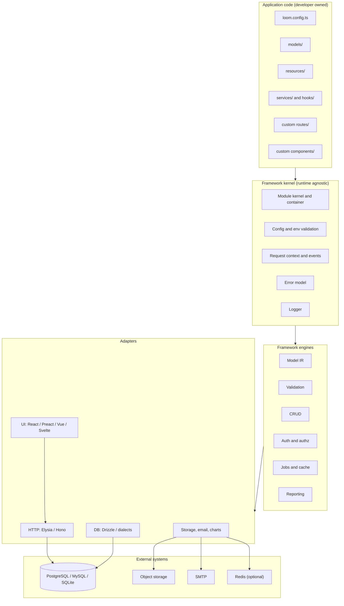
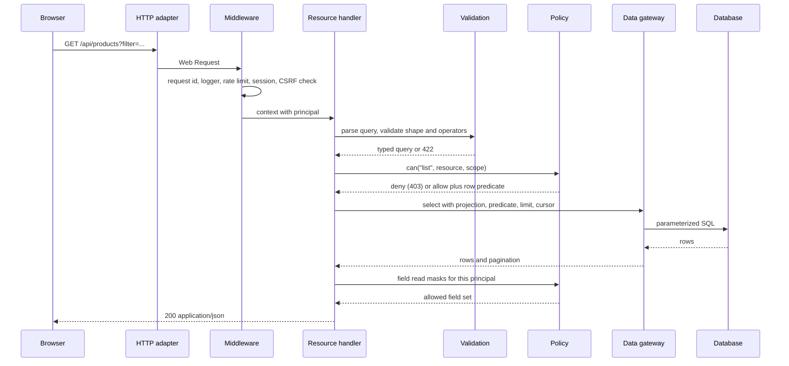
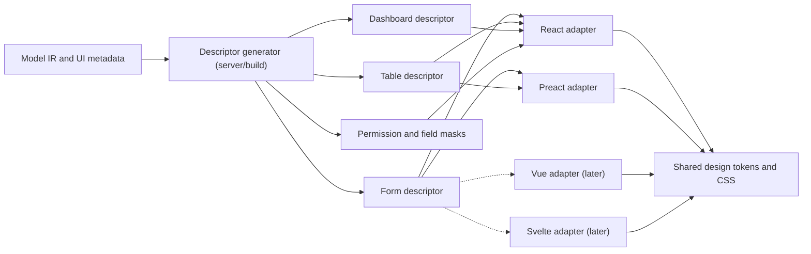
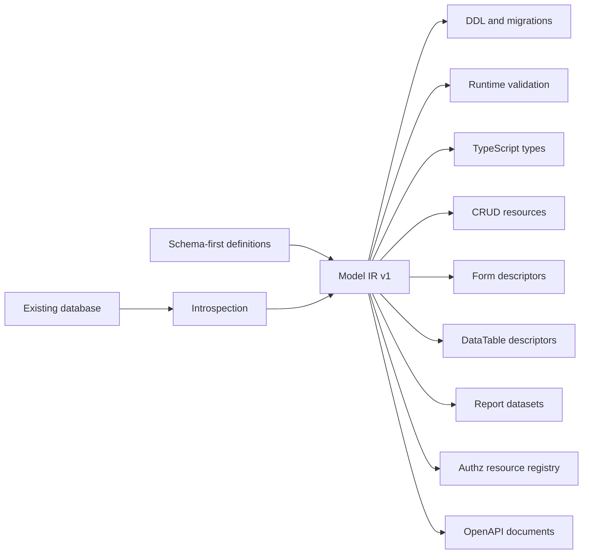
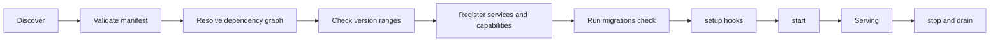
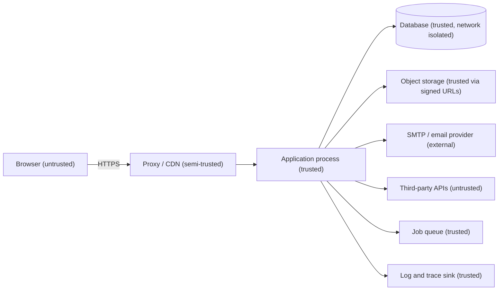
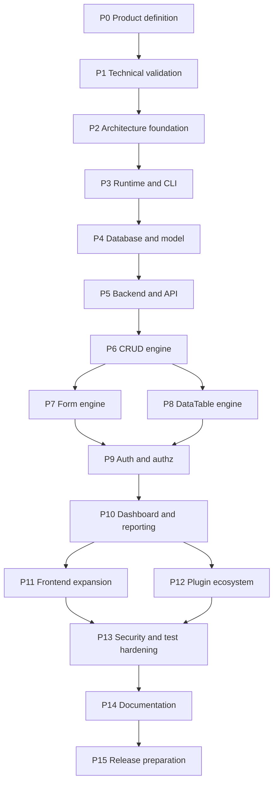

# Loom — Product Requirements Document

**A TypeScript fullstack framework for business applications**

> Working name: **Loom**. It is a placeholder, used here so the document can refer to packages and commands by name. Naming, npm scope, and trademark clearance are tracked as Q-01 in [Open Questions](#45-open-questions). Every API in this document is a proposal until the decision register says otherwise.

---

## 1. Document Metadata

| Field | Value |
| --- | --- |
| Document ID | PRD-LOOM-001 |
| Version | 1.0 |
| Status | Draft for product owner review |
| Date | 2026-11-14 |
| Document owner | Product |
| Primary audience | Engineering, design, product, technical writers, AI coding agents |
| Secondary audience | Prospective users, investors, implementation partners |
| Supersedes | None (first version) |
| File location | `PRD.md` at repository root |
| Change process | Any change to a CONFIRMED decision requires an entry in the Decision Register ([46](#46-decision-register)) |

### 1.1 Document status and how to read it

This document defines what the product must do, what it must not do, and how the team will know it works. It is not an implementation plan for a specific sprint, and it is not API documentation. Where it shows code, the code illustrates intent. None of it has been implemented or tested yet.

The requirements use four decision labels throughout:

| Label | Meaning | Who can change it |
| --- | --- | --- |
| **CONFIRMED** | Selected by the product owner. Treated as a constraint. | Product owner only, with a Decision Register entry |
| **PROPOSED** | Recommended by this document, technically justified, not yet accepted | Product owner accepts or rejects |
| **PENDING** | A real decision is needed and the product owner has not made it | Product owner |
| **VALIDATION REQUIRED** | Cannot be settled by argument. Needs a spike, benchmark, or test result | Engineering, with evidence recorded |

A feature is never described as existing. Sections that describe future behavior use "will", "must", or "target". Sections that show developer APIs are labeled as proposals in the code fence title or the surrounding text.

### 1.2 Conventions

- RFC 2119 keywords (MUST, SHOULD, MAY) apply to requirements. "Must" in prose is a requirement; "should" is a strong default that a developer may override with documented configuration.
- Requirement IDs follow `R-<AREA>-<number>`, for example `R-CRUD-004`. Acceptance criteria follow `AC-<AREA>-<number>`. Risks use `RK-<number>`, open questions `Q-<number>`, decisions `D-<number>`, and product goals `G-<number>`.
- "Intelligent" in this document means **rule-based inference from metadata**. It does not mean an LLM. No core feature calls a model provider. See [Non-Goals](#5-non-goals).
- "Resource" means a model exposed through generated CRUD, UI, and permissions. A model can exist without being a resource.
- "Adapter" means a package that binds a framework-owned interface to an external technology (React, Elysia, Drizzle, S3).
- Diagrams use Mermaid and render on GitHub and most Markdown viewers.

### 1.3 Table of contents

**Part I — Product definition**
[1. Document Metadata](#1-document-metadata) ·
[2. Executive Summary](#2-executive-summary) ·
[3. Product Vision](#3-product-vision) ·
[4. Product Goals](#4-product-goals) ·
[5. Non-Goals](#5-non-goals) ·
[6. Target Audience](#6-target-audience) ·
[7. User Personas](#7-user-personas) ·
[8. User Problems](#8-user-problems) ·
[9. Product Principles](#9-product-principles) ·
[10. Product Scope](#10-product-scope) ·
[11. Feature Matrix](#11-feature-matrix)

**Part II — Architecture**
[12. Architecture Overview](#12-architecture-overview) ·
[13. Runtime Strategy](#13-runtime-strategy) ·
[14. Frontend Strategy](#14-frontend-strategy) ·
[15. Backend Strategy](#15-backend-strategy) ·
[16. Database Strategy](#16-database-strategy) ·
[17. Universal Model System](#17-universal-model-system)

**Part III — Product engines**
[18. CRUD Engine](#18-crud-engine) ·
[19. Form Engine](#19-form-engine) ·
[20. DataTable Engine](#20-datatable-engine) ·
[21. Dashboard Engine](#21-dashboard-engine) ·
[22. Reporting Engine](#22-reporting-engine) ·
[23. Authentication](#23-authentication) ·
[24. Authorization](#24-authorization)

**Part IV — Platform**
[25. Module System](#25-module-system) ·
[26. Plugin System](#26-plugin-system) ·
[27. CLI](#27-cli) ·
[28. Developer Experience](#28-developer-experience) ·
[29. Developer API Examples](#29-developer-api-examples)

**Part V — Security, quality, operations**
[30. Security Requirements](#30-security-requirements) ·
[31. Non-Functional Requirements](#31-non-functional-requirements) ·
[32. Performance Requirements](#32-performance-requirements) ·
[33. Accessibility](#33-accessibility) ·
[34. Internationalization](#34-internationalization) ·
[35. Testing Strategy](#35-testing-strategy) ·
[36. Deployment Strategy](#36-deployment-strategy) ·
[37. Observability](#37-observability) ·
[38. Compatibility Matrix](#38-compatibility-matrix)

**Part VI — Delivery**
[39. MVP Scope](#39-mvp-scope) ·
[40. Version Roadmap](#40-version-roadmap) ·
[41. User Stories](#41-user-stories) ·
[42. Acceptance Criteria](#42-acceptance-criteria)

**Part VII — Governance**
[43. Technical Risks](#43-technical-risks) ·
[44. Dependencies](#44-dependencies) ·
[45. Open Questions](#45-open-questions) ·
[46. Decision Register](#46-decision-register) ·
[47. Glossary](#47-glossary)

**Part VIII — Platform services**
[48. Platform Services](#48-platform-services)

**Part IX — Supporting material**
[49. Documentation Strategy](#49-documentation-strategy) ·
[50. API Stability and Deprecation Policy](#50-api-stability-and-deprecation-policy) ·
[51. Repository and Package Layout](#51-repository-and-package-layout) ·
[52. Requirements Traceability](#52-requirements-traceability) ·
[53. Guidance for AI Coding Agents](#53-guidance-for-ai-coding-agents) ·
[54. Competitive and Technical Positioning](#54-competitive-and-technical-positioning) ·
[55. Assumptions and Evidence Log](#55-assumptions-and-evidence-log)

---

## 2. Executive Summary

Loom is a TypeScript fullstack framework for the applications most software teams actually build: admin panels, inventory systems, ERP modules, internal tools, reporting back offices, and the operational side of SaaS products.

The product bet is simple. A developer should be able to describe their data model once and get a working, permission-aware application from it: database schema, validation, CRUD API, forms, tables, filters, dashboards, and exports. Then they should be able to replace any part of that result with their own code, incrementally, without rewriting what already works.

Most stacks today force a choice. Application frameworks such as Next.js, Nuxt, SvelteKit, NestJS, and AdonisJS give you structure, but every CRUD screen still needs hand-written forms, tables, validation, and permission checks. Admin builders such as Refine, React Admin, Directus, and Payload remove that repetition but assume a particular data layer, UI model, or hosting arrangement, and customizing past their boundaries gets expensive. Loom takes the position that the repetition is the product, and that the generated result must stay editable all the way down.

The framework is organized around a normalized **model intermediate representation (IR)**. Schema-first definitions and database introspection both produce the same IR. The IR feeds a schema pipeline: database migrations, runtime validation, TypeScript types, CRUD resources, form descriptors, DataTable descriptors, dashboard metrics, report datasets, OpenAPI documents, and authorization resource registries. Each consumer reads only the part it needs, so no single object carries database, UI, and policy responsibilities at once.

Six engines sit on top: CRUD, forms, DataTable, dashboard, reporting, and security. Each has a convention-driven default and three override levels (configuration, descriptor patch, full replacement). The security engine is the one decision still awaiting owner confirmation; this document recommends a session-first, deny-by-default design and marks it PENDING.

The runtime strategy is Bun-first with Node.js as a tested secondary target. The HTTP layer is built on Web-standard `Request` and `Response` so business logic does not depend on a server library. Elysia is the proposed first adapter because it fits Bun; Hono is the proposed second adapter because it runs on both runtimes. React is the first frontend adapter, with Preact, Vue, and Svelte staged later behind a descriptor-based contract that shares metadata and design tokens, not components.

### 2.1 What ships first

The MVP is deliberately narrow: Bun, React, PostgreSQL, SQLite, schema-first models, CRUD, forms, DataTable, basic authentication, RBAC, a basic dashboard, and a CLI that can create, run, migrate, and build an application. It excludes multi-tenancy, MySQL production support, Vue and Svelte adapters, plugin marketplaces, scheduled reports, and PDF export. Those are scheduled, not forgotten.

### 2.2 Numbers the team is held to

These are targets, not results. Measurement methods are in [32](#32-performance-requirements) and [42](#42-acceptance-criteria).

| Target | Value | Validated by |
| --- | --- | --- |
| Time from `loom create` to a working CRUD screen | 10 minutes or less for a developer who knows SQL basics | Moderated usability test, 5 participants, MVP |
| Application code for one permission-aware CRUD resource | 30 lines or fewer in the common case | Reference application measurement |
| Generated endpoints reachable without authorization | Zero | Automated security suite, every release |
| Default admin client bundle, initial load | 250 KB gzip or less | Bundle budget check in CI, 1.0 |
| Server time for a filtered, paginated list at 100k rows | p50 under 50 ms, p95 under 150 ms, excluding network | Benchmark suite on reference hardware, 1.0 |
| Adapter contract suite pass rate on Bun and Node | 100% for shared features | CI matrix, 1.0 |

### 2.3 Known risks

The hard parts are not the generators. They are: keeping the abstraction from leaking, preventing generated CRUD from becoming a data breach, carrying four frontend frameworks without diluting the React experience, and keeping Bun and Node behavior aligned. Each risk has a mitigation and a monitoring plan in [43](#43-technical-risks). The most dangerous failure mode is a framework that generates insecure defaults quickly; the security requirements in [30](#30-security-requirements) exist to make that failure loud in tests.

---

## 3. Product Vision

> A developer who understands their data model should get a working, secure business application from it, and keep full control of every layer afterward.

Three promises define the product.

**Speed without a wizard.** The common path is short. Define a model, register a resource, get routes, forms, tables, filters, and permissions. No drag-and-drop builder is required to reach a working screen, and no code generation step needs to be re-run by hand after every change.

**Safety that is not opt-in.** Every generated endpoint is closed until a policy opens it. Every generated form validates on the server, not only in the browser. Every generated table query is bounded and projected. The framework should make the safe thing the shortest path, so a beginner who does not yet know what IDOR means still ships something that resists it.

**Control that survives week two.** Generated code is not a black box. Each engine exposes a documented override ladder: configuration, descriptor patch, custom component, full replacement. The framework must never require forking a package to change a label, and must never hide SQL behind an interface that cannot express a window function.

### 3.1 The tests the vision implies

**The ten-minute test.** A developer with SQL knowledge but no Loom experience installs Bun, runs one command, connects a database, defines two related models, and sees a list page with working search, sort, pagination, and a create form. If that takes an afternoon, the product has failed its first promise.

**The day-thirty test.** The same developer needs a computed inventory value, a custom approval endpoint, and a row-level rule that hides records from other departments. They add one custom route, one policy function, and one form field override. They do not eject, and they do not copy generated files into their app.

**The audit test.** A security reviewer reads the generated route table, the policy registry, and the query builder, and can explain in one sitting how each endpoint is authorized. There is no magic middleware that "handles security" without a traceable decision.

### 3.2 Positioning in one paragraph

Loom is closer to a business application framework than to a general web framework. It borrows the conventions of AdonisJS and NestJS, the resource model of Refine and React Admin, and the type-safe data access of Drizzle. It differs by making the model definition the single source for database, API, UI, and policy metadata, and by treating admin UI generation as a first-class engine rather than a template pack. It does not try to be a CMS, a website builder, or a deployment platform.

---

## 4. Product Goals

Goals are measurable outcomes, not features. Each has a target, a method, and the phase where it is evaluated. Targets marked "unvalidated" must be re-baselined after the technical spikes in Phase 1.

| ID | Goal | Target | Measurement | Phase |
| --- | --- | --- | --- | --- |
| G-1 | Fast first success | `loom create` to working CRUD screen in 10 minutes or less | Moderated test, 5 developers new to Loom, screen recording, success rate ≥ 4/5 | MVP |
| G-2 | Low ceremony | A permission-aware resource fits in 30 lines or fewer | Count non-blank, non-comment lines in the reference app | MVP |
| G-3 | Secure generated defaults | Zero generated endpoints reachable without an explicit grant | Automated authorization matrix test over every generated route | MVP, every release |
| G-4 | Override without forking | Every generated behavior has a documented override point; escape-hatch suite passes for each engine | Escape-hatch test suite, one test per override level | 1.0 |
| G-5 | Type safety | No `any` in public APIs or generated code; templates pass `tsc --strict` and `noUncheckedIndexedAccess` | CI type check plus API extractor report | MVP, ongoing |
| G-6 | Runtime parity | Contract suite passes on Bun and Node for every feature marked cross-runtime | CI matrix, two runtimes, identical assertions | 1.0 |
| G-7 | Predictable performance | Published budgets in [32](#32-performance-requirements) are met on reference hardware | Benchmark suite, percentile reporting, committed results | 1.0 |
| G-8 | Upgrade safety | Minor upgrades need no app code changes outside documented deprecations; majors ship codemods | Upgrade test app from previous minor, then codemod run | 1.0 |
| G-9 | Documentation coverage | Every public export has a reference page and one runnable example; zero undocumented exports | API extractor compared against docs index in CI | 1.0 |
| G-10 | Accessibility | Generated UI passes WCAG 2.2 AA automated checks and a scripted keyboard walkthrough | axe-core in CI plus manual keyboard script per release | 1.0 |

### 4.1 Anti-goals for the goals

G-1 must not be met by hiding configuration that later blocks customization. G-2 must not be met by compressing code into unreadable one-liners or by making permissions implicit. G-3 is a hard gate: a release with a failing authorization matrix does not ship, regardless of other results. G-7 must not be met by benchmarking an empty database or by comparing against a straw-man configuration.

---

## 5. Non-Goals

Non-goals prevent scope creep and set expectations. Some may become goals in later versions, but only through the Decision Register.

| ID | Non-goal | Why | Revisit trigger |
| --- | --- | --- | --- |
| N-1 | AI features, LLM-generated screens, natural-language report building | The value proposition is deterministic inference. AI features add cost, latency, privacy exposure, and nondeterminism to the core. | Separate opt-in module after 2.0, with its own PRD |
| N-2 | GraphQL API generation | REST plus a typed client covers the target applications. GraphQL multiplies authorization and query-cost problems. | Demand from three or more enterprise design partners |
| N-3 | Mobile native app generation | React Native and Flutter are separate rendering targets with their own design constraints. | Never in core; possible adapter by third party |
| N-4 | Website builder, CMS-first editing, marketing page builder | Different product. Loom can host a marketing site, but content modeling is not the focus. | Not planned |
| N-5 | Drag-and-drop application builder as the primary interface | Builders that hide code create the customization cliff this product exists to avoid. Dashboards may have drag-and-drop layout; applications may not. | Not planned |
| N-6 | Proprietary hosted cloud as the only deployment path | Self-hosting and portable builds are required for enterprise adoption. A hosted offering may exist later as an optional service. | Business decision, separate document |
| N-7 | Support for every ORM, database, and frontend framework | Support is a testing obligation, not a marketing claim. Only adapters with a passing contract suite are listed as supported. | Each new adapter passes the contract suite |
| N-8 | Kubernetes operator, service mesh integration, or cluster management | Deployment artifacts should be ordinary containers and processes. | Not planned |
| N-9 | Real-time collaborative editing (multiplayer) | Requires CRDT or OT infrastructure that is unrelated to CRUD productivity. WebSocket events for data refresh are in scope; collaborative text editing is not. | Not planned |
| N-10 | Replacing a general-purpose framework for public, content-heavy websites | SSR support exists, but SEO-first content sites are not the design center. | Not planned |
| N-11 | Magic runtime that requires a compiler plugin to understand application code | Debuggability and standard tooling matter more than syntactic sugar. | Never |
| N-12 | Automatic destructive schema changes | Data loss must be a human decision. | Never |
| N-13 | Microservice orchestration and service discovery | Loom targets modular monoliths and small service counts. | Not planned |

---

## 6. Target Audience

Loom targets teams building line-of-business software, not every web project. The primary segment is a small product team (2 to 15 engineers) building an internal tool or SaaS back office with a relational database. The secondary segment is an enterprise platform team standardizing how internal applications are built.

| Segment | Typical situation | What they need from Loom | Adoption risk |
| --- | --- | --- | --- |
| Solo developer or small studio | Builds client admin tools on fixed budgets | Speed, sensible defaults, low hosting complexity | Needs the beginner path to work without reading architecture docs |
| Startup product team | Building a SaaS with a customer-facing app and an internal back office | Shared models, typed APIs, incremental customization | May outgrow the admin UI and need full component control |
| Enterprise platform team | Many internal apps, inconsistent stacks, audit requirements | Standardization, RBAC, audit logs, observability, upgrade policy | Procurement, security review, long-term support expectations |
| Agency or implementation partner | Repeated delivery of similar business apps | Templates, code generation, predictable structure, fast onboarding | Customization demands vary wildly per client |

### 6.1 Who Loom is not for

Teams building content-heavy public websites, real-time multiplayer products, mobile-first consumer apps, or data science notebooks will find the framework's opinions in the way. Teams that require a fully managed backend-as-a-service with no server code should use a BaaS. Teams that want to write every layer by hand and dislike convention will be happier with a minimal router and an ORM.

---

## 7. User Personas

These personas are composites built from the target segments. They are not based on completed user research. They exist to keep feature decisions grounded in specific workflows, and they will be revised after the first five usability sessions.

### 7.1 Rina — beginner developer

Rina finished a six-month bootcamp three months ago and works at a small logistics company. She maintains an inventory spreadsheet and has been asked to turn it into a web app. She knows JavaScript, basic SQL, and how to follow a tutorial. She does not know what a migration is until something breaks.

Her goals: get a working app this month, avoid breaking production data, understand errors without searching for hours. Her fears: silently deleting data, writing an endpoint that exposes salaries, getting stuck in a framework she cannot debug.

What Loom must give her: one install command, a starter that runs, error messages that name the file and the fix, forms and tables that appear from a model definition, and permissions that default to closed. What will lose her: a config file with forty required options, jargon in error output, or a generated app that returns 500 on first run.

### 7.2 Budi — intermediate developer

Budi works at a five-person agency and ships two or three client admin panels a year. He is comfortable with React, REST, and PostgreSQL. He has used React Admin and found its data provider abstraction awkward when a client needed a custom approval workflow.

His goals: reuse a proven structure across clients, add business logic without fighting the framework, and hand off maintainable code. He needs middleware, hooks, custom endpoints, and the ability to swap a generated form field for a custom component. He will judge Loom by how quickly he can leave the happy path and come back.

### 7.3 Sari — professional developer

Sari is a senior engineer at a 40-person SaaS company. She owns the internal platform: authentication, permissions, audit, and the shared component library. She cares about type safety, query performance, migration safety, and testability. She has been burned by ORMs that cannot express a recursive CTE and by admin frameworks that perform authorization in the browser.

Her goals: predictable SQL, composable policies, no N+1 queries in generated lists, and a test suite that proves authorization. She will read the source of any abstraction before adopting it. She needs raw SQL escape hatches, transaction-scoped context, and adapter contract tests.

### 7.4 The enterprise platform team

A platform team of four supports twelve internal applications built by different squads. They need one security model, one audit format, one deployment shape, and a support policy that survives staff turnover. They will ask about multi-tenancy, SSO, data retention, upgrade paths, and whether a plugin can exfiltrate data.

They do not need every feature on day one. They need to know which features exist, what is tested, what the support window is, and how to extend the framework without forking it. Their adoption decision is usually made by a security architect and an engineering manager, not by the developers who will use it daily.

### 7.5 Persona to feature mapping

| Need | Rina | Budi | Sari | Platform team | Primary sections |
| --- | --- | --- | --- | --- | --- |
| One-command project setup | Essential | Important | Nice | Important | [27](#27-cli), [39](#39-mvp-scope) |
| Automatic CRUD | Essential | Important | Important | Important | [18](#18-crud-engine) |
| Custom business logic | Later | Essential | Essential | Essential | [18.7](#187-lifecycle-hooks), [29](#29-developer-api-examples) |
| Type safety | Not yet | Important | Essential | Essential | [17](#17-universal-model-system), [50](#50-api-stability-and-deprecation-policy) |
| Fine-grained authorization | Unaware | Important | Essential | Essential | [24](#24-authorization) |
| Audit logs | No | Sometimes | Essential | Essential | [30](#30-security-requirements), [37](#37-observability) |
| Multi-tenancy | No | No | Sometimes | Essential | [24.7](#247-multi-tenancy) |
| Raw SQL access | No | Sometimes | Essential | Important | [16.6](#166-escape-hatches) |
| Plugin ecosystem | No | Nice | Risky | Risky | [26](#26-plugin-system) |
| Upgrade guarantees | No | Important | Essential | Essential | [50](#50-api-stability-and-deprecation-policy) |

---

## 8. User Problems

The problems below are the reason the product exists. Each maps to the section that addresses it. If a proposed feature does not map to a problem here, it needs a justification or it gets cut.

| ID | Problem | Who feels it | Cost today | Addressed by |
| --- | --- | --- | --- | --- |
| P-1 | Every CRUD screen repeats the same list, form, validation, and routing code | All segments | Days per resource, inconsistent behavior | [18](#18-crud-engine), [19](#19-form-engine), [20](#20-datatable-engine) |
| P-2 | Validation rules drift between client, server, and database | Budi, Sari | Invalid data, duplicated schemas, production bugs | [17](#17-universal-model-system) |
| P-3 | Authorization is checked in the UI and forgotten in the API | Sari, platform team | Data exposure, failed audits | [24](#24-authorization), [30](#30-security-requirements) |
| P-4 | Admin frameworks become a dead end when requirements get specific | Budi, Sari | Forking, rewrites, abandoned frameworks | [9](#9-product-principles), [18.9](#189-override-ladder) |
| P-5 | Connecting to an existing database means hand-writing models and guessing relations | Budi, platform team | Weeks of setup, wrong assumptions | [17.6](#176-database-first) |
| P-6 | Generated tables fall over at 50k rows or fire one query per row | Sari | Slow pages, database load, user complaints | [20](#20-datatable-engine), [32](#32-performance-requirements) |
| P-7 | Report requests become one-off SQL scripts and spreadsheet exports | Platform team | Untraceable numbers, manual work | [22](#22-reporting-engine) |
| P-8 | Each internal app invents its own auth, roles, and audit format | Platform team | Security gaps, repeated reviews | [23](#23-authentication), [24](#24-authorization) |
| P-9 | Framework upgrades break applications and stall adoption | Sari, platform team | Frozen versions, security debt | [50](#50-api-stability-and-deprecation-policy) |
| P-10 | Bun adoption is blocked by Node-only dependencies and unclear compatibility | Sari | Slow runtime migration, mixed toolchains | [13](#13-runtime-strategy), [38](#38-compatibility-matrix) |
| P-11 | Frontend teams cannot reuse admin work across React, Vue, or Svelte projects | Agencies | Duplicate UI, divergent behavior | [14](#14-frontend-strategy) |
| P-12 | Beginners cannot tell whether their generated app is safe | Rina | Accidental exposure, lost trust | [9](#9-product-principles), [30](#30-security-requirements) |
| P-13 | Documentation assumes the reader already knows the framework's internals | All segments | Support load, abandoned trials | [28](#28-developer-experience), [49](#49-documentation-strategy) |

---

## 9. Product Principles

Principles are tie-breakers. When two designs are both acceptable, the one that better satisfies the higher principle wins.

### PR-1: The model is described once, consumed by many

A field's database type, validation, widget, and permission surface come from one declaration plus explicit overrides. If a developer must repeat a field name in four files, the design is wrong. This does not mean one god object: the IR is normalized, and each consumer receives a projection.

### PR-2: Safe by default, explicit to open

Generated resources deny access until a policy grants it. Generated fields are writable only when the resource says so. Generated queries require bounded pagination. The default must survive a developer who has not read the security guide.

### PR-3: Convention, then configuration, then code

Every generated behavior can be changed at three levels without forking: configuration on the definition, a descriptor patch (labels, widgets, column order), or a full replacement (custom component, custom route, custom query). Each level must be documented and tested.

### PR-4: The escape hatch is part of the product

Raw SQL, native HTTP handlers, custom React components, and direct database access are supported paths, not failures. An abstraction that cannot be bypassed is a liability.

### PR-5: No magic that breaks tooling

TypeScript must understand the code without a custom compiler. Stack traces must point to application files. Debuggers, linters, and test runners must work with standard configuration. Macro-heavy APIs are rejected even when they save keystrokes.

### PR-6: Runtime differences are documented, not hidden

If a feature works on Bun and not Node, the docs say so and the type system or runtime check reports it. Silent behavioral drift between runtimes is a bug.

### PR-7: Boring infrastructure, sharp product

Use PostgreSQL, HTTP, SQL, cookies, and standard observability formats. Innovation belongs in the model pipeline and the engines, not in a new wire protocol or a proprietary queue format.

### PR-8: Performance is a budget, not a claim

Every engine has a query budget and a bundle budget. Benchmarks use fixed hardware, generated datasets, and percentile reporting. No marketing superlatives in code comments, docs, or release notes.

### PR-9: Accessible and localized from the first component

Generated UI ships with labels, keyboard behavior, focus management, and translation hooks. Retrofitting accessibility after 1.0 would require rewriting every component.

### PR-10: Boring upgrades

Public APIs follow semantic versioning. Deprecations last at least one minor release and are announced in a machine-readable changelog. Breaking changes ship with codemods or a written migration guide.

### PR-11: Small core, optional modules

The core runtime must not import React, a chart library, an email client, or an S3 SDK. Optional capability lives in modules that can be excluded from the bundle and the server process.

### PR-12: Explain the failure

Errors name the file, the field, the route, and the likely fix. A beginner should be able to act on an error without opening a search engine. This applies to CLI output, validation errors, runtime exceptions, and build failures.

---

## 10. Product Scope

### 10.1 In scope

Loom covers the server, the data layer, and the administrative client for relational business applications. Concretely, the framework owns:

- Project scaffolding, configuration, environment validation, development server, build, and start commands.
- A module kernel with lifecycle, dependency validation, and capability registration.
- An HTTP abstraction over Web `Request` and `Response`, with adapter packages for specific servers.
- A database gateway over PostgreSQL, MySQL, and SQLite, with migrations, introspection, and raw SQL access.
- A normalized model IR with schema-first and database-first inputs.
- Generated CRUD, forms, tables, dashboards, reports, and their override surfaces.
- Authentication, authorization, audit, and multi-tenant scoping (staged after MVP for tenancy).
- Common platform services: files, email, jobs, cache, i18n, logging, health checks, OpenAPI.
- A React admin UI with framework-neutral design tokens and headless behavior contracts.
- Testing utilities and adapter conformance suites.
- Deployment artifacts for containers, Bun binaries, and Node servers.

### 10.2 Out of scope

The non-goals in [5](#5-non-goals) apply. In addition, the framework does not own: application-specific business logic, data migration between third-party systems, marketing content, payment processing, or infrastructure provisioning.

### 10.3 Scope boundaries by lifecycle

| Boundary | Belongs to Loom | Belongs to the application |
| --- | --- | --- |
| Database schema ownership | Migration generation, drift detection, safety checks | The decision to apply a destructive change |
| Authentication | Session mechanics, password storage, providers | User lifecycle rules (invitations, approval, deletion policy) |
| Authorization | Policy evaluation, enforcement points, row scoping | The policies themselves |
| UI | Components, layouts, descriptors, accessibility behavior | Brand, copy, workflow-specific screens |
| Business rules | Hook and service plumbing | The rules inside hooks and services |
| Deployment | Build output, health endpoints, graceful shutdown | Infrastructure, scaling, secrets |

---

## 11. Feature Matrix

Legend: ● in scope and committed · ◐ partial or basic version · ○ planned · — excluded.

Phases are defined in [40](#40-version-roadmap). "1.0" is the first stable release; "MVP" precedes it and is internal plus design-partner only.

| Area | Capability | MVP | 1.0 | 1.x | 2.0 | Notes |
| --- | --- | --- | --- | --- | --- | --- |
| Core | Config and environment validation | ● | ● | ● | ● | Standard Schema based |
| Core | Module kernel with lifecycle | ● | ● | ● | ● | See [25](#25-module-system) |
| Core | Error model and problem details | ● | ● | ● | ● | RFC 9457 |
| Core | Structured logging | ● | ● | ● | ● | Redaction on by default |
| Core | Runtime capability detection | ● | ● | ● | ● | Bun and Node |
| Core | Request-scoped context | ● | ● | ● | ● | AsyncLocalStorage |
| CLI | `create`, `dev`, `build`, `start` | ● | ● | ● | ● | Bun-first |
| CLI | `db:generate`, `db:migrate`, `db:rollback`, `db:seed` | ● | ● | ● | ● | Rollback limited by migration strategy |
| CLI | `db:inspect`, `db:drift` | ◐ | ● | ● | ● | |
| CLI | `make:model`, `make:resource`, `make:api` | ◐ | ● | ● | ● | |
| CLI | `module:list`, `module:enable`, `module:disable` | ○ | ● | ● | ● | |
| CLI | `doctor`, `upgrade`, `--json` output | ○ | ● | ● | ● | |
| HTTP | Web-standard request/response core | ● | ● | ● | ● | |
| HTTP | Elysia adapter | ● | ● | ● | ● | Bun |
| HTTP | Hono adapter | ○ | ● | ● | ● | Bun and Node |
| HTTP | Route manifest and typed client generation | ● | ● | ● | ● | |
| HTTP | OpenAPI 3.1 generation | ○ | ● | ● | ● | |
| HTTP | Rate limiting | ◐ | ● | ● | ● | Login and auth endpoints first |
| HTTP | CORS policy helpers | ● | ● | ● | ● | Deny by default |
| HTTP | Server-sent events | ○ | ○ | ● | ● | |
| HTTP | WebSocket channels | ○ | ○ | ● | ● | Data-change events |
| Database | Gateway interface and dialects | ● | ● | ● | ● | |
| Database | PostgreSQL adapter | ● | ● | ● | ● | |
| Database | SQLite adapter | ● | ● | ● | ● | Dev and small deployments |
| Database | MySQL adapter | ○ | ● | ● | ● | Requires full contract suite |
| Database | Drizzle-based adapter | ◐ | ● | ● | ● | Validation required |
| Database | Migrations with locking | ● | ● | ● | ● | |
| Database | Introspection and model generation | ◐ | ● | ● | ● | |
| Database | Schema drift detection | ◐ | ● | ● | ● | |
| Database | Read replicas and routing | ○ | ○ | ○ | ● | |
| Database | Row-level security integration | ○ | ○ | ● | ● | PostgreSQL first |
| Model | Schema-first definitions | ● | ● | ● | ● | |
| Model | TS type inference from IR | ● | ● | ● | ● | |
| Model | Relations (1:1, 1:N, M:N) | ● | ● | ● | ● | |
| Model | Computed and virtual fields | ○ | ◐ | ● | ● | Not persisted by default |
| Model | Database-first import | ◐ | ● | ● | ● | Relations inferred where safe |
| Model | Schema drift and migration safety | ◐ | ● | ● | ● | |
| CRUD | List, read, create, update, delete | ● | ● | ● | ● | |
| CRUD | Search, filter, sort, pagination | ● | ● | ● | ● | Allowlisted operators |
| CRUD | Bulk update and delete | ○ | ● | ● | ● | Bounded batch size |
| CRUD | Soft delete and restore | ○ | ● | ● | ● | |
| CRUD | Lifecycle hooks | ● | ● | ● | ● | |
| CRUD | Optimistic concurrency | ○ | ● | ● | ● | Version column |
| CRUD | CSV export | ◐ | ● | ● | ● | Streaming |
| CRUD | XLSX export | ○ | ● | ● | ● | Optional module |
| CRUD | Audit integration | ○ | ● | ● | ● | |
| Forms | Generated field widgets | ● | ● | ● | ● | |
| Forms | Conditional and dependent fields | ◐ | ● | ● | ● | Structured conditions |
| Forms | Async validation | ○ | ● | ● | ● | Debounced, server-backed |
| Forms | Nested and repeating fields | ○ | ● | ● | ● | |
| Forms | Multi-step wizard | ○ | ● | ● | ● | |
| Forms | Field-level permissions | ● | ● | ● | ● | Server enforced |
| Forms | Rich text field | ○ | ○ | ● | ● | Sanitized HTML |
| Tables | Generated columns and formatting | ● | ● | ● | ● | |
| Tables | Server-side search, filter, sort | ● | ● | ● | ● | |
| Tables | Column visibility and ordering | ◐ | ● | ● | ● | Persisted per user |
| Tables | Saved views | ○ | ○ | ● | ● | |
| Tables | Inline editing | ○ | ○ | ● | ● | |
| Tables | Virtualized rendering | ○ | ● | ● | ● | |
| Tables | Column and row permissions | ● | ● | ● | ● | |
| Dashboards | Metric cards and charts | ◐ | ● | ● | ● | Line, bar, area, pie, donut |
| Dashboards | Role-based dashboards | ○ | ● | ● | ● | |
| Dashboards | Drag-and-drop layout | ○ | ○ | ● | ● | Layout only |
| Dashboards | Custom widget registry | ○ | ● | ● | ● | |
| Reporting | Report definitions and filters | ◐ | ● | ● | ● | |
| Reporting | CSV export | ◐ | ● | ● | ● | |
| Reporting | XLSX export | ○ | ● | ● | ● | Optional module |
| Reporting | PDF export | ○ | ○ | ● | ● | Headless browser module |
| Reporting | Scheduled reports | ○ | ○ | ● | ● | Uses job queue |
| Reporting | Large report streaming | ○ | ○ | ● | ● | |
| Auth | Email and password login | ● | ● | ● | ● | Session cookies |
| Auth | Registration and logout | ● | ● | ● | ● | Registration can be disabled |
| Auth | Password reset | ◐ | ● | ● | ● | |
| Auth | Email verification | ○ | ● | ● | ● | |
| Auth | API tokens | ○ | ● | ● | ● | Hashed at rest |
| Auth | OAuth and OIDC | ○ | ○ | ● | ● | Provider adapter |
| Auth | MFA (TOTP, recovery codes) | ○ | ○ | ● | ● | |
| Auth | SSO (SAML) | ○ | ○ | ○ | ● | Enterprise |
| Authz | RBAC | ● | ● | ● | ● | |
| Authz | Policy functions | ● | ● | ● | ● | |
| Authz | Row and record scoping in SQL | ● | ● | ● | ● | |
| Authz | Field-level read/write masks | ● | ● | ● | ● | |
| Authz | Multi-tenancy | ○ | ○ | ● | ● | See [24.7](#247-multi-tenancy) |
| UI | React component library | ● | ● | ● | ● | |
| UI | Design tokens, light and dark themes | ● | ● | ● | ● | CSS custom properties |
| UI | Headless behavior primitives | ◐ | ● | ● | ● | Ark UI or equivalent |
| UI | External UI library integration | ◐ | ● | ● | ● | Registry-based |
| UI | Preact adapter | ○ | ○ | ● | ● | After conformance suite |
| UI | Vue adapter | ○ | ○ | ○ | ● | |
| UI | Svelte adapter | ○ | ○ | ○ | ● | |
| Platform | Local and S3-compatible storage | ◐ | ● | ● | ● | Signed uploads |
| Platform | Image processing | ○ | ● | ● | ● | Optional sharp module |
| Platform | Email (SMTP) | ◐ | ● | ● | ● | Dev outbox |
| Platform | Background jobs | ○ | ● | ● | ● | Database-backed queue |
| Platform | Cache (memory, Redis) | ◐ | ● | ● | ● | Tag invalidation |
| Platform | i18n and timezone handling | ◐ | ● | ● | ● | Intl and ICU |
| Platform | Observability (OpenTelemetry) | ○ | ● | ● | ● | Optional module |
| Platform | Health and readiness endpoints | ● | ● | ● | ● | |
| Platform | Plugin host | ○ | ● | ● | ● | In-process, trusted |
| Platform | Plugin marketplace | ○ | ○ | ○ | ● | Governance required |
| Delivery | Docker and container output | ○ | ● | ● | ● | |
| Delivery | Bun single-file binary | ○ | ● | ● | ● | |
| Delivery | Zero-downtime migration guidance | ○ | ● | ● | ● | Expand and contract |

### 11.1 Matrix maintenance rules

A capability appears with ● only when its acceptance criteria in [42](#42-acceptance-criteria) pass in CI. Moving a cell from ○ to ● requires a linked test run, not a documentation edit. Removing a ● requires a deprecation entry. The matrix is generated from package metadata at release time; this table is the human-readable mirror.

---

## 12. Architecture Overview

### 12.1 Shape of the system

Loom is a modular monolith framework. The server process hosts the application, its modules, and the admin client's API. The client is a separate build artifact served by the same process in development and by a static host or the same process in production.



### 12.2 Tier rules

Dependencies point inward. A lower tier never imports a higher tier, and the core never imports an adapter.

| Tier | Packages | May import | Must not import |
| --- | --- | --- | --- |
| 0 | `@loom/contracts` | Nothing at runtime | Any other Loom package |
| 1 | `@loom/core` | Tier 0, Node built-ins | Engines, adapters, React |
| 2 | Engines (`model`, `validation`, `crud`, `auth`, `authz`, `jobs`, `report`) | Tiers 0 and 1, other engines through declared interfaces | Specific HTTP servers, specific UI frameworks |
| 3 | Adapters (`http-elysia`, `http-hono`, `db-postgres`, `react`, ...) | Tiers 0 to 2 | Application code |
| 4 | Application | Everything public | Internal package paths |

Enforcement: an import-boundary linter runs in CI. Violations fail the build. Internal APIs are exported from a package's `internal` entry point and are not part of the public API extractor.

### 12.3 Composition and dependency injection

There is no global service locator and no decorator-based DI container in the MVP. The framework uses explicit composition:

1. `loom.config.ts` is loaded and validated.
2. Modules are topologically sorted and registered.
3. Each module declares services in a typed registry keyed by a symbol or string.
4. `createApp()` resolves the registry once and returns an app object.
5. Each request gets a context object containing the request, session, tenant, locale, logger, and transaction handle.

Services are resolved at composition time. Per-request access goes through `ctx.services`, which is typed from the module registry. This keeps startup errors early and avoids reflection. A decorator-based DI style may be added later as sugar; it is not required by the core.

### 12.4 Request lifecycle

Every generated endpoint follows the same path. The order is a security requirement, not an implementation detail: validation happens before policy evaluation where possible, and policy evaluation always happens before data access.



Failure short-circuits: a 403 never reaches the database, and a validation error never triggers a policy evaluation that leaks resource existence beyond what the caller may know.

### 12.5 Error model

All framework errors share one shape and serialize to RFC 9457 problem details.

| Field | Purpose |
| --- | --- |
| `type` | Stable URI identifying the error class |
| `title` | Short human-readable summary |
| `status` | HTTP status |
| `detail` | Safe, non-sensitive explanation |
| `code` | Machine code such as `LOOM_VALIDATION_FAILED` |
| `requestId` | Correlation identifier, always present |
| `errors` | Field-level validation errors, when applicable |
| `meta` | Safe structured context, never stack traces or SQL |

Rules: no stack traces in production responses; no SQL text; no internal identifiers the caller cannot already see; raw error causes are logged, not returned. Client-side error mapping consumes `code` and `errors`, not message strings, so localization does not break behavior.

### 12.6 Configuration model

Configuration is layered, with later layers overriding earlier ones:

1. Framework defaults.
2. Module defaults, contributed at registration.
3. `loom.config.ts`, validated by a Standard Schema.
4. Environment variables for secrets and deployment-specific values.
5. Test overrides via `createTestApp`.

Secrets never live in `loom.config.ts`; the config references environment variables by name, and the framework validates them at boot. Missing or malformed required values produce one aggregated error listing every problem, not a crash on the first one.

### 12.7 Build outputs

| Target | Output | Runtime |
| --- | --- | --- |
| Development | Vite-style dev server for the client, API server with HMR for server modules | Bun |
| Production (Bun) | Server bundle plus client assets, optional `bun build --compile` single binary | Bun |
| Production (Node) | ESM server bundle, static client assets, `node dist/server.js` | Node 22+ |
| Library packages | ESM with declaration files, type-checked public API | Any |

The framework does not ship CommonJS builds for its own packages. Applications that need CommonJS can bundle Loom into their own output, but this is not a supported first-class path. This is VALIDATION REQUIRED because it constrains adoption inside older Node codebases.

---

## 13. Runtime Strategy

Decision status: **CONFIRMED** that Bun is primary and Node.js is secondary. The specific support floor, adapter behavior, and feature parity claims are **VALIDATION REQUIRED**.

### 13.1 Principles

Bun is the default because the target workflow benefits from a single toolchain for install, test, build, and run, and because the framework is optimized for cold start and developer loop speed. Node remains a first-class deployment target because most enterprises will not switch runtimes for a framework, and because library compatibility is still broader there.

The core must not call `Bun.*` APIs directly. Runtime-specific behavior sits behind a capability interface implemented by `@loom/runtime-bun` and `@loom/runtime-node`, selected at startup. Where a capability is missing on Node, the framework either provides a Node-native fallback or reports a startup error naming the feature and the alternative.

### 13.2 Capability interface

The following is a proposed contract, not implemented code.

```ts
// PROPOSED API — not implemented
export interface RuntimeCapabilities {
  readonly name: "bun" | "node";
  readonly version: string;
  readonly sqliteDriver: "bun:sqlite" | "node:sqlite" | "better-sqlite3" | null;
  readonly passwordHashing: "argon2id-native" | "argon2id-wasm" | "scrypt";
  readonly testRunner: "bun:test" | "node:test";
  readonly serving: "bun-serve" | "node-http";
  readonly websockets: boolean;
  readonly workerThreads: boolean;
  readonly compileToBinary: boolean;
  readonly fileSystem: "bun-file" | "node-fs";
}
```

### 13.3 Feature differences to validate

| Area | Bun behavior to verify | Node behavior to verify | Fallback if mismatched |
| --- | --- | --- | --- |
| SQLite | `bun:sqlite` support, WAL, busy timeout | `node:sqlite` stability on supported LTS, or `better-sqlite3` native build | Choose one driver per runtime, expose the difference in config |
| Password hashing | `Bun.password.hash` with Argon2id | Argon2id native module (build toolchain) or scrypt via `node:crypto` | Runtime capability flag; scrypt is acceptable, documented |
| HTTP server | `Bun.serve` performance and streaming | `node:http` with keep-alive and streaming | Adapter-specific tuning |
| WebSockets | Native support | Requires adapter or `ws` | Feature parity deferred to 1.x |
| Compression | Built-in gzip/brotli | `node:zlib` | Compression middleware per adapter |
| Environment files | Bun loads `.env` automatically | Node 20+ `--env-file` or dotenv | Framework loads and validates explicitly |
| Test runner | `bun:test` | `node:test` | Contract tests run under both runners |
| Native addons | Compatibility varies | Broader support | Mark native-dependent modules optional |
| Clustering | Not a Bun model | `node:cluster` or process manager | Prefer horizontal process scaling |
| Binary output | `bun build --compile` | None | Node deployments use containers |
| Source maps and stack traces | Verify file paths and columns | Standard | Build config fix |

### 13.4 Support policy

- Bun: latest stable at release time, plus the previous stable minor. Exact minimum pinned in `package.json` and CI.
- Node: latest active LTS at release time, plus the previous LTS still in maintenance. The proposed floor is Node 22.12.0; Node 20 is not supported because of `node:sqlite` and other API gaps. **VALIDATION REQUIRED.**
- A feature is labeled "cross-runtime" only after the adapter contract suite passes on both runtimes in CI.
- Runtime-specific bugs are release blockers for the affected runtime only if the feature is labeled cross-runtime.

### 13.5 What would make us reconsider

If Node support costs more than one full-time engineer per release cycle, or if a required dependency cannot run on Node without a fork, the product owner may narrow support to Bun plus a documented container fallback. That decision requires evidence from the Phase 1 runtime spike and a Decision Register entry. Conversely, if Bun's Node compatibility gaps make the adapter escape hatches leak, the runtime abstraction gets thicker, not thinner.

---

## 14. Frontend Strategy

Decision status: React is **CONFIRMED** as the first frontend. Preact, Vue, and Svelte are **CONFIRMED** as additional targets. The sequencing and the adapter contract below are **PROPOSED**.

### 14.1 The core problem

Rendering models differ: React uses a virtual DOM and hooks, Vue uses a reactive proxy system and single-file components, Svelte compiles reactivity away. Forcing all of them into one component API produces the lowest-common-denominator abstraction that feels wrong in every ecosystem and breaks each framework's escape hatches.

Loom therefore splits the frontend into two layers:

1. **Descriptors**: serializable metadata produced by the server or build. Field lists, table columns, filter definitions, layout hints, permission masks, validation rules, and i18n keys.
2. **Adapters**: native implementations that render descriptors using each framework's own idioms, with their own components, state management, and routing.

Descriptors are the contract. Components are never shared across frameworks. Design tokens and CSS are shared because both are framework-neutral.



### 14.2 Adapter contract

Every adapter implements the same capability surface and passes the same conformance suite. The suite tests behavior through the adapter's public mount API, not its internals.

```ts
// PROPOSED API — not implemented
export interface FrontendAdapter {
  readonly name: "react" | "preact" | "vue" | "svelte";
  readonly version: string;
  readonly capabilities: {
    ssr: boolean;
    streaming: boolean;
    suspenseLike: boolean;
    portals: boolean;
  };
  createApp(input: AdapterAppInput): AdapterApp;
  registerWidget(fieldType: string, widget: WidgetComponent): void;
  registerCellRenderer(columnType: string, renderer: CellComponent): void;
  registerLayout(name: string, layout: LayoutComponent): void;
  renderToStream?(app: AdapterApp, url: string): Promise<ReadableStream>;
}

export interface AdapterAppInput {
  routes: RouteManifest;
  client: TypedApiClient;
  i18n: I18nInstance;
  theme: ThemeConfig;
  auth: ClientAuthState;
}
```

The conformance suite covers: rendering a form descriptor with all MVP field types, rendering a table with server-side state, applying field masks, handling 401 and 403 responses, keyboard navigation, focus after validation failure, locale switching, theme switching, and error boundaries.

### 14.3 Phasing

| Phase | Adapter | Rationale | Exit criteria |
| --- | --- | --- | --- |
| MVP | React 19 | Largest admin ecosystem, team familiarity, descriptor rendering is straightforward | Core conformance suite green; bundle budget met |
| MVP | Preact (validation only) | Tests whether the descriptor contract survives a different React-like runtime with a smaller bundle | Spike report, not a shipped adapter |
| 1.x | Preact | High code reuse, small bundle for embedded admin panels | Full conformance suite, separate package, documented differences |
| 2.0 | Vue 3 | Large enterprise presence in Asia and Europe; requires a native state and router binding | Full conformance suite, SSR parity for public pages |
| 2.0 | Svelte 5 | Compile-time reactivity, strong DX; requires a different descriptor-to-component strategy | Full conformance suite |

Preact is not promised in MVP because "React-compatible" is a claim that needs evidence. If the spike shows that third-party React components in the wild break under Preact aliasing, the Preact adapter ships with a restricted component surface and a clear warning.

### 14.4 Rendering model

| Surface | Default | Optional |
| --- | --- | --- |
| Admin application shell | Client-rendered SPA with a server-rendered HTML shell | Full SSR |
| Public or SEO-relevant pages | SSR with streaming, if the adapter supports it | Static generation |
| Auth screens | Server-rendered shell, client-interactive form | Full SSR |
| Error pages | Server-rendered, no client JS required | Themed variants |

The admin is an authenticated tool, so SEO is irrelevant and CSR keeps the server simple. The shell still renders on the server to avoid a blank first paint and to deliver the correct theme and locale without a flash. This is **PROPOSED**; an owner who wants SSR everywhere can change it without affecting the descriptor contract.

### 14.5 Routing

Route definitions live in a framework-neutral manifest generated from resources and custom routes. Each adapter binds the manifest to its native router. React uses React Router or TanStack Router; the choice is **VALIDATION REQUIRED** and should be made on bundle size, data loading integration, and type safety. Vue uses Vue Router, Svelte uses SvelteKit's router or a standalone equivalent.

Resource routes are generated (`/admin/products`, `/admin/products/new`, `/admin/products/:id`). Custom pages are declared in application code and can sit anywhere in the tree. Route-level authorization is declared next to the route and enforced on the server; the client uses it only to hide links.

### 14.6 State and data fetching

Server state is fetched through the generated typed client. React uses TanStack Query as the proposed default because caching, invalidation, and optimistic updates are already solved there. Vue and Svelte adapters use their ecosystem equivalents behind the same small client interface. Local form state belongs to the form engine, not the data cache.

No global store is required. The framework does not ship Redux, Zustand, Pinia, or a custom store. Adapters may use whatever local state library they prefer internally, but application code should not need to learn it.

### 14.7 UI system

The UI approach is **CONFIRMED** as hybrid: native components plus customization. The implementation is **PROPOSED**.

- Behavior primitives: Ark UI (built on Zag.js) is the proposed base for accessible menus, dialogs, comboboxes, and tabs, because it has React, Vue, and Svelte implementations with a shared state machine. This reduces divergent keyboard behavior across adapters.
- Styling: plain CSS with cascade layers and CSS custom properties. No Tailwind requirement. A Tailwind preset is exported for teams that want it.
- Tokens: color, spacing, radius, typography, elevation, motion, and z-index, all themeable at runtime.
- Component registry: applications register replacements by name (`TextInput`, `DataTable`, `PageHeader`) without patching internals.
- External libraries: adapters expose headless hooks so a team can use shadcn/ui, Mantine, or Element Plus for presentation while keeping Loom's data and permission logic.

### 14.8 Bundle discipline

The client is split by route and by module. Modules that are disabled are not imported. Charts, rich text, and PDF preview are separate chunks loaded on demand. A resource page should not load the reporting engine. Bundle budgets are enforced in CI per entry point, not as a single total.

---

## 15. Backend Strategy

Decision status: hybrid backend with a framework-owned core. Elysia and Hono are **CONFIRMED** as candidates, not mandatory dependencies. The proposed adapter assignment is **PROPOSED**.

### 15.1 Web-standard boundary

Handlers receive a standard `Request` and return a standard `Response`. This keeps business logic portable and testable without starting a server, and it lets the framework run on Bun, Node, serverless handlers, and test harnesses with the same code.

```ts
// PROPOSED API — not implemented
export type Handler = (request: Request, ctx: RequestContext) => Promise<Response>;

export interface HttpAdapter {
  readonly name: "elysia" | "hono";
  createServer(input: {
    routes: RouteManifest;
    middleware: Middleware[];
    onError: ErrorHandler;
    serve: ServeOptions;
  }): HttpServer;
}
```

### 15.2 Adapter choice

Elysia is proposed as the Bun-first adapter because it is built for Bun's HTTP server, has strong TypeScript inference, and supports validation at the route boundary. Hono is proposed as the cross-runtime adapter because it runs well on both Bun and Node and has a large middleware ecosystem.

Two adapters are deliberate. One adapter would be simpler, but it would either tie the framework to Bun (blocking Node adoption) or give up Bun-native performance. The cost is a conformance suite and dual maintenance. The suite is required from the first adapter commit, not added later.

### 15.3 Middleware pipeline

Middleware runs in a fixed order. Applications can add middleware inside stages but cannot reorder security stages without explicit configuration and a warning in logs.

| Order | Stage | Responsibility |
| --- | --- | --- |
| 1 | Request identity | Request ID, start time, trace context |
| 2 | Error boundary | Convert thrown errors to problem details |
| 3 | Logging | Structured access log with redaction |
| 4 | Body limits | Reject oversized payloads before parsing |
| 5 | CORS | Origin policy, preflight handling |
| 6 | Rate limit | Per-IP and per-principal budgets |
| 7 | Session | Cookie or token resolution, session freshness |
| 8 | CSRF | Required for cookie-authenticated unsafe methods |
| 9 | Tenant | Resolve tenant scope, reject mismatches |
| 10 | Route match | Path parameters and route metadata |
| 11 | Validation | Params, query, body against schemas |
| 12 | Authorization | Policy evaluation for the route and resource |
| 13 | Handler | Business logic |
| 14 | Response shaping | Serialization, field masks, ETag, compression |

### 15.4 Validation boundary

Validation uses the Standard Schema interface, so Zod, Valibot, ArkType, or a framework-generated schema can be used interchangeably. The framework generates schemas from the model IR for common cases and allows explicit overrides.

Two rules apply. First, every generated endpoint validates input on the server, regardless of what the client already validated. Second, unknown fields are rejected by default in create and update bodies rather than silently dropped or mass-assigned. Both rules have tests.

### 15.5 Custom routes

A custom route is a first-class citizen, not an escape from the framework. It receives the same context, session, tenant, logger, and transaction helper, and it participates in OpenAPI generation when the developer declares input and output schemas.

```ts
// PROPOSED API — not implemented
app.route({
  method: "POST",
  path: "/api/products/:id/adjust-stock",
  input: z.object({ delta: z.number().int().min(-1000).max(1000), reason: z.string().max(200) }),
  access: allowIf(hasPermission("inventory:adjust")),
  handler: async ({ input, params, ctx }) => {
    const product = await ctx.services.inventory.adjust(params.id, input.delta, {
      actorId: ctx.session.userId,
      reason: input.reason,
    });
    return Response.json(product);
  },
});
```

### 15.6 Background work and long requests

Handlers should not do work that can outlive a request without a job. The framework exposes `ctx.jobs.enqueue()` and rejects enqueueing outside a committed transaction when the job depends on that data. Reports, exports, emails, and webhooks run as jobs. The HTTP layer has a configurable request timeout, and generated endpoints have per-route budgets.

### 15.7 Adapter-agnostic testing

Because handlers are plain functions over `Request`, a test can call them directly. `createTestApp()` returns a client that dispatches requests without opening a port. Adapter-specific tests run the same suite through a real server to catch serialization, header, and streaming differences.

---

## 16. Database Strategy

Decision status: hybrid database engine, three initial targets (**CONFIRMED**). Drizzle is a **candidate** for the first adapter and is treated as **VALIDATION REQUIRED**.

### 16.1 The gateway, not a new ORM

Loom does not build a query compiler or a new ORM. It owns a narrow `DataGateway` interface for generated CRUD and reporting, and it exposes the underlying query builder for application code. The framework adds projection, policy predicates, pagination, and instrumentation around the builder; it does not replace SQL.

```ts
// PROPOSED API — not implemented
export interface DataGateway {
  readonly dialect: Dialect;
  readonly capabilities: DialectCapabilities;

  findMany<T>(plan: ListPlan): Promise<ListResult<T>>;
  findOne<T>(plan: FindPlan): Promise<T | null>;
  insert<T>(plan: InsertPlan): Promise<T>;
  update<T>(plan: UpdatePlan): Promise<T>;
  delete(plan: DeletePlan): Promise<number>;

  transaction<T>(fn: (tx: DataGateway) => Promise<T>): Promise<T>;
  raw<T>(query: SqlFragment): Promise<T[]>;
  readonly native: NativeQueryBuilder;
}
```

`native` is the Drizzle database instance (or Kysely, if validation chooses it). Applications use it for window functions, CTEs, `LATERAL` joins, and vendor-specific features. Generated code uses the interface so policies and instrumentation apply uniformly.

### 16.2 Dialect capabilities

Differences between databases are surfaced as data, not hidden by the lowest common denominator.

| Capability | PostgreSQL | MySQL 8 | SQLite | How Loom handles it |
| --- | --- | --- | --- | --- |
| JSON query | `jsonb` operators | `JSON_*` functions | `json_*` functions | Capability flags; generate dialect-specific filters |
| Partial indexes | Yes | No | Yes | Skip with a warning on MySQL |
| `RETURNING` | Yes | Limited | Yes (modern versions) | Fallback: follow-up select inside the transaction |
| Advisory locks | Yes | `GET_LOCK` | No | Migration lock strategy per dialect |
| Row-level security | Yes | No | No | PostgreSQL-only defense in depth |
| Case-insensitive search | `citext` or `ILIKE` | Collation-dependent | `COLLATE NOCASE` | Query builder emits dialect-specific expression |
| Decimal storage | `numeric` | `decimal` | No native decimal | SQLite stores TEXT plus app-level validation; documented |
| `SKIP LOCKED` | Yes | Yes (8.0+) | No | SQLite job queue is single-writer with in-process locking |
| Concurrent writes | MVCC | MVCC | Single writer | Documented concurrency limits for SQLite |
| Array and enum types | Native | Enum type, no arrays | Neither | Emulated with join tables and check constraints |

Unsupported combinations are rejected at startup when a model uses them, not discovered at runtime. The error names the model, field, dialect, and the supported alternative.

### 16.3 Connection management

One pool per configured database, created at boot, with health checks. Pool sizes come from config with conservative defaults (for example `min: 0`, `max: 10`) and are validated against the runtime. Request handlers borrow from the pool through the gateway; transactions pin a single connection. The framework never opens a connection per query outside a transaction.

SQLite runs in WAL mode with a busy timeout. The framework warns when an application uses SQLite with more than one server process, and refuses to start when a multi-process configuration is detected unless explicitly overridden. Multi-process SQLite is a data corruption risk, not a performance trade-off.

### 16.4 Transactions and request context

`db.transaction(async (tx) => ...)` provides a transaction-scoped gateway. The transaction handle is propagated through `AsyncLocalStorage`, so hooks and services called inside the callback use the same connection without passing `tx` through every signature. An explicit `tx` parameter is preferred in new code; the ambient handle exists for framework call sites.

Rules:
- Generated create, update, delete, and bulk operations run in a transaction, including audit writes and job enqueue records.
- Nested `transaction()` calls join the outer transaction rather than starting a second one, unless `{ independent: true }` is set for work that must commit regardless (used sparingly, for example failed-login counters).
- A transaction never spans an external network call by default. Email, webhooks, and object storage run after commit through an outbox pattern.
- Serialization failures and deadlocks are retried according to a bounded policy (default 3 attempts with jitter) only when the operation is marked idempotent.

### 16.5 Migrations

Migrations are SQL files committed to the repository, generated from the diff between the model IR and the migration ledger. The CLI wraps the adapter's generator so the command surface stays stable if the adapter changes.

| Command | Behavior |
| --- | --- |
| `loom db:generate` | Diff IR against ledger, write SQL and a metadata file. No database connection required if the ledger is complete. |
| `loom db:migrate` | Acquire lock, verify checksums, apply pending migrations in order, record results. |
| `loom db:rollback` | Apply the down migration for the last batch, only when the migration is reversible and the environment allows it. |
| `loom db:inspect` | Read the live catalog and produce a normalized snapshot. |
| `loom db:drift` | Compare the live catalog with the ledger and the IR; report differences without changing anything. |
| `loom db:seed` | Run idempotent seed scripts with an environment guard. |

Safety rules:
- Destructive changes require `--allow-data-loss` and an interactive confirmation unless `--yes` is combined with the flag. Both the flag and the operator are recorded in the migration audit log.
- Renames are never inferred automatically from a drop plus add. The CLI asks the developer to confirm a rename, and the generated migration uses `ALTER ... RENAME` where the dialect supports it.
- Column type narrowing, `NOT NULL` without a default on a non-empty table, dropping a table or column, and truncation are all classified as destructive.
- Migrations run with a lock: PostgreSQL advisory lock, MySQL `GET_LOCK`, SQLite exclusive transaction with busy timeout.
- Checksums are verified before applying; a modified applied migration is a hard error.

### 16.6 Escape hatches

Three levels, all supported:

1. Typed query builder: the native Drizzle instance for complex selects.
2. Raw SQL with tagged templates that parameterize values: `sql\`select ... where id = ${id}\``.
3. Driver-level access for migrations, bulk loaders, and database-specific commands.

Identifiers (table names, column names, sort directions) are never interpolated from user input. The query parser validates them against an allowlist derived from the IR.

### 16.7 Performance guards

- List queries require a limit; the default is 25, the maximum is configurable (default 200, hard ceiling 1000).
- Generated list queries select only visible columns plus keys needed for relations. `select *` is never generated.
- Relation loading uses explicit strategies: `none`, `join`, `in` (batched), or `exists`. N+1 is prevented by batching, and tests assert query counts.
- Count queries are optional. Offset pagination pages that need a total use one count query; cursor pagination avoids it.
- Slow query logging is on by default above a threshold (200 ms in development, configurable in production).
- Report queries have statement timeouts; PostgreSQL uses `statement_timeout`, MySQL `MAX_EXECUTION_TIME`, SQLite a progress handler.

### 16.8 Database-first support

Introspection reads tables, columns, primary keys, foreign keys, unique constraints, indexes, enums, and comments. It infers relations from foreign keys and naming conventions. It cannot reliably infer business meaning, so the generated IR marks inferred UI metadata as unconfirmed and the CLI writes a review file. The developer confirms labels, widgets, permissions, and sensitive fields before the model is used by CRUD.

Drift detection hashes the normalized catalog per table. When the live database and the IR disagree, `db:drift` reports added, removed, and changed columns with the affected models. In development, the app can fail fast on drift; in production, drift surfaces as a readiness warning and a metric, never an automatic repair.

---

## 17. Universal Model System

Decision status: hybrid schema system (**CONFIRMED**). The IR design and layer separation below are **PROPOSED**.

### 17.1 One representation, six consumers

A model is declared once and normalized into an intermediate representation. The IR is a plain data structure with a version number. It is not a class hierarchy and it has no database connection.



Each consumer receives a projection. The CRUD engine does not read UI labels. The form engine does not read database indexes. The policy engine does not read widget hints. This separation is enforced by types: each projection has its own interface, and packages import only the projection they need.

### 17.2 Layer responsibilities

| Layer | Package | Input | Output | Extensible by app |
| --- | --- | --- | --- | --- |
| Physical schema | `@loom/db` | IR fields, indexes, constraints | DDL, migrations, drift report | Raw SQL migrations |
| Domain model | `@loom/model` | IR | TS types, relation helpers | Computed fields, methods |
| Validation | `@loom/validation` | IR field rules | Standard Schemas for create/update/query | Full schema overrides |
| Resource | `@loom/crud` | IR + resource config | Routes, query plans, hooks | Custom routes, hooks |
| UI metadata | `@loom/ui` | IR UI hints | Form and table descriptors | Descriptor patches, widgets |
| Authorization | `@loom/authz` | Resource registry + policies | Predicates and field masks | Policies, roles, conditions |

The IR carries references between layers by name and stable ID. It does not embed function instances, React components, or policy closures. This keeps it serializable for code generation, client descriptors, and caching.

### 17.3 IR shape

```ts
// PROPOSED API — not implemented
export interface ModelIR {
  readonly irVersion: 1;
  readonly name: string;              // singular, camelCase identifier
  readonly table: string;             // physical table name
  readonly schema?: string;           // database schema
  readonly primaryKey: string[];
  readonly fields: FieldIR[];
  readonly relations: RelationIR[];
  readonly indexes: IndexIR[];
  readonly constraints: ConstraintIR[];
  readonly options: {
    softDelete?: { field: string; deletedAtField: string };
    timestamps?: { createdAt: string; updatedAt: string };
    tenant?: { field: string; strategy: "column" | "schema" };
    concurrency?: { versionField: string };
  };
  readonly meta: {
    label?: string;
    description?: string;
    displayField?: string;
  };
}

export interface FieldIR {
  readonly name: string;
  readonly column: string;
  readonly type: LogicalType;         // string, text, integer, decimal, boolean, ...
  readonly nullable: boolean;
  readonly default?: DefaultValueIR;
  readonly db: { nativeType?: string; length?: number; precision?: number; scale?: number };
  readonly validation: ValidationRuleIR[];
  readonly ui: UiHintIR;              // label, widget, placeholder, help, group, span
  readonly flags: {
    primaryKey?: boolean;
    unique?: boolean;
    immutable?: boolean;
    hidden?: boolean;
    pii?: boolean;
    sensitive?: boolean;
    readOnly?: boolean;
  };
  readonly storage?: StorageHintIR;   // for file and image fields
}
```

### 17.4 Logical types and default behavior

The engine maps a small set of logical types to database types, validators, widgets, table renderers, and filter operators. The table below is the default; every cell can be overridden.

| Logical type | PostgreSQL | MySQL 8 | SQLite | Default widget | Table renderer | Allowed filter operators |
| --- | --- | --- | --- | --- | --- | --- |
| `string` | `varchar(n)` | `varchar(n)` | `text` | text input | plain text | eq, in, contains, startsWith, endsWith, isNull |
| `text` | `text` | `text` | `text` | textarea | truncated text | contains, eq, isNull |
| `integer` | `integer` / `bigint` | `int` / `bigint` | `integer` | number input | locale integer | eq, ne, gt, gte, lt, lte, between, in |
| `decimal` | `numeric(p,s)` | `decimal(p,s)` | `text` (validated) | decimal input | locale decimal | eq, gt, gte, lt, lte, between |
| `money` | `numeric(19,4)` | `decimal(19,4)` | `text` (minor units) | currency input | locale currency | comparisons, between |
| `boolean` | `boolean` | `tinyint(1)` | `integer` (0/1) | switch | yes/no badge | eq |
| `date` | `date` | `date` | `text` (ISO date) | date picker | locale date | eq, before, after, between |
| `timestamp` | `timestamptz` | `timestamp(6)` | `text` (ISO UTC) | datetime picker | locale datetime | eq, before, after, between |
| `enum` | enum or text + check | enum or varchar + check | text + check | select | badge | eq, in |
| `uuid` | `uuid` | `char(36)` or binary | `text` | hidden if PK, text if not | short ID | eq, in |
| `json` | `jsonb` | `json` | `text` with `json_valid` | JSON editor | collapsed preview | contains, hasKey, isNull |
| `file` | `text` storage key | `varchar` | `text` | upload | file link | isNull, eq |
| `image` | `text` storage key | `varchar` | `text` | image upload with preview | thumbnail | isNull |
| `relation` | FK column | FK column | FK column | relation selector | related display field link | eq, in, exists, isNull |

Notes that matter in practice:
- SQLite has no native decimal type. Money and decimal values are stored as strings or integer minor units, validated in the application, and documented as a precision decision the developer must confirm.
- `timestamptz` is the default for timestamps in PostgreSQL. SQLite stores ISO 8601 UTC strings. Display timezone is a UI concern.
- Enum changes are migrations. Adding a value is additive; removing one requires a data check.
- `pii` and `sensitive` flags affect logging, export, audit, and default field masks. They do not encrypt data by themselves; encryption at rest is a deployment concern unless a field-level encryption module is enabled.

### 17.5 Schema-first

```ts
// PROPOSED API — not implemented
import { defineModel, field, relation } from "@loom/model";

export const Product = defineModel("product", {
  table: "products",
  fields: {
    id: field.uuid().primaryKey().defaultRandom(),
    sku: field.string({ max: 64 }).unique(),
    name: field.string({ max: 200 }).label("Product name"),
    description: field.text().nullable(),
    price: field.money({ precision: 19, scale: 4 }),
    stock: field.integer().default(0).min(0),
    status: field.enum(["draft", "active", "archived"]).default("draft"),
    categoryId: field.uuid().references(() => Category, "id"),
    createdAt: field.timestamp().defaultNow().immutable(),
    updatedAt: field.timestamp().defaultNow().onUpdate(),
  },
  options: {
    softDelete: { field: "deletedAt", deletedAtField: "deletedAt" },
    timestamps: { createdAt: "createdAt", updatedAt: "updatedAt" },
  },
  ui: { displayField: "name" },
});

export const Category = defineModel("category", {
  table: "categories",
  fields: {
    id: field.uuid().primaryKey().defaultRandom(),
    name: field.string({ max: 120 }),
    parentId: field.uuid().nullable().references(() => Category, "id"),
  },
  relations: {
    products: relation.hasMany(() => Product, { foreignKey: "categoryId" }),
    parent: relation.belongsTo(() => Category, { foreignKey: "parentId" }),
  },
});
```

Field builders produce IR fragments and chainable metadata. They do not execute anything at import time beyond building a plain object, which keeps tree-shaking and test isolation intact.

### 17.6 Database-first

The workflow:

1. `loom db:inspect` connects read-only and writes `.loom/introspection.json`.
2. `loom db:pull` generates model files with inferred fields and relations, plus a `REVIEW.md` listing assumptions.
3. The developer edits labels, widgets, permissions, PII flags, and removes tables that should not become resources.
4. `loom db:drift` verifies that the confirmed IR still matches the live database.

Inference is deliberately conservative. A UUID column named `user_id` with a foreign key may be inferred as a relation. A text column named `status` is not guessed to be an enum unless a check constraint or database enum exists. A table without a primary key produces a warning and cannot become a resource until the developer resolves it.

### 17.7 Schema drift and destructive changes

| Change | Classification | Default behavior |
| --- | --- | --- |
| Add nullable column | Additive | Allowed |
| Add column with default | Additive | Allowed |
| Add index | Additive | Allowed, with lock warning on large tables |
| Add table | Additive | Allowed |
| Drop index | Reversible | Allowed |
| Rename column | Ambiguous | Requires confirmation; never inferred from drop plus add |
| Drop column or table | Destructive | Blocked without `--allow-data-loss` |
| Narrow type | Destructive | Blocked without flag and a data check |
| Add `NOT NULL` without default | Destructive on non-empty table | Blocked without flag, backfill plan |
| Remove enum value | Destructive | Blocked without flag and row count |
| Change primary key | Destructive | Blocked; manual migration required |

Production migrations should follow expand and contract: add the new structure, backfill, deploy code that writes both, switch reads, then remove the old structure in a later release. The documentation includes a worked example.

### 17.8 Naming and conventions

Defaults, all overridable: tables are plural snake_case (`order_items`), models are singular PascalCase (`OrderItem`), fields are camelCase in TypeScript and snake_case in the database unless configured otherwise, foreign keys are `<relation>Id` in TypeScript and `<relation>_id` in the database. Primary keys default to UUID v7 (time-ordered) with an option for auto-increment integers. Timestamps are UTC.

Conventions exist to remove decisions, not to fight teams with an existing schema. Database-first import preserves existing names and records mapping explicitly in the IR.

### 17.9 IR versioning

The IR carries `irVersion`. Generators refuse to run on an unknown major version and print an upgrade command. Projections are additive within a major version; removing a field from a projection is a breaking change. Cached descriptors include the IR version and the model hash, so a stale client descriptor is detected and refreshed rather than silently rendering the wrong form.
---

## 18. CRUD Engine

Decision status: Intelligent CRUD Engine (**CONFIRMED**). The route surface, query grammar, and hook names below are **PROPOSED**.

### 18.1 What a resource is

A model describes data. A resource describes how that data is exposed: path, actions, permissions, hooks, table configuration, and form configuration. Separating them lets a model exist without an API (a join table, an internal audit table) and lets one model power more than one resource with different policies.

```ts
// PROPOSED API — not implemented
import { defineResource, allowIf, hasPermission } from "@loom/crud";
import { Product } from "../models/product";

export const products = defineResource(Product, {
  path: "/products",
  label: "Products",
  actions: ["list", "read", "create", "update", "delete", "export"],
  access: {
    list: allowIf(hasPermission("product:read")),
    read: allowIf(hasPermission("product:read")),
    create: allowIf(hasPermission("product:create")),
    update: allowIf(hasPermission("product:update")),
    delete: allowIf(hasPermission("product:delete")),
    export: allowIf(hasPermission("product:export")),
  },
  scope: ({ principal }) => ({ tenantId: principal.tenantId }),
  softDelete: true,
  hooks: {
    beforeCreate: [assignSku, validateStock],
    afterCreate: [notifyWarehouse],
    beforeUpdate: [preventStockEditWithoutPermission],
    afterUpdate: [invalidateProductCache],
  },
  table: { defaultSort: "-createdAt", searchable: ["sku", "name"] },
  form: { groups: [{ title: "Basics", fields: ["name", "sku", "status"] }] },
});
```

Every key is optional except `access`. Omitted actions are disabled, not implicitly public.

### 18.2 Generated routes

For a resource at `/products`, the framework registers the following under the application's API prefix. Individual routes can be disabled per resource.

| Method | Path | Action | Default permission |
| --- | --- | --- | --- |
| GET | `/products` | List with filter, sort, search, pagination | `product:read` |
| GET | `/products/:id` | Read one record | `product:read` |
| POST | `/products` | Create | `product:create` |
| PATCH | `/products/:id` | Partial update | `product:update` |
| PUT | `/products/:id` | Full replace (opt-in) | `product:update` |
| DELETE | `/products/:id` | Delete or soft delete | `product:delete` |
| POST | `/products/bulk` | Bulk update (opt-in) | `product:update` |
| POST | `/products/bulk-delete` | Bulk delete (opt-in) | `product:delete` |
| POST | `/products/:id/restore` | Restore soft-deleted record (opt-in) | `product:restore` |
| GET | `/products/export` | Export current filtered view (opt-in) | `product:export` |
| GET | `/products/stats` | Aggregates for cards and charts (opt-in) | `product:read` |

Response header `Allow` and an OpenAPI document describe enabled routes. A disabled route returns 404, not 403, so the API does not advertise capabilities the caller cannot use.

### 18.3 Deny-by-default contract

This is a hard requirement, `R-CRUD-001`:

1. A resource without an `access` entry for an action cannot serve that action.
2. A resource without any `access` object is registered but exposes no routes, and the app logs a warning at boot in development.
3. The "admin" role is not magic. It receives permissions like any other role, unless the application explicitly configures a bypass with a named policy and an audit event.
4. Field-level write permissions are enforced during mass-assignment filtering, before validation of business rules.
5. Read field masks are applied after the query but before serialization, and the SQL projection excludes denied columns when the mask is static for the request.

### 18.4 List query grammar

The query string is parsed into a typed plan. Unknown parameters, unknown fields, and unknown operators are rejected with 422 and a problem-details response listing each offending key.

```text
GET /api/products
  ?page=2
  &limit=25
  &sort=-createdAt,name
  &filter[status]=active
  &filter[price][gte]=100
  &filter[categoryId][in]=a1,b2
  &q=widget
  &fields=id,sku,name,price,status
  &with=category
  &total=1
```

| Parameter | Rules |
| --- | --- |
| `page` | Integer ≥ 1. Ignored when `cursor` is present. |
| `limit` | Integer 1 to configured maximum (default 25, max 200, hard ceiling 1000). |
| `cursor` | Opaque, signed cursor containing sort key and last value. Invalid or tampered cursors return 400. |
| `sort` | Comma-separated fields, `-` prefix for descending. Only fields marked sortable. Maximum 3 fields. |
| `filter[field]` | Simple equality. |
| `filter[field][op]` | Operator from the field's allowlist. `in` accepts a comma-separated list up to 100 values. |
| `q` | Search across explicitly configured searchable fields; capped length (200 chars). |
| `fields` | Sparse fieldset. Denied or unknown fields are rejected, not ignored. |
| `with` | Relation names from an allowlist. Unknown relations rejected. |
| `total` | `1` requests a count query. Default `0` because counts are expensive on large tables. |

`R-CRUD-002`: filter values are always parameterized. Identifiers, operators, and sort directions are validated against allowlists derived from the IR, never copied from input.

### 18.5 Query pipeline

1. Parse and validate the query. Reject unknown keys.
2. Load the resource and the principal's effective permissions.
3. Evaluate action policy. Deny returns 403 (or 404 when the resource is hidden from the principal by configuration).
4. Compute the row predicate from tenant scope and record-level policy.
5. Compute the field projection: requested fields intersect readable fields.
6. Build the SQL with parameterized values, bounded limit, and stable sort tiebreaker (primary key).
7. Execute with a statement timeout.
8. Apply dynamic field masks (masks that depend on row content).
9. Serialize with relation summaries, not full nested graphs, unless `with` requests them.
10. Emit an access log entry with resource, action, duration, row count, and policy decision ID.

The pipeline returns the same shape for the typed client, the admin table, and exports. Export differs only in streaming and column set.

### 18.6 Relations in responses

By default, a foreign key is returned as an ID. `with=category` adds a summary object containing the related model's display field and ID. Full relation graphs require explicit selection and a depth limit of 2. This prevents accidental payload explosions and recursive serialization.

```json
{
  "data": [
    {
      "id": "018f...",
      "sku": "WID-100",
      "name": "Steel widget",
      "price": "19.9900",
      "status": "active",
      "category": { "id": "018e...", "name": "Widgets" }
    }
  ],
  "page": { "limit": 25, "next": "eyJ...", "hasMore": true },
  "meta": { "requestId": "req_01..." }
}
```

Money and decimal values serialize as strings to avoid floating-point loss. The typed client exposes them as branded decimal strings with helpers, not as JavaScript numbers.

### 18.7 Lifecycle hooks

| Hook | Runs | May mutate input | In transaction | External calls allowed |
| --- | --- | --- | --- | --- |
| `beforeValidate` | Before schema validation | Yes, raw input | Yes | No |
| `afterValidate` | After validation | No | Yes | No |
| `beforeCreate` | Before insert | Yes, validated input | Yes | No |
| `afterCreate` | After insert | Yes, result | Yes | No; enqueue a job |
| `beforeUpdate` | Before update | Yes, patch | Yes | No |
| `afterUpdate` | After update | No | Yes | No; enqueue a job |
| `beforeDelete` | Before delete | No | Yes | No |
| `afterDelete` | After delete | No | Yes | No; enqueue a job |
| `beforeRead` | Before select | No | No | No |
| `afterRead` | After select | No | No | No |
| `beforeList` | Before query build | Yes, plan | No | No |
| `afterList` | After select | No | No | No |
| `beforeBulk` | Before bulk operation | Yes, plan | Yes | No |
| `afterBulk` | After bulk operation | No | Yes | No |

Hook rules:
- Hooks receive one context object: `{ input, result, principal, tenantId, tx, logger, jobs, cache, audit, request }`.
- Throwing aborts the operation and rolls back the transaction. Thrown framework errors keep their status; unknown errors become 500 with a generic message.
- Hooks must be idempotent when retries are enabled. Retries only apply to operations explicitly marked idempotent.
- A hook must not call the resource's own HTTP endpoint. It calls a service or the gateway with the same transaction.
- The order of multiple hooks for the same event is declaration order. There is no priority number in MVP; ordering by number invites subtle coupling.

### 18.8 Writes, concurrency, and audit

Create and update requests are filtered against a writable-field allowlist before validation. Unknown fields produce 422 with the field name. Read-only fields are ignored with a warning only if the resource opts into lenient mode; the default is rejection.

Optimistic concurrency: when the model declares a version field or the resource enables it, updates require the current version through `If-Match` or a `version` body field. A mismatch returns 409 with the current record summary. This is opt-in in MVP and on by default in 1.0 for resources that enable it.

Audit writes happen in the same transaction as the data change: actor, action, resource, record ID, changed field names, redacted before/after values for non-sensitive fields, request ID, IP, tenant, timestamp. A failed audit write rolls back the business change. Sensitive and PII fields are recorded as changed, never with values.

### 18.9 Override ladder

| Level | Mechanism | Effort | When to use |
| --- | --- | --- | --- |
| 1 | Resource configuration | One key | Change path, enable action, set default sort |
| 2 | Model or resource UI metadata | A few keys | Labels, widgets, field groups |
| 3 | Hooks and services | A function | Business rules around create/update |
| 4 | Custom route with the same context | A handler | New endpoint or a different response shape |
| 5 | Replace the resource entirely | Your own handler or external service | The generated shape is wrong |

Levels 1 to 4 are supported and tested. Level 5 is allowed but documented as leaving the framework's protection unless the developer uses the context and policy helpers.

### 18.10 Soft delete

When enabled, the framework adds a nullable timestamp field, filters deleted rows from list and read by default, and exposes restore when permitted. Two caveats are documented with migrations:
- A unique constraint on a business key still applies to deleted rows on most databases. PostgreSQL partial unique indexes solve it; MySQL requires a workaround (nullable generated column or a separate archive table). The framework generates the PostgreSQL form and warns on MySQL.
- Hard delete is a separate permission and should be rare. Retention policy may require purging soft-deleted rows after a window; the framework provides a job template but does not run it automatically.

### 18.11 Bulk operations

Bulk update and delete are opt-in, capped at 100 records by default (configurable, hard ceiling 1000), and atomic by default: one transaction, all-or-nothing. A per-item mode exists for large imports and returns per-record results, but it requires explicit configuration and emits one audit entry per record plus a batch entry.

Authorization runs for every record, not only the first. A bulk request that includes one unauthorized ID fails with 403 and a list of denied IDs that the caller is allowed to know about. Performance guard: policy predicates are compiled into the `WHERE` clause, so the database does the filtering even for bulk operations.

### 18.12 Exports

Exports reuse the list query pipeline with a fixed sort and a streaming serializer. CSV streams by default with backpressure. XLSX is generated by an optional module because the dependency is heavy. The export route has its own permission, its own rate limit, and a row ceiling (default 100k, configurable). Exports above the ceiling become background jobs that produce a downloadable file with an expiry.

Column-level permissions apply to exports. A user who cannot see `salary` in the table cannot export it by crafting a query. This is a test case, not a promise.

### 18.13 Statistics

`GET /stats` returns a small, allowlisted set of aggregates declared on the resource: counts by status, sums of numeric fields, and date-bucketed series for charts. Every aggregate names its field and function in configuration. Ad-hoc aggregation strings from the client are rejected. Row scope applies to aggregates, which matters: a total that ignores tenant scope is a data leak.

### 18.14 Performance requirements

| Requirement | Target | Test |
| --- | --- | --- |
| Query count for a list page with two relations | ≤ 4 queries regardless of row count | Query counter assertion |
| Default page payload at 25 rows | ≤ 100 KB JSON | Fixture test |
| List query at 100k rows, indexed filter | p95 ≤ 150 ms server time | Benchmark suite |
| Create with two hooks and audit | p95 ≤ 80 ms server time | Benchmark suite |
| Export | Constant memory per 10k rows | Memory sampling in test |
| Bulk update of 100 records | ≤ 10 queries | Query counter assertion |

---

## 19. Form Engine

Decision status: Intelligent Form Engine (**CONFIRMED**). The descriptor schema and override order are **PROPOSED**.

### 19.1 Generated by default, not generated only

A form is generated from the model IR plus resource configuration, then adjusted at four points: resource form config, descriptor patch, custom widget registration, or a fully custom form component that still uses framework validation and submission helpers.

The generated form is a real form, not a scaffold. It handles required fields, server errors, dirty state, unsaved-change warnings, file upload, relation search, and permission masks.

### 19.2 Descriptor

The server or build emits a JSON descriptor. The adapter renders it. Descriptors are cacheable and versioned by model hash.

```json
{
  "kind": "form",
  "irVersion": 1,
  "resource": "product",
  "mode": "create",
  "layout": { "columns": 12, "gap": "md", "labelPosition": "top" },
  "groups": [
    { "id": "basics", "title": "Basics", "fields": ["name", "sku", "status"] },
    { "id": "pricing", "title": "Pricing and stock", "fields": ["price", "stock", "categoryId"] }
  ],
  "fields": [
    {
      "name": "sku",
      "type": "string",
      "widget": "text",
      "label": "SKU",
      "required": true,
      "readOnly": false,
      "span": 6,
      "validation": [{ "rule": "maxLength", "value": 64 }],
      "autocomplete": "off"
    },
    {
      "name": "price",
      "type": "money",
      "widget": "currency",
      "label": "Price",
      "required": true,
      "span": 6,
      "validation": [{ "rule": "min", "value": "0" }]
    },
    {
      "name": "status",
      "type": "enum",
      "widget": "select",
      "label": "Status",
      "span": 6,
      "options": [
        { "value": "draft", "label": "Draft" },
        { "value": "active", "label": "Active" },
        { "value": "archived", "label": "Archived" }
      ]
    },
    {
      "name": "categoryId",
      "type": "relation",
      "widget": "relation-select",
      "label": "Category",
      "span": 6,
      "relation": { "resource": "categories", "displayField": "name", "searchable": true }
    }
  ],
  "actions": ["submit", "cancel"],
  "submit": { "method": "POST", "path": "/api/products" }
}
```

### 19.3 Widget selection algorithm

Deterministic, in order. First match wins.

| Priority | Signal | Widget |
| --- | --- | --- |
| 1 | Explicit `ui.widget` | Named widget from the registry |
| 2 | Field flag `password` | Password input with reveal toggle |
| 3 | Validation format `email` | Email input with `autocomplete="email"` |
| 4 | Validation format `url` | URL input |
| 5 | Logical type `image` or `file` | Upload widget |
| 6 | Logical type `json` | JSON editor |
| 7 | Logical type `boolean` | Switch, or checkbox in dense layouts |
| 8 | Logical type `enum` with ≤ 4 options and `ui.presentation: "inline"` | Radio group |
| 9 | Logical type `enum` | Searchable select |
| 10 | Logical type `timestamp` | Datetime picker with timezone display |
| 11 | Logical type `date` | Date picker |
| 12 | Logical type `money` | Currency input with minor-unit handling |
| 13 | Logical type `decimal` or `integer` | Number input with step and precision |
| 14 | Logical type `text` | Textarea with configurable rows |
| 15 | Relation, many-to-one | Relation select with async search |
| 16 | Relation, one-to-many | Repeating field group |
| 17 | Relation, many-to-many | Multi-select with chips |
| 18 | Field name contains `description`, `notes`, `comment` | Textarea |
| 19 | Fallback | Text input |

Rule 18 is a convention, and conventions are allowed to be wrong. It is documented, overridable, and disabled when `ui.widget` is set. It should not be extended into a pile of name-based guesses.

### 19.4 Override precedence

Highest to lowest:

1. Runtime props passed to the form component (`<ResourceForm fields={{ price: { widget: "percent" } }} />`).
2. Resource-level form configuration.
3. Model-level UI hints.
4. Widget selection algorithm.
5. Adapter default component.

The same order applies to labels, help text, spans, group placement, and read-only state. A developer can always find which level produced a value through the `loom form:explain <resource>` CLI command, which prints the descriptor and the source of each field's settings. This command exists because debugging layered configuration without it is miserable.

### 19.5 Conditional and dependent fields

Conditions are structured data, never `eval` and never a JavaScript string.

```ts
// PROPOSED API — not implemented
status: field.enum(["draft", "active", "archived"]).ui({
  visibleWhen: { field: "status", op: "notIn", value: ["archived"] },
}),

reason: field.text().ui({
  visibleWhen: { all: [
    { field: "status", op: "eq", value: "archived" },
    { field: "principal.role", op: "eq", value: "manager" },
  ]},
  requiredWhen: { field: "status", op: "eq", value: "archived" },
}),
```

Supported condition operators: `eq`, `ne`, `in`, `notIn`, `gt`, `gte`, `lt`, `lte`, `empty`, `notEmpty`, `changed`. Conditions can read field values and a small, explicitly provided context (principal attributes, tenant settings). They cannot read arbitrary application state, because that breaks server rendering and validation.

Server validation runs the same conditions using the submitted payload. A field hidden in the browser but present in the request is still validated, and a hidden required field is not required unless the server evaluates its condition as true. Client and server share the condition evaluator package.

Dependent options: a select can declare `optionsFrom: { resource: "cities", filter: { countryId: "$countryId" }, labelField: "name" }`. The client refetches with debounce; the server validates the final value against the dependency when `enforceOptions` is set.

### 19.6 Validation and errors

Three layers, no duplication of authority:
1. Field-level schema validation in the browser for fast feedback.
2. The same Standard Schema on the server, authoritative.
3. Database constraints as the final backstop, mapped back to field errors when possible.

Server errors use problem details with `errors: [{ field, code, message, params }]`. The form maps by field name, focuses the first invalid field, and announces a summary through an `aria-live` region. Unknown field errors appear in a form-level summary rather than disappearing.

Async validation (uniqueness, stock availability) is explicit, debounced (300 ms default), cancellable, and always rechecked by the create/update hook. It never blocks submit indefinitely; a timeout produces "could not verify" and the server decides.

### 19.7 Structure

- Nested forms: relation editors render a child form descriptor inside a parent, with independent validation scopes.
- Repeating fields: an array editor with add, remove, reorder, and per-item errors. Keys are stable; reorder does not remount inputs.
- Wizards: ordered steps with per-step validation, a review step, and a server-side revalidation on submit. Draft state persists to local storage only when the resource opts in; sensitive forms never persist drafts client-side.
- Layout: 12-column grid, field spans, groups, tabs, and collapsible sections. Every layout is a descriptor, so custom layouts do not require a new generator.

### 19.8 Modes

| Mode | Data source | Writable | Typical use |
| --- | --- | --- | --- |
| Create | Defaults and query prefill | Yes | New record |
| Edit | GET by ID | Yes, minus read-only fields | Update |
| Read-only detail | GET by ID | No, rendered as description list | View, audit |
| Inline edit | Row in table | Single field or small set | Quick fixes |
| Wizard | Multi-step local state | Yes | Complex create flows |

The same descriptor powers all modes; `mode` changes widget flags, button set, and validation strictness.

### 19.9 Field-level permissions

The server computes a per-request field policy: `readable`, `writable`, `required`, `masked`. The descriptor reflects it. The client hides or disables fields, but enforcement is server-side: a write to a non-writable field is rejected with 403 and the field name, not silently dropped. Masked fields render a placeholder and never receive the value.

### 19.10 File and image upload

Upload is a two-step flow to keep large bodies out of the API process:
1. Client requests an upload slot with filename, content type, and size.
2. Server validates the declared type and size, creates a pending record, returns a signed upload URL or a direct upload endpoint.
3. Client uploads; the storage module verifies content by sniffing magic bytes, not by trusting the extension or header alone.
4. Form submit sends the storage key. The server verifies the key belongs to the session's tenant and the pending upload is complete.
5. Orphan cleanup runs as a job after a grace period.

Images can be processed by an optional module for resizing and metadata stripping. SVG uploads are rejected by default because sanitizing them correctly is hard; if enabled, they are sanitized server-side and served with `Content-Disposition` and a restrictive content type.

### 19.11 Form lifecycle hooks

Client hooks (`onChange`, `onSubmitStart`, `onSubmitSuccess`, `onSubmitError`) are conveniences. Server hooks in the CRUD engine are authoritative. Documentation states this plainly to prevent developers from putting business rules in the browser.

### 19.12 Accessibility requirements

These are acceptance criteria, not aspirations:
- Every input has a programmatically associated label. Placeholder text is never the label.
- Required fields expose `required` and `aria-required`, described once at the top of the form.
- Help text and errors are connected with `aria-describedby`; invalid fields set `aria-invalid`.
- Submission failure moves focus to the error summary or the first invalid field, in that order of preference.
- Grouped inputs use `fieldset` and `legend`.
- Date, time, and number inputs have text alternatives and do not trap keyboard focus.
- Upload widgets are operable without drag and drop.
- Wizard navigation announces step changes and preserves focus.
- The form is usable at 200% zoom and with a screen reader in browse and forms modes.

---

## 20. DataTable Engine

Decision status: Intelligent DataTable Engine (**CONFIRMED**). The descriptor and query contract are **PROPOSED**.

### 20.1 Generated columns

Columns come from the model IR, filtered by the request's field read mask, then ordered by resource config. Each column carries a renderer type, sortability, filter operators, width hints, and an optional custom cell component.

```ts
// PROPOSED API — not implemented
export const productsTable = defineTable(Product, {
  columns: {
    sku: { width: 140, sticky: "left" },
    name: { minWidth: 220 },
    price: { align: "right", aggregate: "sum" },
    status: { renderer: "badge" },
    categoryId: { header: "Category", renderer: "relation" },
    createdAt: { defaultHidden: true },
  },
  defaultSort: "-createdAt",
  searchable: ["sku", "name"],
  filters: ["status", "categoryId", "price"],
  rowActions: ["edit", "delete"],
  bulkActions: ["export", "archive"],
  pageSize: 25,
  pagination: "auto",
});
```

### 20.2 Server-side state

The table does not hold the dataset. It holds query state: page or cursor, sort, filters, search, visible columns, and density. Each change produces a new request through the typed client. The server returns rows plus pagination metadata.

`pagination: "auto"` uses offset pagination for small tables and cursor pagination when the estimated row count or the configured threshold suggests deep paging. Cursor pagination is stable under inserts; offset pagination is easier to jump to page N. The difference is visible in the pagination UI rather than hidden.

### 20.3 Filtering

Filters are typed per column. The UI offers operators the column supports; the server rejects others. Multi-column filters combine with AND by default. OR groups are supported through a structured filter tree, not through repeated query keys that become ambiguous.

```json
{
  "filter": {
    "and": [
      { "field": "status", "op": "in", "value": ["active", "draft"] },
      { "or": [
        { "field": "stock", "op": "lte", "value": 5 },
        { "field": "discontinued", "op": "eq", "value": true }
      ]}
    ]
  }
}
```

The tree is validated against allowed fields, operators, and a maximum depth (default 3) and node count (default 20). This prevents a client from generating a pathological query.

### 20.4 Search

`q` searches only fields explicitly marked searchable. The default strategy is `contains` with case-insensitive comparison, which is correct but not fast on large text columns. Each resource can choose:
- `contains`: `ILIKE '%term%'`, requires a trigram index on PostgreSQL for performance.
- `prefix`: `LIKE 'term%'`, index-friendly.
- `fullText`: PostgreSQL `tsvector`, MySQL `FULLTEXT`, SQLite FTS5; dialect-specific and opt-in.

The generator does not create search indexes silently. It warns when `contains` is used on a table above a size threshold without a matching index. Documentation explains the trade-off, because slow search is one of the usual ways an admin panel degrades.

### 20.5 Relations and N+1 prevention

Allowed loading strategies:

| Strategy | SQL shape | Use |
| --- | --- | --- |
| `none` | FK only | ID is enough |
| `join` | `LEFT JOIN` and selected columns | One-to-one, small many-to-one |
| `in` | Second query with `WHERE id IN (...)` | Many-to-one columns across a page |
| `exists` | `EXISTS` subquery | Filtering without loading |
| `aggregate` | Grouped subquery | Counts and sums per row |

`join` with a one-to-many relation duplicates parent rows and breaks pagination; the framework rejects that combination and suggests `in` or a separate detail load. Batching groups relation keys across the page, so a 25-row page with a category column issues one parent query and one relation query.

### 20.6 Columns, permissions, and masking

- Static field masks remove the column from the projection and the descriptor.
- Dynamic masks (row-dependent) blank the cell and mark it as restricted; the value never leaves the server.
- Column visibility and order persist per user per resource. Saved views (1.x) persist filters, sort, and columns as a named view, shareable within a tenant when permitted.
- A hidden column is still subject to permissions. Hiding is not a security control.

### 20.7 Bulk selection and actions

Selection is capped at the page size by default, with an option to select across pages up to the bulk action limit. Cross-page selection carries the filter tree, not a list of IDs, so it stays correct after data changes; the server re-evaluates the filter at execution time and reports affected rows.

Bulk actions show a confirmation with the count and the exact action. Destructive actions require typing a confirmation phrase when the affected row count exceeds a configurable threshold.

### 20.8 Inline editing (1.x)

Inline editing is per-cell, optimistic, and validated by the same schema as the full form. It requires `product:update` and the field to be writable. Failed updates revert the cell and surface the server error inline. No inline edit bypasses hooks.

### 20.9 Export

Export uses the current query state, including filters and sort, minus pagination. CSV streams. The filename includes resource, timestamp, and a short query hash. Export of masked columns is refused even if requested explicitly.

### 20.10 Performance and scale

| Concern | Requirement |
| --- | --- |
| Rows rendered in DOM | Virtualized; ≤ 60 row elements at any scroll position |
| Query count per page | Constant and ≤ 8 including count and policies |
| Count queries | Only when the UI needs a total; cursor mode never counts |
| Payload | Only visible columns plus keys and relation summaries |
| Deep pagination | Cursor fallback beyond a configurable page threshold |
| Large text | Truncated in list, full value on detail |
| Stale data | Cache invalidation after mutations; ETag support optional |
| Slow filter | Query timeout and a warning naming the filter |

### 20.11 Responsive behavior

Below a breakpoint (default 768 px), the table collapses to a card list using the first three priority columns and a detail action. Sticky columns and horizontal scroll remain available for data-dense use. The card view uses the same descriptor, so a custom cell renderer works in both without a second implementation.

### 20.12 Accessibility

- Renders a real `table` with `caption`, `th` and `scope`, or ARIA grid semantics when virtualized.
- Sort state is announced through `aria-sort`.
- Selection uses checkboxes with labels that include the row identifier.
- Bulk action toolbar is reachable and announces selected count.
- Keyboard support: arrow navigation in grid mode, space to select, enter to open, escape to cancel inline edit.
- Virtualization preserves `aria-rowcount` and `aria-rowindex`.
- Loading and error states are announced without stealing focus.
---

## 21. Dashboard Engine

Decision status: Intelligent Dashboard & Reporting Engine (**CONFIRMED** for dashboards; widget format and layout model **PROPOSED**).

### 21.1 What a dashboard is

A dashboard is a named layout of widgets. A widget is a small, typed query with a presentation. Widgets do not execute arbitrary code from configuration. The dashboard definition is data, validated at boot, so a malicious or malformed saved layout cannot run a query the developer did not allow.

```ts
// PROPOSED API — not implemented
import { defineDashboard, metric, chart } from "@loom/dashboard";
import { Product } from "../models/product";
import { Order } from "../models/order";

export default defineDashboard("operations", {
  title: "Operations",
  roles: ["admin", "ops"],
  refresh: "60s",
  widgets: [
    metric({
      id: "active-products",
      title: "Active products",
      model: Product,
      aggregate: "count",
      filter: { status: "active" },
      format: "integer",
      span: 3,
    }),
    metric({
      id: "low-stock",
      title: "Low stock",
      model: Product,
      aggregate: "count",
      filter: { stock: { lte: 10 } },
      format: "integer",
      warnWhen: { gt: 0 },
      span: 3,
    }),
    metric({
      id: "revenue-30d",
      title: "Revenue, last 30 days",
      model: Order,
      aggregate: "sum",
      field: "total",
      filter: { status: "paid", paidAt: { gte: "$now-30d" } },
      format: "currency",
      currency: "USD",
      span: 6,
    }),
    chart({
      id: "orders-by-day",
      title: "Orders per day",
      model: Order,
      type: "line",
      x: { field: "createdAt", bucket: "day" },
      y: { aggregate: "count" },
      series: [{ field: "channel" }],
      range: "30d",
      span: 8,
      height: 320,
    }),
  ],
});
```

### 21.2 Widget types

| Type | Purpose | Required fields |
| --- | --- | --- |
| `metric` | Single value with optional comparison and threshold | model, aggregate, format |
| `chart` | Line, bar, area, pie, donut, scatter, mixed | model, type, x, y |
| `table` | Small ranked or recent list | model, columns, limit |
| `progress` | Value against a target | model, aggregate, target |
| `custom` | Registered React (or adapter-native) component with a typed data prop | component key, data contract |

Custom widgets must be registered by the application at build time. There is no runtime widget upload.

### 21.3 Metrics and time ranges

Supported aggregates: `count`, `countDistinct`, `sum`, `avg`, `min`, `max`, and `ratio` (two aggregates with a denominator guard). Every aggregate names a field and applies the resource's row scope and the dashboard's permissions. Comparisons (`previous period`) are computed by running the same query over the shifted window, not by approximating from the current series.

Relative ranges (`$now-30d`, `$startOfMonth`) are parsed by the server. Absolute ranges come from query parameters and are validated as dates. Timezone for bucketing comes from the viewer's profile, falling back to the tenant default; the SQL groups in UTC when the database supports it and converts for display, so two viewers in different zones see consistent totals.

### 21.4 Loading and caching

A dashboard page requests all widget data in one batched call: `GET /api/dashboards/:id/data?range=30d`. The server executes allowed widgets concurrently with a per-widget timeout and returns partial results with per-widget error states. One failing widget does not blank the dashboard.

Cache keys include tenant, dashboard, widget, range, effective permission hash, and schema hash. A cached aggregate computed under a broader permission set is never served to a narrower one. That rule has a dedicated test because it is an easy leak.

Default TTL is 60 seconds for operational dashboards. Stale data is marked in the UI with a timestamp and a refresh control. Mutations to a model invalidate widgets that depend on it through a declared dependency, or through a conservative table-level invalidation.

### 21.5 Layout

Layouts use a 12-column responsive grid. Positions, spans, heights, and order are stored as JSON and validated against a schema. Drag-and-drop reordering is a 1.x feature; the underlying layout model ships in MVP so saved layouts do not need a migration later.

Layout validation: maximum 20 widgets per dashboard, no overlapping positions, allowed span values, minimum height. Invalid saved layouts fall back to the default order with a warning rather than rendering broken.

### 21.6 Permissions

Three levels:
- Dashboard access: role or permission, enforced on the data endpoint.
- Widget access: permission filter on the widget definition; unauthorized widgets are removed server-side, not merely hidden.
- Row scope: inherited from the model and the principal, same as CRUD.

A dashboard with no accessible widgets returns an empty state, not an error. The client never receives data for a widget it cannot view.

### 21.7 Templates and customization

The framework ships templates: operations, sales, inventory, support, finance. A template is a dashboard definition with placeholder model references; running `loom make:dashboard --template inventory` writes a definition into the app where the developer edits it. Templates are starting points, not a locked gallery.

Custom widgets receive typed props: `{ data, loading, error, range, locale, theme }`. They do not receive the database client. If a widget needs a custom query, the developer adds a custom endpoint with its own permission and passes the result through a generic `custom` widget.

### 21.8 Performance and accessibility

| Requirement | Target |
| --- | --- |
| Widget query timeout | 10 seconds default, configurable |
| Dashboard payload at 12 widgets | ≤ 150 KB JSON |
| Above-the-fold widgets | Load first; below-the-fold lazy |
| Chart series points | Downsample above 500 points, server-side where possible |
| Screen reader alternative | Every chart has an accessible data table or summary |
| Color | Series distinguishable without color; patterns or labels available |
| Keyboard | Refresh, range, and table fallback reachable by keyboard |

Charts render through `@loom/charts`, which wraps Apache ECharts by default. ECharts is chosen **PROPOSED** because it is framework-neutral, handles large series, and avoids maintaining three chart implementations. The wrapper is tree-shaken per chart type and loaded as a separate chunk. The adapter contract exposes the chart spec, not ECharts options, so a future renderer can replace it.

---

## 22. Reporting Engine

Decision status: part of the confirmed Dashboard & Reporting Engine. Report definition format and export strategy are **PROPOSED**.

### 22.1 Audience and scope

MVP reporting is for developers: reports are defined in code, configured with typed datasets, and rendered in the admin. An end-user report builder is a 1.x or 2.0 feature and depends on a safe query model, saved definitions, and stronger limits. The PRD does not pretend the builder exists.

### 22.2 Report definition

```ts
// PROPOSED API — not implemented
import { defineReport, measure, dimension } from "@loom/report";
import { Order } from "../models/order";

export default defineReport("sales-by-category", {
  title: "Sales by category",
  dataset: Order,
  access: allowIf(hasPermission("report:sales")),
  dimensions: [
    dimension("categoryId", { label: "Category", relation: "category", displayField: "name" }),
    dimension("createdAt", { label: "Month", bucket: "month" }),
  ],
  measures: [
    measure("revenue", { aggregate: "sum", field: "total" }),
    measure("orders", { aggregate: "count" }),
    measure("averageOrder", { aggregate: "avg", field: "total", precision: 2 }),
  ],
  filters: ["createdAt", "status", "channel"],
  defaultRange: "90d",
  limits: { maxRows: 50_000, timeoutMs: 30_000 },
  exports: ["csv", "xlsx"],
});
```

Datasets are resources or named custom query definitions. A custom dataset must declare its row scope; it cannot opt out of tenant filtering. Joins are declared, not inferred at request time, so the SQL surface is known before a user clicks anything.

### 22.3 Compilation and safety

The report compiles to a single parameterized SQL query:
- Grouping, aggregation, and ordering come from the definition plus validated request filters.
- Request parameters can only select declared dimensions, measures, filters, and sort keys.
- Values are parameterized; identifiers are looked up in a map.
- Row scope from the principal is injected as a predicate before grouping.
- Field masks remove measures the principal cannot read, and the report fails with a clear 403 if the requested measure is denied.
- Statement timeout and row limit are applied at the database level where supported.

No report definition accepts raw SQL from the client. Raw SQL is allowed inside a developer-authored custom dataset, reviewed like code, because it is code.

### 22.4 Output and export

| Format | Mechanism | Limits |
| --- | --- | --- |
| On-screen table | Paginated or first N rows with a total | 1,000 rows in the browser |
| CSV | Streaming response | 100k rows synchronous ceiling |
| XLSX | Background job, optional module | 500k rows, file expiry 24h |
| PDF | Background job, headless browser, 1.x | 10k rows or a chart-focused layout |

Exports above the synchronous ceiling return 202 with a job ID and a download link when ready. Export files are stored with tenant scope and short-lived signed URLs. Filenames avoid personal data.

### 22.5 Scheduling

Scheduled reports (1.x) use the job queue and a cron expression stored per schedule. Each schedule records: report, filters, format, recipients, timezone, owner, last run, next run, and failure count. Recipients are resolved at send time with permission checks; a recipient who lost access does not receive the report. Failures retry twice, then alert the owner through the configured notification channel.

Timezone semantics: the cron expression is interpreted in the schedule's timezone, and the report's relative date range is computed in that same timezone. DST transitions are tested because "last 30 days" at 02:30 on a spring-forward day is a real bug source.

### 22.6 Reproducibility

Every generated report carries metadata: report ID, definition version, parameters, timezone, generated-at timestamp, and the row count. For numbers used in finance or compliance, teams can enable snapshot mode, which stores the result set or an aggregate checksum for later comparison. Without snapshot mode, a report reflects the database at query time, and the UI says so.

### 22.7 Large data strategies

In order of preference:
1. Aggregate in SQL, never in application memory.
2. Push filters into the query; no post-filtering of fetched rows.
3. Use covering indexes recommended by the query inspector.
4. Stream exports with backpressure.
5. Move heavy reports to jobs with a longer timeout.
6. Precompute with materialized views or summary tables, refreshed on a schedule the application owns. The framework can generate the migration and refresh job; it does not guess when freshness is acceptable.

Pagination in reports is offset-based with a hard cap because analytical ordering is not stable enough for cursor pagination without a unique tiebreaker. The UI makes the cap explicit.

### 22.8 Reporting acceptance requirements

- `R-REP-001`: A report cannot be executed by a principal without the declared permission.
- `R-REP-002`: Row scope applies to screen, CSV, XLSX, PDF, and scheduled delivery.
- `R-REP-003`: No client-supplied field name reaches SQL without an allowlist check.
- `R-REP-004`: A report exceeding its row or time limit fails with a stable error code, not a generic 500.
- `R-REP-005`: Every export records an audit event with actor, report, parameters, row count, and format.
- `R-REP-006`: The same report definition and parameters produce the same aggregate total across pagination pages.

---

## 23. Authentication

Decision status: **PENDING PRODUCT OWNER CONFIRMATION.** The Intelligent Security Engine is this document's recommendation. Everything in this section is **PROPOSED** until the owner confirms the architecture. Implementation does not start before that confirmation, because auth choices are expensive to reverse.

### 23.1 Recommended shape

A session-first design for browser clients, opaque tokens for machine clients, and adapters for external identity providers.

| Client type | Credential | Storage | Default lifetime |
| --- | --- | --- | --- |
| Admin browser app | Opaque session token in an HttpOnly cookie | Session table, token hashed | 7 days idle, 30 days absolute |
| Public API / scripts | API token with prefix and scopes | Token table, hash only | Configurable, 90 days default |
| OAuth-connected app | Provider access and refresh tokens | Encrypted at rest, per account | Provider-defined |
| Service-to-service (later) | Signed short-lived token or mTLS | Not stored | Minutes |

Browser sessions do not use JWTs by default. A JWT that cannot be revoked without a server lookup gives up the main advantage of stateless tokens, and revocation matters more than avoiding one indexed query.

### 23.2 Data model

| Table | Key fields | Notes |
| --- | --- | --- |
| `users` | id, email (normalized, unique), password_hash, name, status, email_verified_at, created_at | Email uniqueness is per tenant when tenancy is enabled |
| `sessions` | id, user_id, token_hash, created_at, last_seen_at, expires_at, ip, user_agent, revoked_at | Hash only; no plaintext token stored |
| `password_reset_tokens` | id, user_id, token_hash, expires_at, used_at | Single use, 30 minutes |
| `email_verification_tokens` | id, user_id, token_hash, expires_at, used_at | Single use, 24 hours |
| `api_tokens` | id, user_id, name, token_hash, prefix, scopes, expires_at, last_used_at | Prefix visible for identification |
| `oauth_accounts` | id, user_id, provider, provider_account_id, access_token_encrypted, refresh_token_encrypted | Link rules below |
| `auth_events` | id, user_id, type, ip, user_agent, created_at, meta | Append-only audit stream |

All tokens are generated with at least 256 bits of entropy from a cryptographic source, base64url encoded, and stored as SHA-256 hashes. Lookup is by hash, so a database read does not yield a usable token.

### 23.3 Password handling

Argon2id is the default. Proposed parameters: memory 19 MiB, iterations 2, parallelism 1, matching current OWASP guidance. Bun's native `Bun.password` is used when available; Node uses a native Argon2 binding when the build toolchain permits, with scrypt as a documented fallback (`N=2^17, r=8, p=1`). The runtime capability interface exposes which algorithm is active, and the hash string records it so rehashing on login is possible after parameter changes.

Password policy: minimum 12 characters, maximum 256 (to avoid hashing DoS), no composition rules, no periodic rotation. A breached-password check through a k-anonymity API is optional and off by default because it sends a prefix to a third party. Password strength feedback is advisory; the server enforces length and the breach policy if enabled.

Login behavior:
- Uniform error response for unknown user, wrong password, and disabled account.
- A dummy hash verification runs for unknown users to reduce timing differences.
- Per-IP and per-account rate limits with exponential backoff; lockout is soft (delays and challenges), not a permanent account lock an attacker can trigger.
- Successful login rotates the session ID and sets a fresh cookie.
- Session revocation on password change, password reset, role change, and explicit logout everywhere.
- Password reauthentication is required for sensitive actions (email change, token creation, destructive settings).

### 23.4 Cookie and CSRF rules

- Cookie name is `__Host-loom_session` when HTTPS is available: `Secure`, `Path=/`, no `Domain`.
- `HttpOnly` always. `SameSite=Lax` by default.
- Session cookie value is opaque, never contains user data.
- Unsafe methods require an `Origin` or `Referer` check against an allowlist. When the admin is served from a different origin than the API, a double-submit CSRF token is required. `SameSite=None` is permitted only with that token and a secure origin.
- Logout uses POST. GET logout is not registered.
- Session cookies are not shared across tenants. A tenant switch creates a new session scope or revalidates membership.

### 23.5 Flows

Registration: enabled by default in development, disabled by default in production templates unless configured. Invite-only mode creates a user with a one-time token and no password until accepted. Email verification is required before access when enabled.

Password reset: request always returns 202 regardless of whether the email exists. Token is single use, 30 minutes, invalidated by password change. The email includes the requesting IP and time.

Email verification: token 24 hours, resend rate limited, verification does not automatically log the user in.

OAuth and OIDC (1.x): authorization code with PKCE, `state` and `nonce` validation, strict redirect URI matching. Account linking rule: link only when the provider asserts a verified email that matches an existing account, and require an authenticated session to link a second provider. An unverified provider email creates a new account or is rejected, never silently merges.

MFA (1.x): TOTP with recovery codes, enrollment requires password reauthentication, recovery codes are hashed and single use. This is planned, not shipped in MVP.

### 23.6 API tokens

Tokens are shown once at creation, prefixed for identification (`loom_pat_...`), stored hashed, scoped, and expiring. Scopes are a subset of the user's permissions at use time. A token cannot exceed its owner's current permissions: revoking a role immediately reduces what existing tokens can do. `last_used_at` updates are batched to avoid a write per request.

### 23.7 Authentication requirements

| ID | Requirement |
| --- | --- |
| R-AUTH-001 | Passwords are hashed with Argon2id or the documented scrypt fallback; plaintext or reversible storage is forbidden |
| R-AUTH-002 | Session tokens are opaque, at least 256 bits, and stored hashed |
| R-AUTH-003 | Session cookies are HttpOnly, Secure in production, and SameSite=Lax or stricter |
| R-AUTH-004 | Login, reset, verification, and token endpoints are rate limited per IP and per account |
| R-AUTH-005 | Session ID rotates on login and on privilege change |
| R-AUTH-006 | Password reset and email verification tokens are single use and expire |
| R-AUTH-007 | Logout invalidates the session server-side, not only the cookie |
| R-AUTH-008 | Authentication events are written to an append-only audit stream with IP, user agent, and result |
| R-AUTH-009 | Unknown-user and wrong-password responses are indistinguishable in status, body, and approximate timing |
| R-AUTH-010 | API tokens can never grant more than the owner's current permissions |
| R-AUTH-011 | OAuth flows use PKCE, state, nonce, and exact redirect URI matching |
| R-AUTH-012 | The auth module can be replaced by an external identity adapter without changing authorization enforcement |

### 23.8 What is pending

The owner must confirm:
1. Whether Loom ships its own auth engine (recommended) or delegates to an external provider by default.
2. Whether session-first with opaque cookies is accepted, or JWT-based auth is required for an existing SSO topology.
3. Which OAuth providers are launch requirements.
4. Whether MFA is a 1.0 requirement for the target enterprise segment.

Until confirmed, auth remains a design with no implementation commitment. The rest of the framework references a `Principal` interface, so the authorization layer can be built and tested independently of the auth mechanism.

---

## 24. Authorization

Decision status: **PENDING** for the overall security engine. The authorization model below is **PROPOSED** and, unlike auth mechanics, is likely to survive whichever auth provider is chosen.

### 24.1 Model

Authorization combines RBAC for coarse access with policy functions for context and row rules, and field masks for column-level control. All four are evaluated on the server.

| Concept | Meaning | Example |
| --- | --- | --- |
| Principal | The authenticated actor and its attributes | user ID, roles, tenant, department |
| Permission | Named capability | `product:update` |
| Role | Named set of permissions | `warehouse_manager` |
| Policy | Function or rule that decides an action on a resource, optionally per row | "can update if same department" |
| Scope | Predicate applied to every query | `tenant_id = principal.tenant` |
| Mask | Field-level read or write restriction | hide `costPrice` from non-finance |

### 24.2 Permission grammar

Permissions are strings in the form `<resource>:<action>`. Actions are the standard CRUD actions plus declared custom actions (`product:adjust_stock`). Wildcards are limited to `resource:*` for administrative roles and are expanded at startup into a concrete set; wildcards are never evaluated at request time as a string match.

Role definitions are code or seed data, versioned with the application. A role editor UI is 1.x; until then, roles are managed by migrations and seed scripts, which is safer for an MVP than a half-built admin UI.

```ts
// PROPOSED API — not implemented
export const warehouseManager = defineRole("warehouse_manager", {
  permissions: [
    "product:read",
    "product:update",
    "inventory:adjust",
    "report:inventory",
  ],
});
```

### 24.3 Policy evaluation

```ts
// PROPOSED API — not implemented
import { definePolicy, allow, deny } from "@loom/authz";

export const productPolicy = definePolicy(Product, {
  read: allow(),
  update: ({ principal, row }) =>
    principal.departmentId === row.departmentId ||
    principal.roles.includes("admin"),
  delete: deny(),
  fields: {
    costPrice: {
      read: hasAnyRole("finance", "admin"),
      write: hasRole("admin"),
    },
    status: {
      write: ({ principal, row, next }) =>
        principal.roles.includes("admin") ||
        (principal.roles.includes("warehouse_manager") && next.status !== "archived"),
    },
  },
});
```

Evaluation order for an action:
1. Is the action enabled on the resource?
2. Does the principal hold the required permission or is there an explicit allow policy?
3. Does the policy allow this row or this request context?
4. Do field masks permit the columns involved?
5. Is the tenant scope satisfied?

Any "no" is a deny. Errors during policy evaluation are denies, logged as security events, never treated as allow.

### 24.4 Row scoping must happen in SQL

The predicate returned by the scope and read policy is compiled into the `WHERE` clause. Fetching rows and filtering them in application code is forbidden for generated list, aggregate, export, and report queries.

Why this is a hard rule:
- Pagination counts and page contents would disagree if filtering happened after the query.
- Aggregates would include rows the user cannot see.
- Exports would leak unless every export path remembered to filter.
- A 25-row page could fetch 25 unauthorized rows and render nothing, which looks like a bug and hides the leak in logs.

The compiled predicate is parameterized. Policy functions that need per-row logic return SQL fragments through a restricted helper (`eq`, `in`, `isNull`, `and`, `or`, relation exists), not free-form strings. For genuinely complex rules, a developer can return a raw SQL fragment from a reviewed policy file; the helper marks it for auditing.

### 24.5 Field-level permissions

Read masks:
- Static: the column is excluded from the SQL projection.
- Dynamic: the value is fetched, then replaced with a masked marker before serialization. Use sparingly, because the value exists in process memory and could appear in logs. The serializer redacts it.

Write masks:
- A non-writable field in a request body produces 403 with the field name. Silent dropping is a footgun: a developer may believe an update succeeded when it did not.
- Required fields that become non-writable in a given state are validated as "unchanged and required", not "must be supplied".

Field policies apply to forms, tables, exports, reports, API responses, and audit snapshots. A single enforcement point serializes resources; every consumer goes through it, which is tested by attempting to read a denied field through each route.

### 24.6 Record-level and action-level rules

Record-level rules use the same policy function with the row loaded. For update and delete, the row is loaded inside the transaction with a `SELECT ... FOR UPDATE` when the dialect supports it, so a concurrent change cannot bypass the policy check between read and write.

Action-level permissions cover custom endpoints and bulk actions. A custom route declares `access` and is denied without it. There is no implicit "authenticated means allowed".

### 24.7 Multi-tenancy

Status: **VALIDATION REQUIRED** for implementation, **PROPOSED** for the initial approach.

| Strategy | Isolation | Operational cost | Migration cost | Cross-tenant analytics | Recommended |
| --- | --- | --- | --- | --- | --- |
| Shared database, shared schema, `tenant_id` column | Logical only; requires disciplined scoping | Lowest | Simple per-tenant migrations | Easy | Yes, initial |
| Shared database, schema per tenant | Stronger logical separation; one schema per tenant | Medium; migrations fan out, connection search path per request | Moderate | Harder | 1.x option for enterprise |
| Database per tenant | Strongest; separate credentials and backups | Highest; provisioning and pooling per tenant | Per-tenant | Very hard | Deployment option for regulated customers |

The initial approach: a mandatory tenant column on tenant-scoped models, a tenant resolver in middleware, scoping injected by the gateway, and a startup check that rejects resources on tenant-scoped models without a tenant scope. PostgreSQL row-level security can be added in 1.x as defense in depth, using a session variable set per transaction. RLS is not a substitute for application scoping because it does not exist on MySQL or SQLite, and because a connection reuse bug can defeat it.

Tenant resolution order: authenticated session's tenant claim, then subdomain or header for public entry points, then explicit configuration. A request that resolves to no tenant on a tenant-scoped route is rejected. A request that supplies a tenant different from the session's is rejected and logged as a security event.

### 24.8 Caching authorization decisions

Policy and permission sets can be cached per principal for a short TTL (default 30 seconds) with invalidation on role change. Cache keys include principal ID, tenant, permission set version, and resource. Row-level predicates are not cached as results; they are compiled per request. Caching a "yes" from one row and applying it to another is a bug class the design forbids by shape.

### 24.9 Authorization requirements

| ID | Requirement |
| --- | --- |
| R-AUTHZ-001 | Deny by default for every generated and custom route |
| R-AUTHZ-002 | Authorization is enforced server-side; client hiding is cosmetic |
| R-AUTHZ-003 | Row scope is compiled into SQL for list, aggregates, exports, reports, and bulk operations |
| R-AUTHZ-004 | Field read and write masks apply on every serialization and write path |
| R-AUTHZ-005 | Policy evaluation errors result in deny and a security event |
| R-AUTHZ-006 | Update and delete evaluate the policy against the current row inside the transaction |
| R-AUTHZ-007 | A tenant mismatch is rejected before any data access |
| R-AUTHZ-008 | Role and permission changes invalidate cached decisions within the documented TTL |
| R-AUTHZ-009 | An authorization matrix test covers every route, role, and field mask combination in the reference app |
| R-AUTHZ-010 | Administrative bypass, if configured, is explicit, permissioned, logged, and documented |

### 24.10 Patterns the framework must make hard

- Filtering rows after fetching them.
- Trusting a client-provided `tenantId` or `userId` for scoping.
- Treating a hidden UI control as a permission.
- Using a wildcard permission to cover a resource added later without review.
- Serializing full records and relying on the client to hide fields.
- Checking permission once at login and never again.
- Returning different error messages that reveal whether a record exists to a principal who cannot read it.

---

## 25. Module System

Decision status: modular batteries included (**CONFIRMED**). The manifest format and lifecycle are **PROPOSED**.

### 25.1 Module categories

| Category | Owner | Stability | Examples |
| --- | --- | --- | --- |
| Core module | Framework team | Stable within major | kernel, db, http, model, crud, auth, authz |
| Official optional module | Framework team | Stable within major, separate release cadence | jobs, cache, storage, email, reporting, audit, openapi |
| Adapter | Framework team or vetted partner | Contract-tested | `http-elysia`, `http-hono`, `db-postgres`, `react`, `vue` |
| Third-party plugin | External | Best effort, compatibility range declared | A CRM connector, a custom field type |

Adapters are a kind of module but have their own contract suite and version compatibility rules.

### 25.2 Manifest

```ts
// PROPOSED API — not implemented
import { defineModule } from "@loom/core";

export default defineModule({
  name: "@loom/audit",
  version: "1.2.0",
  kind: "official",
  requires: {
    loom: "^1.0.0",
    modules: { "@loom/db": "^1.0.0", "@loom/auth": "^1.0.0" },
  },
  optionalModules: { "@loom/queue": "^1.0.0" },
  capabilities: ["audit.write", "audit.read"],
  provides: {
    services: { audit: auditService },
    routes: auditRoutes,
    resources: [auditLogResource],
    migrations: "./migrations",
    jobs: [purgeOldAuditLogs],
    cli: [auditVerifyCommand],
  },
  configSchema: auditConfigSchema,
  setup(ctx) {
    ctx.hooks.on("crud.afterWrite", recordAuditEntry);
  },
  async start(ctx) {
    ctx.logger.info("audit module ready");
  },
  async stop() {
    // flush buffered events
  },
});
```

The manifest is data plus lifecycle functions. It is evaluated at build time for dependency validation and at boot for wiring.

### 25.3 Lifecycle



- Discovery reads enabled modules from config and installed packages. It does not scan `node_modules` for anything importable.
- Validation rejects duplicate names, missing peers, incompatible versions, and capability conflicts.
- Resolution is a topological sort. Cycles are a startup error with the cycle printed.
- Registration order follows dependencies. Independent modules register in config order for determinism.
- `setup` runs before the server accepts traffic and must not perform network I/O.
- `start` may open connections and start workers. Failures stop startup and print the module and cause.
- `stop` gets a deadline (default 10 seconds) and then the process proceeds with shutdown, logging what did not stop.

### 25.4 Enable, disable, and bundle boundaries

A disabled module is not imported at runtime and not included in the client build. This requires that package entry points have no import-time side effects and that the framework's barrel files do not re-export optional modules. An ESLint rule and a bundle test enforce it.

Dependency validation has two modes: strict (a missing dependency is an error) and optional (the module adapts when the dependency is absent). An optional dependency's capability is checked at runtime before use, never assumed.

### 25.5 Services and capabilities

Modules register typed services in a registry. Other modules declare which capabilities they consume. The registry is resolved at composition time and frozen before serving.

A capability is a named contract, not an implementation. `audit.write` means "an audit writer is available and has this interface". This lets a plugin replace the audit backend without changing call sites, and it lets tests provide a fake.

### 25.6 Isolation and failure

Modules run in-process. There is no per-module sandbox in 1.0, and the documentation says so. A module can read secrets and open sockets. Trust is established at install time through package provenance and review, not at runtime.

Failure policy:
- A core module failure stops startup.
- An optional module failure stops startup by default. A module can declare `critical: false`, in which case the framework logs the failure, marks the module unavailable, and serves the rest. This is opt-in because partial startup is harder to reason about.
- A module that throws during a request is isolated by the error boundary; the request fails, the process continues.

### 25.7 Versioning and compatibility

Modules declare a Loom version range and ranges for their dependencies. The resolver uses standard semver. Pre-release versions are never auto-selected. A module built for Loom 0.x is not assumed to work on 1.0; the upgrade guide lists what changed.

Third-party plugins declare `loom` and dependency ranges in `peerDependencies` as well as the manifest, so package managers warn early.

### 25.8 Module requirements

| ID | Requirement |
| --- | --- |
| R-MOD-001 | Disabled modules contribute no server code and no client bundle |
| R-MOD-002 | Missing or incompatible dependencies fail at startup with a named error |
| R-MOD-003 | Dependency cycles are detected and reported before any service starts |
| R-MOD-004 | Modules can register services, routes, resources, hooks, jobs, CLI commands, and UI extensions through declared interfaces |
| R-MOD-005 | Module registration order is deterministic |
| R-MOD-006 | A module failure does not corrupt the database or leave partial migrations |
| R-MOD-007 | Each module has an owner, a version policy, and a deprecation path |
| R-MOD-008 | Optional dependencies are checked at use time, and a clear error names the missing capability |

---

## 26. Plugin System

Decision status: **PROPOSED**. The distinction below follows from the confirmed module architecture.

### 26.1 Module, plugin, adapter, core

| Term | What it is | Who can ship it | Trust | Contract |
| --- | --- | --- | --- | --- |
| Core module | Required framework capability | Framework team | High | Public API, semver |
| Official optional module | First-party feature | Framework team | High | Public API, semver |
| Adapter | Binds an interface to external tech | Framework team, vetted partners | High | Contract suite per adapter type |
| Third-party plugin | Adds app-specific capability | Anyone | Same as app code | Public plugin API, declared ranges |

The word "plugin" is reserved for third-party extensions. Official features are modules. This keeps support expectations honest.

### 26.2 Extension points

Server:
- Register a service or override a capability implementation (with a declared override flag).
- Add routes with the same context and policy helpers.
- Add resources, models, migrations, jobs, CLI commands, and config schemas.
- Subscribe to lifecycle events (`crud.afterWrite`, `auth.login`, `job.failed`, `module.start`).
- Contribute OpenAPI metadata.

Client:
- Register field widgets, cell renderers, layouts, dashboard widgets, menu items, settings pages, and route pages.
- Contribute translations and theme tokens.

A plugin cannot replace the auth middleware, the policy evaluator, the error boundary, or the logger without an explicit `override` declaration that appears in the boot log and in `loom module:list`.

### 26.3 Trust model

Plugins run with full process privileges: environment variables, database, network, filesystem. There is no sandbox, and claiming otherwise would be false. Mitigations:

- Installation only through the package manager and the application's lockfile. No runtime plugin download, no "enable plugin from URL".
- `loom module:list --security` prints requested capabilities (network, filesystem, env, database) from the manifest. This is advisory, not enforced in 1.0.
- Provenance and signature verification are planned for 2.0, after npm provenance adoption is broad enough to matter.
- The docs recommend a code review and a dependency audit for any third-party plugin used in production.
- CI runs `loom module:audit` which checks for known vulnerable versions and flags plugins that import internals or private paths.

### 26.4 Compatibility

A plugin declares:
- Loom version range.
- Module dependency ranges.
- Node and Bun ranges if it uses runtime-specific features.
- Client adapter compatibility (React only, all adapters, and so on).
- Database dialect support if it ships migrations.

The boot check validates these before `setup`. A mismatch is an error naming the plugin and the conflicting constraint. Optional soft compatibility ("works but untested") is expressed as a warning, never silence.

### 26.5 Lifecycle and removal

Install, enable, start, stop, disable, uninstall. Uninstall does not remove migrations or data automatically; the CLI prints the tables and columns the plugin owns and requires a separate explicit command to generate a cleanup migration. Removing a plugin must never silently drop data.

### 26.6 Plugin requirements

| ID | Requirement |
| --- | --- |
| R-PLG-001 | Plugins are installed only through the package manager and recorded in the lockfile |
| R-PLG-002 | The boot log lists every third-party plugin, its version, and any overridden core capability |
| R-PLG-003 | Incompatible Loom or module versions fail at startup with a specific message |
| R-PLG-004 | Uninstall never drops data automatically |
| R-PLG-005 | Plugins use public APIs; imports of internal paths are flagged in CI |
| R-PLG-006 | Plugin client extensions are tree-shaken when the plugin is disabled |
| R-PLG-007 | A plugin can be disabled without editing application source |
| R-PLG-008 | The trust model is documented plainly: in-process, full privilege, reviewed like application code |
---

## 27. CLI

Decision status: command categories **CONFIRMED** as requirements; names and flags **PROPOSED**.

### 27.1 Design rules

1. Every command works non-interactively when stdin is not a TTY and prints what it would do. Destructive commands require an explicit flag in that mode.
2. Every command supports `--json` for automation, with a stable schema and no color codes.
3. Errors name the file, line, problem, and fix. Links point to a documentation slug that exists.
4. Commands validate configuration before doing work. A migrate command on an invalid config fails before touching the database.
5. No command writes outside the project directory without confirmation, and none writes secrets to disk.
6. Exit codes are stable and documented.
7. Long-running output is line-oriented and parseable when `--json` is not requested. Spinners are disabled in CI.

### 27.2 Commands

| Command | Purpose | Flags (proposed) | Phase |
| --- | --- | --- | --- |
| `loom create <name>` | Scaffold a project | `--template admin\|api\|blank`, `--runtime bun\|node`, `--db postgres\|sqlite\|mysql`, `--no-install`, `--no-git` | MVP |
| `loom dev` | Start API and client with watch | `--port`, `--host`, `--open`, `--no-client` | MVP |
| `loom build` | Build server and client | `--target bun\|node`, `--outDir`, `--analyze` | MVP |
| `loom start` | Run production build | `--port`, `--host` | MVP |
| `loom db:generate` | Generate migration from IR | `--name`, `--check` (exit 1 if pending) | MVP |
| `loom db:migrate` | Apply pending migrations | `--to`, `--dry-run`, `--allow-data-loss` | MVP |
| `loom db:rollback` | Revert last batch | `--steps`, `--dry-run`, `--allow-data-loss` | MVP |
| `loom db:seed` | Run seeders | `--env`, `--class`, `--force` | MVP |
| `loom db:inspect` | Snapshot live schema | `--url`, `--out` | MVP |
| `loom db:drift` | Compare live schema with IR and ledger | `--fail-on-drift`, `--json` | 1.0 |
| `loom make:model <name>` | Create a model file | `--fields`, `--from-table` | MVP |
| `loom make:resource <name>` | Create a resource bound to a model | `--actions`, `--path` | MVP |
| `loom make:api <name>` | Create a custom route module | `--method`, `--path` | 1.0 |
| `loom make:dashboard <name>` | Create a dashboard definition | `--template` | 1.0 |
| `loom make:report <name>` | Create a report definition | `--dataset` | 1.0 |
| `loom module:list` | List modules, versions, status | `--json`, `--security` | 1.0 |
| `loom module:enable <name>` | Enable a module in config | `--yes` | 1.0 |
| `loom module:disable <name>` | Disable a module | `--keep-data` | 1.0 |
| `loom module:audit` | Check plugin compatibility and advisories | `--json` | 1.x |
| `loom generate <type> <name>` | Generic code generation | `--template`, `--force` | 1.0 |
| `loom routes` | Print the route table with permissions | `--json`, `--access` | MVP |
| `loom form:explain <resource>` | Explain descriptor settings and their source | `--json` | 1.0 |
| `loom doctor` | Diagnose environment, config, versions, DB | `--fix` (safe fixes only) | 1.0 |
| `loom upgrade` | Upgrade framework packages and run codemods | `--to`, `--dry-run` | 1.0 |

### 27.3 Scaffold output

```text
my-app/
├── loom.config.ts
├── package.json
├── tsconfig.json
├── .env.example
├── .gitignore
├── drizzle/                  # or the active adapter's migration directory
│   └── 0000_init.sql
├── src/
│   ├── server.ts
│   ├── client.tsx
│   ├── models/
│   │   └── user.ts
│   ├── resources/
│   │   └── users.ts
│   ├── auth/
│   │   ├── policies.ts
│   │   └── roles.ts
│   ├── modules/
│   └── ui/
├── tests/
│   ├── app.test.ts
│   └── auth.test.ts
└── README.md
```

The default template includes one working resource and a seed user, because an empty project that runs is less useful than a small project that runs and can be inspected.

### 27.4 Interactive setup

`loom create` asks only what it cannot infer: project name, runtime, database, and whether to include auth and the admin client. It detects package manager, existing files, and available database URLs from the environment. Every prompt has a default and can be bypassed with flags. In CI or when `--yes` is passed, missing required choices become errors rather than hanging.

### 27.5 Output and error format

```text
$ loom db:migrate
→ Checking configuration ................ ok
→ Connecting to postgres://localhost:5432/shop ... ok
→ 3 pending migrations
  0004_add_product_status.sql
  0005_create_audit_log.sql
  0006_add_product_indexes.sql
→ Applying 0004 ... ok (42 ms)
→ Applying 0005 ... ok (18 ms)
→ Applying 0006 ... ok (11 ms)
✓ 3 migrations applied in 71 ms
```

```text
$ loom db:migrate
error LOOM_MIGRATION_DIRTY
  drizzle/0005_create_audit_log.sql
  Checksum mismatch. This migration was applied on 2026-11-02 and edited afterward.
  Restore the original file, or create a new migration for the change.
  Docs: https://loom.dev/errors/LOOM_MIGRATION_DIRTY
```

### 27.6 Exit codes

| Code | Meaning |
| --- | --- |
| 0 | Success |
| 1 | General failure |
| 2 | Invalid usage or unknown flag |
| 3 | Configuration or environment invalid |
| 4 | Dependency or version conflict |
| 5 | Database or migration failure |
| 6 | Check failed (`--check`, `--fail-on-drift`, doctor) |
| 7 | Permission or approval required |
| 130 | Interrupted by user |

### 27.7 Cross-platform and runtime notes

The CLI is written in TypeScript and runs under Bun by default. Windows support requires path handling through `node:path`, no shell-specific syntax, and tests on Windows in CI. A `npx loom` path exists for Node users, with the caveat that database drivers and native hashing may need build tools. The CLI never shells out to `rm -rf`, `cp`, or `mv`; it uses filesystem APIs with explicit checks.

### 27.8 CLI requirements

| ID | Requirement |
| --- | --- |
| R-CLI-001 | Every command supports `--help` with examples and a docs link |
| R-CLI-002 | Commands validate config and environment before side effects |
| R-CLI-003 | Destructive commands are blocked without an explicit flag and confirmation |
| R-CLI-004 | `--json` output is stable, documented, and free of terminal formatting |
| R-CLI-005 | Error output includes an error code, location, cause, and fix |
| R-CLI-006 | The CLI does not hang in non-interactive environments |
| R-CLI-007 | Commands work on Linux, macOS, and Windows |
| R-CLI-008 | No command requires global installation |

---

## 28. Developer Experience

Decision status: **CONFIRMED** as a priority. Specific tooling choices are **PROPOSED**.

### 28.1 The first five minutes

A new developer should be able to answer four questions without leaving the terminal: what do I run, where do I edit, how do I see my data, and what went wrong. The scaffold prints the next three commands after creation, and the dev server prints the admin URL, API URL, and seeded login.

### 28.2 Feedback loop targets

| Loop | Target | Measurement |
| --- | --- | --- |
| Server code change to reload | ≤ 300 ms for a single module | Dev server instrumentation |
| Client code change to visible update | ≤ 1 s on the reference laptop | Manual stopwatch, HMR log |
| Type check of a 50-model app | ≤ 10 s incremental | `tsc --incremental` timing |
| Migration generation for one field | ≤ 2 s | CLI timing |
| Test suite for reference app | ≤ 60 s on CI with 4 cores | CI timing |

These are targets for the skeleton, not benchmarks of every app.

### 28.3 Type inference

The developer should rarely write a type by hand:
- Model definitions produce row, insert, and update types.
- Resource definitions produce route types and permission names.
- The typed client infers query parameters from the IR configuration.
- Custom routes infer input and output from their schemas.
- Form components infer field names from the resource type, so a typo is a compile error.

Public types are checked with API Extractor and a type-level test suite. A type that requires a cast in documented usage is a bug.

### 28.4 Error quality

Error messages follow one format: code, location, what happened, why, what to do, docs link. The code is stable and searchable. Validation errors list every invalid field at once, not the first one. Build errors point to the source line before the framework frame. SQL errors include the query name and parameter count, never the parameter values, which may contain personal data.

### 28.5 Debugging tools

- `loom routes` shows every route, its handler, its access rule, and whether access is default-deny.
- `loom form:explain` shows the resolved descriptor and the source of each setting.
- A query inspector panel in development shows SQL, bindings (redacted), duration, and row count per request.
- A request timeline shows middleware time, policy time, database time, and serialization time.
- An authorization panel in development shows why a request was allowed or denied, including the policy and the matched permission.
- Source maps work for server and client builds, including the Bun binary build where possible; this is **VALIDATION REQUIRED**.

### 28.6 Local development services

Local storage writes to `.loom/storage` and is served through an authenticated dev route. Email goes to an outbox UI at `/dev/mail` and to files in `.loom/mail`. Jobs run in-process with a dev dashboard showing pending, running, failed, and scheduled jobs. Seeds create a demo tenant, users, roles, and sample records when the template includes them.

### 28.7 Editor and tooling support

- JSON Schema for `loom.config.ts` completion where possible, plus TypeScript types as the primary source.
- A VS Code extension is not required for MVP. A language server for descriptors and route types is a 1.x idea.
- ESLint and Prettier configs are exported and used by templates. The framework does not mandate a formatter for application code beyond the template default.
- Generated files carry a header with the generator version and a note on regeneration. Hand-edited generated files are detected on the next run and the CLI refuses to overwrite without `--force`.

### 28.8 Upgrade experience

`loom upgrade` reports installed versions, target versions, breaking changes that affect the app, and available codemods. It runs codemods in a dry-run mode first, shows a diff, then applies with confirmation. The upgrade test app in CI runs the codemods against code written for the previous minor release.

### 28.9 Developer experience requirements

| ID | Requirement |
| --- | --- |
| R-DX-001 | A new project runs locally with two commands after creation |
| R-DX-002 | Every framework error includes a stable code and a docs link |
| R-DX-003 | Documented usage requires no manual type annotations beyond the definitions |
| R-DX-004 | Generated files are never silently overwritten |
| R-DX-005 | Development tools expose query, policy, and descriptor decisions |
| R-DX-006 | Templates pass lint, type check, and tests on creation |
| R-DX-007 | The upgrade path from the previous minor is tested by CI |

---

## 29. Developer API Examples

Every example in this section is **PROPOSED**. None of these APIs exist yet. They are written to be consistent with the architecture and to give implementers a target. Names may change during Phase 1 validation; behavior described around them is the requirement.

### 29.1 Create a project

```bash
bunx create-loom@latest my-app --template admin --db postgres
cd my-app
bun install
cp .env.example .env
bun run loom db:migrate
bun run loom dev
```

### 29.2 Configuration and database connection

```ts
// loom.config.ts — PROPOSED
import { defineConfig, env } from "@loom/cli";

export default defineConfig({
  runtime: "bun",
  database: {
    dialect: "postgres",
    url: env("DATABASE_URL"),
    pool: { min: 0, max: 10 },
    ssl: env("DATABASE_SSL", "false") === "true",
  },
  http: { adapter: "elysia", port: 3000, trustedProxies: [] },
  client: { adapter: "react", path: "/admin", ssr: false },
  modules: {
    auth: { registration: "invite", session: { idleDays: 7, absoluteDays: 30 } },
    audit: true,
    jobs: { driver: "database", concurrency: 4 },
    storage: { driver: "local", path: ".loom/storage" },
  },
  security: {
    allowedOrigins: ["http://localhost:3000"],
    rateLimit: { windowMs: 60_000, max: 120 },
  },
});
```

### 29.3 Define a model

```ts
// src/models/product.ts — PROPOSED
import { defineModel, field, relation } from "@loom/model";
import { Category } from "./category";

export const Product = defineModel("product", {
  table: "products",
  fields: {
    id: field.uuid().primaryKey().defaultRandom(),
    sku: field.string({ max: 64 }).unique(),
    name: field.string({ max: 200 }),
    description: field.text().nullable(),
    price: field.money({ precision: 19, scale: 4 }).min(0),
    stock: field.integer().default(0).min(0),
    status: field.enum(["draft", "active", "archived"]).default("draft"),
    categoryId: field.uuid().references(() => Category, "id"),
    createdAt: field.timestamp().defaultNow().immutable(),
    updatedAt: field.timestamp().defaultNow().onUpdate(),
  },
  relations: {
    category: relation.belongsTo(() => Category, { foreignKey: "categoryId" }),
  },
  ui: { displayField: "name", label: "Product" },
  flags: { searchable: ["sku", "name"] },
});
```

### 29.4 Register a resource and get CRUD

```ts
// src/resources/products.ts — PROPOSED
import { defineResource, allowIf, hasPermission } from "@loom/crud";
import { Product } from "../models/product";

export const products = defineResource(Product, {
  path: "/products",
  access: {
    list: allowIf(hasPermission("product:read")),
    read: allowIf(hasPermission("product:read")),
    create: allowIf(hasPermission("product:create")),
    update: allowIf(hasPermission("product:update")),
    delete: allowIf(hasPermission("product:delete")),
  },
  table: { defaultSort: "-createdAt", pageSize: 25 },
});
```

```ts
// src/server.ts — PROPOSED
import { createApp } from "@loom/core";
import config from "../loom.config";
import { Product } from "./models/product";
import { Category } from "./models/category";
import { products } from "./resources/products";

export const app = await createApp({
  config,
  models: [Category, Product],
  resources: [products],
});
```

The routes from [18.2](#182-generated-routes) now exist, each guarded by its access rule. No route is public.

### 29.5 Generate a form

```tsx
// src/client.tsx — PROPOSED
import { mountAdmin } from "@loom/react";
import { products } from "./resources/products";

mountAdmin({
  target: "#app",
  resources: [products],
  routes: [
    { path: "/products/new", element: <ResourceForm resource={products} mode="create" /> },
    { path: "/products/:id/edit", element: <ResourceForm resource={products} mode="edit" /> },
  ],
});
```

A form without a custom route is available automatically at `/admin/products/new` when the resource enables create.

### 29.6 Configure a DataTable

```tsx
// PROPOSED
<ResourceTable
  resource={products}
  columns={{ createdAt: { defaultHidden: true }, price: { align: "right" } }}
  filters={["status", "categoryId", "price"]}
  bulkActions={["export"]}
  onRowClick={(row) => navigate(`/products/${row.id}`)}
/>
```

### 29.7 Build a dashboard

```ts
// src/dashboards/operations.ts — PROPOSED
import { defineDashboard, metric, chart } from "@loom/dashboard";
import { Order } from "../models/order";

export default defineDashboard("operations", {
  title: "Operations",
  roles: ["admin", "ops"],
  widgets: [
    metric({
      id: "revenue",
      title: "Revenue, 30 days",
      model: Order,
      aggregate: "sum",
      field: "total",
      filter: { status: "paid" },
      format: "currency",
      currency: "USD",
    }),
    chart({
      id: "orders-per-day",
      title: "Orders per day",
      model: Order,
      type: "line",
      x: { field: "createdAt", bucket: "day" },
      y: { aggregate: "count" },
      range: "30d",
    }),
  ],
});
```

### 29.8 Create a report

```ts
// src/reports/sales-by-category.ts — PROPOSED
import { defineReport, dimension, measure } from "@loom/report";
import { OrderItem } from "../models/order-item";

export default defineReport("sales-by-category", {
  title: "Sales by category",
  dataset: OrderItem,
  dimensions: [dimension("product.categoryId", { relation: "product.category", label: "Category" })],
  measures: [
    measure("revenue", { aggregate: "sum", field: "lineTotal" }),
    measure("units", { aggregate: "sum", field: "quantity" }),
  ],
  filters: ["createdAt"],
  exports: ["csv", "xlsx"],
});
```

### 29.9 Authentication setup

```ts
// src/auth/index.ts — PROPOSED, PENDING CONFIRMATION
import { defineAuth } from "@loom/auth";
import { db } from "@loom/db";

export const auth = defineAuth({
  session: {
    cookieName: "__Host-loom_session",
    idleDays: 7,
    absoluteDays: 30,
    rotateOnPrivilegeChange: true,
  },
  password: { algorithm: "argon2id", minLength: 12 },
  registration: "invite",
  passwordReset: { tokenMinutes: 30 },
  emailVerification: { required: true, tokenHours: 24 },
  providers: [],
  hooks: {
    afterLogin: async ({ user, session, ctx }) => {
      await ctx.audit.write({ type: "auth.login", userId: user.id, sessionId: session.id });
    },
  },
});
```

### 29.10 Authorization policies

```ts
// src/auth/policies.ts — PROPOSED
import { definePolicy, allow, deny, hasRole } from "@loom/authz";
import { Product } from "../models/product";

export const productPolicy = definePolicy(Product, {
  list: allow(),
  read: allow(),
  create: allowIf(hasRole("admin", "warehouse_manager")),
  update: allowIf(hasRole("admin", "warehouse_manager")),
  delete: deny(),
  scope: ({ principal }) => ({ tenantId: principal.tenantId, deletedAt: null }),
  fields: {
    costPrice: { read: hasRole("admin", "finance"), write: hasRole("admin") },
  },
});
```

### 29.11 Custom business logic in a service

```ts
// src/services/inventory.ts — PROPOSED
import { defineService } from "@loom/core";
import { sql } from "@loom/db";
import { Product } from "../models/product";

export const inventory = defineService("inventory", ({ db, audit, jobs }) => ({
  async adjust(productId: string, delta: number, meta: { actorId: string; reason: string }) {
    return db.transaction(async (tx) => {
      const [product] = await tx
        .select({ id: Product.id, stock: Product.stock })
        .from(Product)
        .where(sql`${Product.id} = ${productId}`)
        .for("update");

      if (!product) throw new NotFoundError("PRODUCT_NOT_FOUND", { productId });
      const next = product.stock + delta;
      if (next < 0) throw new ConflictError("INSUFFICIENT_STOCK", { available: product.stock });

      await tx.update(Product).set({ stock: next }).where(sql`${Product.id} = ${productId}`);
      await audit.write(
        { type: "inventory.adjust", productId, from: product.stock, to: next, ...meta },
        { tx },
      );
      await jobs.enqueue("inventory.reorder-check", { productId }, { tx });
      return { ...product, stock: next };
    });
  },
}));
```

### 29.12 Custom API route

```ts
// src/routes/adjust-stock.ts — PROPOSED
import { z } from "zod";
import { allowIf, hasPermission } from "@loom/authz";

export const adjustStockRoute = {
  method: "POST",
  path: "/api/products/:id/adjust-stock",
  input: z.object({ delta: z.number().int().min(-1000).max(1000), reason: z.string().min(3).max(200) }),
  access: allowIf(hasPermission("inventory:adjust")),
  handler: async ({ input, params, ctx }) => {
    const result = await ctx.services.inventory.adjust(params.id, input.delta, {
      actorId: ctx.principal.id,
      reason: input.reason,
    });
    return Response.json(result);
  },
} as const;
```

### 29.13 Database transactions and raw SQL

```ts
// PROPOSED
const rows = await db.transaction(async (tx) => {
  const moved = await tx.execute(sql`
    update inventory_items
       set warehouse_id = ${targetWarehouse}
     where warehouse_id = ${sourceWarehouse}
       and tenant_id = ${tenantId}
     returning id, sku, quantity
  `);
  if (moved.length > 500) throw new ConflictError("MOVE_TOO_LARGE");
  return moved;
});
```

### 29.14 Custom UI component

```tsx
// src/ui/StockBadge.tsx — PROPOSED
import { registerCellRenderer } from "@loom/react";

export function StockBadge({ value }: { value: number }) {
  const tone = value === 0 ? "danger" : value < 10 ? "warning" : "success";
  return <Badge tone={tone}>{value === 0 ? "Out of stock" : `${value} left`}</Badge>;
}

registerCellRenderer("stock-badge", StockBadge);
```

### 29.15 Typed client usage

```ts
// PROPOSED
const page = await api.products.list({
  filter: { status: "active", price: { gte: "100.00" } },
  sort: "-createdAt",
  limit: 25,
  with: ["category"],
});
```

### 29.16 Module configuration

```ts
// PROPOSED
export default defineModule({
  name: "@acme/crm-sync",
  version: "0.3.0",
  requires: { loom: "^1.0.0", modules: { "@loom/jobs": "^1.0.0" } },
  configSchema: z.object({ endpoint: z.string().url(), token: z.string().min(20) }),
  setup(ctx) {
    ctx.jobs.register("crm.sync", async (payload, job) => {
      const cfg = ctx.config;
      await fetch(cfg.endpoint, {
        method: "POST",
        headers: { authorization: `Bearer ${cfg.token}` },
        body: JSON.stringify(payload),
        signal: job.signal,
      });
    });
  },
});
```

The `fetch` call in this example would go through the framework's outbound HTTP helper in a real plugin, so SSRF protections apply. The example is intentionally simple, not a security template.

### 29.17 How examples evolve

Examples live in the documentation repository and are compiled in CI against the current packages. An example that no longer type-checks fails the build, which keeps this PRD's intent honest as the API changes. When an example changes materially, the PRD section is updated in the same pull request.
---

## 30. Security Requirements

Security is a release gate, not a feature. This section defines the threat model, the controls, and the acceptance criteria that must pass before any release tagged 1.0 or later.

### 30.1 Security posture

Loom assumes the network is hostile, the browser is untrusted, and application developers will occasionally make mistakes. The framework's job is to make the secure path the default and to make insecure choices explicit rather than accidental.

Three rules override convenience:
1. Deny by default on every route, field, and query.
2. Validate and authorize on the server, every time.
3. Never return or log data the caller is not allowed to see.

### 30.2 Threat model

The model covers the framework runtime and generated application surface. It does not model the hosting provider, the database engine's own vulnerabilities, or the application's business logic beyond the framework's enforcement points.

| Threat | Scenario | Primary controls | Acceptance |
| --- | --- | --- | --- |
| Spoofing | Stolen or forged session cookie; token replay | HttpOnly/Secure cookies, hashed server-side sessions, rotation, expiry, binding checks | AC-SEC-01 |
| Spoofing | Credential stuffing | Rate limits, uniform errors, optional breached-password check | AC-SEC-02 |
| Tampering | Client changes `tenantId`, role, or hidden field | Server-derived principal, mass-assignment allowlist, tenant check | AC-SEC-03 |
| Tampering | Client alters filter operator or sort field to inject SQL | Allowlisted identifiers, parameterized values | AC-SEC-04 |
| Repudiation | User denies a destructive action | Transactional audit log with actor, IP, request ID | AC-SEC-05 |
| Information disclosure | IDOR on read, update, or export | Row policy in SQL, 404 for hidden resources, field masks | AC-SEC-06 |
| Information disclosure | Cross-tenant leak through cache or aggregate | Tenant in cache keys and predicates; aggregate scoping tests | AC-SEC-07 |
| Information disclosure | Secrets or PII in logs and error responses | Redaction, safe problem details, no SQL values | AC-SEC-08 |
| Denial of service | Huge page size, deep filter tree, expensive report | Limits, depth caps, timeouts, rate limits | AC-SEC-09 |
| Elevation of privilege | Missing access rule on a custom route | Deny by default, route table audit, startup check | AC-SEC-10 |
| Elevation of privilege | Admin bypass reached through plugin | Explicit override logging, review checklist | AC-SEC-11 |
| Supply chain | Malicious dependency or plugin | Lockfile, audit in CI, provenance plan, minimal deps | AC-SEC-12 |
| Server-side request forgery | Plugin or webhook fetches internal metadata service | Outbound allowlist, private IP blocking, redirect limits | AC-SEC-13 |
| Malicious file upload | Polyglot file, SVG with script, path traversal | Magic-byte sniffing, random storage keys, no execution, separate origin | AC-SEC-14 |
| Cross-site scripting | Rich text or stored field injects script | Output encoding, sanitization, CSP | AC-SEC-15 |
| Cross-site request forgery | Cookie-authenticated state change from another origin | SameSite, Origin check, double-submit token when needed | AC-SEC-16 |
| Deserialization | Unsafe JSON parsing or object merge | Schema validation, no prototype pollution via `__proto__`, depth limits | AC-SEC-17 |

### 30.3 Trust boundaries



Every arrow crossing out of the application process uses an adapter with a timeout, a size limit, and an explicit allowlist where the destination is configurable. Every arrow crossing into the application process passes through validation, authentication, and authorization in that order.

### 30.4 Application security controls

**Input validation.** Every request body, query string, path parameter, header used for logic, and cookie is parsed and validated against a schema. Unknown fields in write bodies are rejected. JSON depth and size are bounded. Content-Type is checked; a JSON body sent as `text/plain` is rejected unless the route opts in.

**SQL injection.** Values are parameterized by the driver. Identifiers come from allowlists derived from the IR. Raw SQL uses tagged templates that parameterize interpolations; string concatenation into SQL is flagged by a lint rule. Ordering and grouping parameters are mapped through a dictionary, never interpolated.

**Cross-site scripting.** React escapes by default, and the framework never generates `dangerouslySetInnerHTML`. A rich text field stores sanitized HTML produced by a server-side sanitizer with an allowlist of tags and attributes. User-generated SVG is rejected by default. A Content Security Policy with a per-request nonce is on by default for server-rendered responses; pure API responses set `default-src 'none'` where applicable.

**Cross-site request forgery.** Session cookies use `SameSite=Lax`, which blocks most cross-site unsafe requests. On top of that, unsafe methods verify `Origin` against the configured allowlist. Cross-origin deployments require a double-submit token. `GET` endpoints never mutate state.

**Security headers.** Defaults: `Content-Security-Policy`, `Strict-Transport-Security` (production, HTTPS only), `X-Content-Type-Options: nosniff`, `Referrer-Policy: strict-origin-when-cross-origin`, `Permissions-Policy` with camera, microphone, and geolocation disabled, `Cross-Origin-Opener-Policy: same-origin`, and `frame-ancestors 'none'` unless embedding is explicitly configured.

**Server-side request forgery.** All outbound HTTP goes through `ctx.http.fetch()` or the module-level helper when the destination is configurable. It resolves DNS, blocks loopback, link-local, private ranges, and cloud metadata addresses unless explicitly allowlisted, follows at most two redirects with revalidation, applies a timeout and response size cap, and logs the destination host without credentials.

**File uploads.** Covered in [19.10](#1910-file-and-image-upload). Additional rules: storage keys are random and never derived from user filenames; files are served from a separate origin or path with `Content-Disposition: attachment` for non-image types; execution is impossible because storage is outside the application root; image processing re-encodes and strips EXIF; an optional antivirus hook runs before the file is marked available.

**Rate limiting.** Login, registration, password reset, email verification, token creation, export, report execution, and custom routes marked sensitive have per-IP and per-principal limits. Defaults are conservative and configurable. Rate limit responses include `Retry-After` and use 429. The limiter is pluggable; the default uses in-memory counters and documents that it is per-process, not cluster-wide.

**Secrets.** Secrets are read from environment variables or a secret manager adapter, never from `loom.config.ts` values committed to git. The config schema marks secret fields so they are redacted in `loom doctor`, logs, and error output. Client bundles are scanned in CI for known secret patterns and for any environment variable not explicitly public.

**Logging hygiene.** The logger redacts by key name (`password`, `token`, `authorization`, `cookie`, `secret`, `apiKey`, plus configured patterns) and never logs request bodies by default. Query logging records parameter count, not values. Error causes are logged internally; responses carry a request ID only.

**Sessions and authentication.** Covered in [23](#23-authentication). The security test suite treats auth as untrusted until R-AUTH requirements pass.

**Dependency and supply chain.** Lockfiles are committed. CI runs a vulnerability audit, a license check, and a check for install scripts in new dependencies. The core keeps its dependency list short and prefers standard library features. Plugin trust is documented honestly in [26.3](#263-trust-model).

### 30.5 Data governance

**Classification.** Every model can declare a classification per field: `public`, `internal`, `confidential`, `restricted`. The classification drives default masks, export restrictions, logging redaction, and audit detail. It does not encrypt anything by itself.

**Retention.** Applications declare retention policies per model: keep forever, keep N days after deletion, or keep until an external event. The framework provides a job template that deletes or anonymizes expired records and writes an audit entry. It does not enable retention jobs by default, because deleting data on behalf of a developer who did not ask is worse than leaving it.

**Deletion and export.** Soft delete is not erasure. A documented hard-delete path exists for privacy requests, including related records and files. The framework provides a data export helper that collects a subject's records across declared models, with field masks applied. The application still owns the legal decision of what to include.

**Audit trails.** Audit records are append-only from the application's perspective. The table has no update or delete route. Retention of audit data is separate from business data and configurable. Optional hash chaining makes tampering detectable, but it is not a substitute for a write-once store.

**Backups.** The framework documents what must be backed up (database, object storage, encryption keys for OAuth tokens) and what must not (session tokens in plaintext, because they are hashed). Backup and restore drills are the operator's responsibility, with a documented procedure.

**Third-party data flows.** Email providers, error trackers, and object storage receive data outside the app. The docs list what each official module sends by default and how to disable payloads that contain personal data.

### 30.6 Security acceptance criteria

| ID | Criterion | Pass condition |
| --- | --- | --- |
| AC-SEC-01 | Session theft resistance | A copied cookie from another IP or user agent can be revoked; tokens are unreadable from the database; expired sessions fail |
| AC-SEC-02 | Credential stuffing resistance | 20 failed logins from one IP trigger 429 with `Retry-After`; responses for unknown users and wrong passwords are indistinguishable |
| AC-SEC-03 | Mass assignment | Sending `role: "admin"`, `tenantId`, or a read-only field returns 403/422 and does not persist |
| AC-SEC-04 | Query injection | Sending `sort=id;drop table users`, an unknown filter operator, or an unknown field returns 422; no SQL executes |
| AC-SEC-05 | Repudiation | Every create, update, delete, export, login, and role change produces an audit record with actor and request ID |
| AC-SEC-06 | IDOR | A user from tenant A cannot read, update, delete, or export a record from tenant B through any route, including bulk and export |
| AC-SEC-07 | Cache isolation | A dashboard or list response cached for an admin is never served to a user with a narrower scope |
| AC-SEC-08 | Log hygiene | A request containing a password, token, and card number produces logs without those values |
| AC-SEC-09 | Resource exhaustion | `limit=100000`, a 50-level filter tree, and a report over the row limit are rejected before execution |
| AC-SEC-10 | Route coverage | The route table audit fails the build when a route has no access rule |
| AC-SEC-11 | Plugin overrides | A plugin overriding auth or policy logs a warning and appears in `module:list --security` |
| AC-SEC-12 | Dependency audit | CI fails on a high-severity advisory in a runtime dependency |
| AC-SEC-13 | SSRF | A webhook to `http://169.254.169.254/` or `http://localhost` is blocked unless explicitly allowlisted |
| AC-SEC-14 | Upload safety | A `.php` file with a PHP payload and an image MIME type is rejected; an SVG with a script is rejected; a `../` filename cannot escape storage |
| AC-SEC-15 | XSS | Stored `<script>` in a rich text field renders as text; CSP blocks inline script without a nonce |
| AC-SEC-16 | CSRF | A cross-origin POST with a valid session cookie and no Origin/token is rejected |
| AC-SEC-17 | Prototype pollution | A JSON body with `__proto__` and `constructor.prototype` does not alter object prototypes |
| AC-SEC-18 | Headers | All HTML responses carry the configured CSP, HSTS in production, nosniff, and frame-ancestors |
| AC-SEC-19 | Error leakage | A forced 500 contains no stack trace, SQL, file path, or internal ID beyond the request ID |
| AC-SEC-20 | Secret scanning | A build fails when a known secret pattern appears in the client bundle |

### 30.7 Reporting a vulnerability

A `SECURITY.md` at the repository root defines a private disclosure channel, a response target (acknowledge within 3 business days, triage within 10), a supported version window, and a credit policy. Security fixes are released as patch versions with an advisory. The framework does not publish exploit details before a fix is available for supported versions.

### 30.8 What security does not cover

The framework cannot stop an application from writing a policy that allows everyone to read everything, from putting business logic in a client component, or from running a database without backups. It also cannot protect a deployment that exposes the database port to the internet. The documentation says this once, plainly, and focuses its effort on making those mistakes hard to make by accident.

---

## 31. Non-Functional Requirements

### 31.1 Reliability

| ID | Requirement | Verification |
| --- | --- | --- |
| R-NFR-001 | Graceful shutdown on SIGTERM: stop accepting connections, finish in-flight requests up to a deadline (default 30 s), drain jobs, close pools, exit | Integration test with a slow request during shutdown |
| R-NFR-002 | Liveness and readiness are separate; readiness fails when the database, migrations, or required module is unavailable | Health endpoint test with a stopped database |
| R-NFR-003 | Database connection errors produce a 503 with a stable code, not a stack trace | Fault injection in integration test |
| R-NFR-004 | Failed jobs retry with exponential backoff and jitter, then move to a dead-letter state with the error preserved | Job worker test |
| R-NFR-005 | A job that crashes mid-run becomes visible again after its visibility timeout; handlers can be idempotent via a key | Worker restart test |
| R-NFR-006 | Mutations that span multiple tables, audit, and job enqueue commit atomically or not at all | Transaction rollback test |
| R-NFR-007 | The application starts in a known-good state or fails with one aggregated error listing every problem | Boot test with multiple invalid settings |
| R-NFR-008 | Migration failure leaves the database in the last successfully applied version, with no partial DDL where the dialect supports transactional DDL | Migration failure test |
| R-NFR-009 | The server does not lose in-flight requests on a rolling restart when run behind a proxy with connection draining | Load test during deploy |

SQLite deserves a specific note: it is a single-writer database. The framework supports it for development, small deployments, and embedded use, and documents that write concurrency is limited. It does not pretend SQLite is a drop-in replacement for PostgreSQL under load.

### 31.2 Scalability

The application process is stateless except for caches and local file storage. Sessions live in the database. Horizontal scaling works when local storage is replaced by object storage and the rate limiter and cache use a shared backend. The docs mark which defaults are single-process: in-memory rate limiting, in-memory cache, local files, and in-process jobs. Each has a documented shared alternative.

Background jobs use `FOR UPDATE SKIP LOCKED` on PostgreSQL and MySQL 8, and a single-process lock on SQLite. Worker concurrency is configurable per queue. Queues are not partitioned by tenant in MVP; noisy-neighbor protection is a concurrency cap and a fair scheduling policy deferred to 1.x.

### 31.3 Maintainability

- One public API per package, checked by API Extractor.
- No circular dependencies between packages, enforced in CI.
- Every module has an owner, a README, a changelog entry, and contract tests.
- Public types are documented; internal types are marked with `@internal` and excluded from the API report.
- The codebase uses strict TypeScript, no `any` in public signatures, and no non-null assertions in framework internals without a comment.
- Deprecated APIs carry a removal version and a codemod where feasible.

### 31.4 Operability

Operators need to answer: is it up, is it healthy, is it slow, what changed, and how do I roll back. The framework provides health endpoints, structured logs, metrics hooks, migration status, build metadata (version, commit, build time), and a documented rollback procedure. It does not provide a hosted control plane.

### 31.5 Compatibility and portability

Compatibility claims are evidence-based. The matrix in [38](#38-compatibility-matrix) lists what is tested and what is assumed. Assumptions are labeled. No feature is described as cross-runtime, cross-database, or cross-browser until the relevant suite runs in CI.

### 31.6 Documentation as a requirement

A feature without documentation is incomplete. The definition of done for every user-facing feature includes a reference page, at least one runnable example, an error-code entry if it can fail, and an upgrade note if it changes behavior.

---

## 32. Performance Requirements

### 32.1 No superlatives

Loom does not claim to be the fastest framework, and release notes will not contain "blazing", "lightning", or "zero overhead". Performance is reported as measured numbers on named hardware with a named dataset, and compared only against a configuration that was actually run.

### 32.2 Reference environment

Benchmarks run on a fixed machine, documented in `benchmarks/README.md`:

| Component | Specification |
| --- | --- |
| CPU | 8 vCPU, 3.0 GHz class, shared cloud instance |
| Memory | 16 GB |
| Disk | SSD, local to the database |
| Runtime | Bun and Node versions pinned per release |
| Database | PostgreSQL 16, local socket or loopback, tuned defaults |
| Network | Loopback only; client and server on the same host for server-time measurements |
| Dataset | Generated: 1k, 100k, 1M rows with realistic distributions and indexes |
| Load tool | autocannon or k6, pinned version |
| Runs | 5 runs after warmup, median reported, p50/p95/p99 |

Server time excludes browser rendering and network. End-to-end numbers, when published, state the client hardware and network conditions.

### 32.3 Budgets

| Scenario | Metric | Target | Phase |
| --- | --- | --- | --- |
| Production cold start, minimal app | Time to first successful request | ≤ 500 ms | 1.0 |
| Development server start | Ready in terminal | ≤ 3 s | MVP |
| List, 100k rows, indexed equality filter, 25 rows | Server p95 | ≤ 150 ms | 1.0 |
| List, 1M rows, indexed range filter, 25 rows | Server p95 | ≤ 300 ms | 1.0 |
| Read one record by primary key | Server p95 | ≤ 30 ms | 1.0 |
| Create with validation, audit, two hooks | Server p95 | ≤ 80 ms | 1.0 |
| Update with optimistic concurrency | Server p95 | ≤ 80 ms | 1.0 |
| Dashboard with 12 widgets, cached | Server p95 | ≤ 200 ms | 1.0 |
| Dashboard with 12 widgets, cold | Server p95 | ≤ 2 s | 1.0 |
| Report aggregate over 1M rows, indexed | Server p95 | ≤ 3 s | 1.x |
| CSV export, 1M rows | Throughput | ≥ 20k rows/s, memory ≤ 512 MB | 1.x |
| Admin client initial bundle | JS, gzip | ≤ 250 KB | 1.0 |
| Resource list route chunk | JS, gzip | ≤ 120 KB | 1.0 |
| Chart chunk (line and bar only) | JS, gzip | ≤ 180 KB | 1.0 |
| Memory, idle server | RSS | ≤ 150 MB | 1.0 |
| Memory, 100 concurrent list requests | RSS | ≤ 400 MB | 1.0 |
| Build, 50 models and 20 resources | Wall clock | ≤ 60 s | 1.0 |
| Table interaction, 10k rows | Scroll frame budget | ≤ 16 ms typical, no long task over 100 ms | 1.0 |

All targets are **unvalidated** until the benchmark suite exists. Phase 1 records baselines; Phase 6 and later enforce budgets.

### 32.4 Methodology rules

1. Warm up the runtime, the JIT, and the connection pool before measuring.
2. Run the same dataset and index state across frameworks. No missing indexes for the competitor.
3. Report database time separately from application time.
4. Report query count per request, not only wall time. A fast query repeated 50 times is still a design flaw.
5. Include p99. Averages hide tail latency, and tail latency is what users notice on a slow connection.
6. Measure cold start with an empty OS cache and a warm OS cache, and label both.
7. For bundle sizes, report the entry chunk, the route chunk, and the total transferred for a first visit.
8. Do not benchmark generated endpoints with authorization disabled.
9. Commit raw results with the harness version; a number without a reproducible script is marketing.
10. When a budget regresses by more than 10% across two consecutive runs, CI opens an issue with the diff and the commit range.

### 32.5 Frontend performance

- Route-level code splitting; no single bundle for the whole admin.
- Charts, rich text, JSON editor, and report builder load on demand.
- Tables virtualize rows above 50.
- Images use explicit dimensions and lazy loading below the fold.
- Fonts are system fonts by default; custom fonts are opt-in with `font-display: swap`.
- The client measures and reports Long Tasks in development, with a warning threshold.
- The typed client batches dashboard widget requests into one HTTP call.
- Prefetching is limited to the next likely route after a hover or focus delay; it is never eager on initial load.

### 32.6 What is deliberately not optimized

Startup time for a huge app, serverless cold starts, and multi-region replication are not MVP targets. The framework does not ship a custom bundler, a custom runtime, or a native query engine. If a budget cannot be met with the chosen stack, the response is to measure, document the gap, and change an adapter, not to claim the budget was met.

---

## 33. Accessibility

Target: WCAG 2.2 Level AA for all generated UI. Accessibility is part of the definition of done for every component, not a separate workstream after 1.0.

### 33.1 Component requirements

- Semantic HTML first. Buttons are `button`, links are `a`, tables are `table`. ARIA is added when semantics are insufficient, never to fix a div soup.
- Every interactive element is reachable by keyboard and has a visible focus indicator with at least 3:1 contrast against adjacent colors.
- Focus order follows reading order. Dialogs trap focus while open and restore it on close.
- Route changes move focus to the main heading and announce the page title.
- A skip link to main content is the first focusable element.
- Target size is at least 24 by 24 CSS pixels for pointer targets, with 44 by 44 recommended for primary actions.
- Dragging operations (dashboard layout in 1.x) have a keyboard alternative and a non-drag reorder control.
- Motion respects `prefers-reduced-motion`; no essential information is conveyed by animation alone.
- Color is never the only signal. Status badges include text or an icon with an accessible name.
- Text contrast meets 4.5:1, large text 3:1, UI boundaries 3:1.
- Zoom to 200% and reflow at 320 CSS pixels width do not lose content or functionality.

### 33.2 Forms

Covered in [19.12](#1912-accessibility-requirements). Additional rule: authentication forms allow paste and password managers, and do not require a cognitive test. This is WCAG 2.2 SC 3.3.8 and it also makes login work.

### 33.3 Tables

Covered in [20.12](#2012-accessibility). Additional rules: sortable headers expose `aria-sort`, the caption describes the current filter state, and the empty state is announced when a filter yields no rows.

### 33.4 Charts and dashboards

Every chart has a text summary and a data table fallback. The summary is generated from the data, not hand-written, and states the range, the measure, and the top contributors. Series have distinct patterns or direct labels in addition to color. Keyboard users can reach the fallback table and the range controls without entering the chart canvas.

### 33.5 Testing

| Layer | Method | Gate |
| --- | --- | --- |
| Automated | axe-core on every component story and every generated page | Zero serious or critical violations |
| Automated | jsx-a11y lint rules | Zero errors |
| Manual | Keyboard-only walkthrough of the reference app | Every task completable |
| Manual | Screen reader pass with NVDA + Firefox on Windows and VoiceOver + Safari on macOS | No blocking issues |
| Manual | Zoom and reflow at 200% and 320 px | No content loss |
| Automated | Contrast check on token pairs | All pairs pass at their intended size |

The manual pass runs every release and before any component library change. Automated tools catch roughly a third of issues; the rest need a person.

### 33.6 Accessibility statement

The documentation publishes a conformance statement listing what is tested, known gaps, and how to report a barrier. Gaps are honest: a virtualized table with screen readers, for example, needs specific testing and may have limitations that are documented rather than hidden.

---

## 34. Internationalization

### 34.1 Scope

The framework localizes interface strings, validation messages, generated labels, empty states, dates, numbers, currencies, and emails sent by official modules. Application content stored in the database is the application's responsibility in MVP. Content translation tables are a 1.x feature.

### 34.2 Catalogs

Messages use ICU MessageFormat and live in typed catalogs. The default locale is English. Catalogs are JSON or TypeScript modules, loaded per locale, and split per module so a French admin does not download Japanese strings.

```json
{
  "form.required": "{field} is required",
  "table.selected": "{count, plural, =0 {No rows selected} one {1 row selected} other {# rows selected}}",
  "report.generatedAt": "Generated {date, date, medium} at {date, time, short}"
}
```

Keys are namespaced by module and stable across releases. Renaming a key is a breaking change for translators and follows the deprecation policy.

### 34.3 Locale resolution

Order: explicit user preference, tenant default, `Accept-Language` negotiation, application default. The resolved locale is stored on the request context and used by the server for emails and server-rendered HTML. API responses return error codes and parameters, not localized prose, so clients can translate consistently and caches stay locale-neutral.

### 34.4 Formatting and time

- Dates, times, numbers, and currencies use `Intl`. No custom formatter is shipped for these.
- Timestamps are stored in UTC. Display uses the viewer's timezone, falling back to the tenant's. Date-only fields are not shifted across timezones.
- Currency is stored with an explicit code; the framework never assumes USD.
- Week start, first day of the week, and calendar preferences come from locale data, not from a hardcoded Monday.
- DST transitions are covered by tests for scheduled reports, date ranges, and relative filters.

### 34.5 Right-to-left

Layout uses CSS logical properties (`margin-inline-start`, `padding-inline-end`) from the first component. Icons that imply direction (arrows, chevrons) mirror where appropriate. Charts and tables do not assume left-to-right reading order for numeric columns. Arabic and Hebrew are supported as locales; full RTL visual review is required before claiming support.

### 34.6 Missing translations

In development, a missing key renders the key with a visible marker and logs a warning. In production, it falls back to the default locale and increments a metric. A build check fails when a shipped locale is missing more than a configured threshold of keys for enabled modules. Silent fallbacks that ship untranslated screens are how localization rots.

### 34.7 Tooling

`loom i18n:extract` scans application code and generated descriptors, writes missing keys to the default catalog, and reports unused keys. A pseudo-locale (`en-XA`) expands strings by 30% and wraps them in markers, which catches truncation and hardcoded text. The generated admin supports locale switching in the user menu when more than one locale is enabled.

### 34.8 Internationalization requirements

| ID | Requirement |
| --- | --- |
| R-I18N-001 | All framework strings come from catalogs; no user-visible string is hardcoded in a component |
| R-I18N-002 | Validation errors are codes with parameters, translated by the client or the email renderer |
| R-I18N-003 | Dates, numbers, and currencies use `Intl` with explicit locale and timezone |
| R-I18N-004 | Layout uses logical CSS properties and works in RTL |
| R-I18N-005 | Locale catalogs load on demand and do not inflate the default bundle |
| R-I18N-006 | Missing keys are visible in development and counted in production |
| R-I18N-007 | Scheduled and emailed content renders in the recipient's locale and timezone |
| R-I18N-008 | A pseudo-locale build is part of the release test suite |
---

## 35. Testing Strategy

### 35.1 What testing is for

The test suite exists to protect the promises users cannot verify themselves: authorization is enforced, generated SQL is correct, migrations do not lose data, and the same code behaves the same way on both runtimes. Coverage numbers are a weak signal; the categories below are the real contract.

### 35.2 Test layers

| Layer | Scope | Tool | Runs on | Gate |
| --- | --- | --- | --- | --- |
| Unit | Pure functions: query parser, policy compiler, IR normalization, formatters | `bun:test` and `node:test` | Both runtimes | Every commit |
| Contract | Adapter conformance: HTTP, database, frontend, storage, email | Custom harness per adapter type | Both runtimes, all dialects | Every commit and release |
| Integration | Real database, real HTTP server, generated endpoints, hooks, transactions | Test app plus containerized databases | Both runtimes | Every pull request |
| Security | Authorization matrix, injection, CSRF, uploads, tenant isolation | Custom harness plus targeted tests | Both runtimes | Every pull request |
| End-to-end | Browser flows against a running app | Playwright | Chromium, Firefox, WebKit | Nightly and release |
| CLI | Commands, scaffolding, migrations, exit codes, non-interactive mode | Process-level tests in temp directories | Linux, macOS, Windows | Every pull request |
| Performance | Budgets from [32](#32-performance-requirements) | autocannon or k6 plus query counters | Reference hardware | Nightly and release |
| Compatibility | Bun and Node, database versions, browser versions | Same suites under a version matrix | CI matrix | Release |
| Regression | Previously fixed bugs | Named tests linked to issues | Every commit | Every commit |

### 35.3 Adapter contract suites

Each adapter type has one suite that every implementation must pass. This is what makes "supported" mean something.

**HTTP adapter suite.** Route matching precedence, path parameters, query parsing, header casing, body limits, streaming, chunked responses, abort handling, error mapping, CORS preflight, HEAD and OPTIONS, 405 behavior, and request IDs.

**Database adapter suite.** CRUD against the real engine, type round-trips (dates, decimals, JSON, UUID, booleans), identifier quoting, transaction commit and rollback, nested transactions, deadlock retry behavior, pagination stability, `RETURNING` fallback, null ordering, case-insensitive search, index-aware query plans for the benchmark dataset, migration lock, and introspection output shape.

**Frontend adapter suite.** Rendering every MVP field type, table state transitions, permission masks, error handling, focus behavior, keyboard navigation, locale switching, theme switching, SSR where supported, and hydration mismatches.

**Storage adapter suite.** Put, get, delete, signed URL expiry, content type preservation, path traversal attempts, large file streaming, and orphan cleanup.

**Email adapter suite.** Rendering, locale, attachments, bounce simulation where the provider supports it, and dev outbox behavior.

A new adapter is not listed as supported until its suite is green in CI and the results are linked from the compatibility matrix.

### 35.4 Database test matrix

| Dialect | Versions | Environments | Notes |
| --- | --- | --- | --- |
| PostgreSQL | 15, 16, 17 | Container per CI job | Primary target, full feature set |
| MySQL | 8.0, 8.4 | Container per CI job | No partial indexes, no RLS, `RETURNING` gaps |
| SQLite | Bundled with Bun and Node driver | In-process temp file, plus in-memory for unit tests | Single writer, no decimal type |

Tests that depend on a dialect-specific feature are tagged and skipped elsewhere with the reason recorded. A skipped test is reported in the CI summary, not silently ignored.

### 35.5 Security tests

The authorization matrix is generated from the reference app's route table and role definitions. For every route, role, and field mask, the suite asserts allow or deny, and asserts that denied field values never appear in the response body, export, report, or cached payload. A route added without an access rule fails the build before the matrix runs.

Additional suites: fuzzing of the query parser and filter tree, malformed JSON and depth limits, file upload magic bytes, header injection, open redirect attempts on auth flows, SSRF address classes, rate limiter behavior under concurrency, session fixation, and token entropy checks.

### 35.6 Test utilities

```ts
// PROPOSED API — not implemented
import { createTestApp, withDatabase, factory } from "@loom/testing";

const app = await createTestApp({
  modules: ["auth", "crud", "audit"],
  database: "sqlite",
});

const admin = await app.loginAs("admin");
const product = await factory(Product).create({ name: "Test widget" }, { as: admin });

const res = await app.request("/api/products", { as: admin });
expect(res.status).toBe(200);
```

`createTestApp` boots the real kernel with in-memory or container databases, applies migrations, seeds roles, and returns a client that dispatches requests without a port. Factories respect model validation and can create related graphs. A `withDatabase` helper wraps each test in a transaction and rolls back, except where the test is about transaction behavior itself.

### 35.7 Test data rules

- No production data in tests, ever.
- Generated datasets are deterministic with a fixed seed.
- Factories create only what the test needs; no shared mutable fixtures across tests.
- Personal data in fixtures is synthetic.
- Tests that require a clock use an injectable clock, not real sleeps. A suite that sleeps is a suite that flakes.
- Timezone-sensitive tests run in at least two zones.

### 35.8 Coverage expectations

| Area | Target |
| --- | --- |
| Query parser and authorization compiler | 100% branch coverage, plus property-based tests |
| Policy evaluation and field masks | 100% branch coverage |
| Migrations and drift detection | Every migration tested up and down |
| CRUD pipeline | All routes, all error codes |
| Form descriptor generation | Every logical type and each precedence level |
| Overall framework packages | 80% line coverage as a floor, not a goal |

Coverage below the floor fails CI. Coverage above it does not excuse missing behavioral tests.

### 35.9 Flaky test policy

A flaky test is quarantined within 24 hours, assigned an owner, and fixed or deleted within two weeks. Quarantine means the test runs in a non-blocking lane and appears in a dashboard. Retrying until green is not a fix. The suite budget is 15 minutes for pull requests and 60 minutes for the full matrix; beyond that, developers stop running it locally and quality drops.

### 35.10 CI stages

| Stage | Contents | Budget |
| --- | --- | --- |
| Fast | Type check, lint, unit tests | 3 minutes |
| Pull request | Integration, security, contract suites on one runtime, one database | 15 minutes |
| Matrix | Both runtimes, three databases, three OSes for CLI | 45 minutes |
| Nightly | E2E, performance, accessibility, dependency audit | 90 minutes |
| Release | Full matrix plus benchmarks and upgrade test | 2 hours |

Failures block merge at the pull request stage. Nightly failures block release, not merge, unless they indicate a security or data integrity problem.

---

## 36. Deployment Strategy

### 36.1 Artifacts

| Target | Output | Start command | Notes |
| --- | --- | --- | --- |
| Bun server | JS bundle plus client assets | `bun run dist/server.js` | Default |
| Bun binary | Single executable plus assets | `./app` | Assets embedded or alongside; validated |
| Node server | ESM bundle plus assets | `node dist/server.js` | Node 22+ |
| Container | OCI image | `docker run` | Multi-stage, non-root user |
| Static client | Hashed assets | Served by CDN or app | API can be separate origin with CSRF token |

The build embeds version, commit, and build time, exposed at `/health` and in logs. Source maps are generated and uploaded separately when the error tracker is configured, not served publicly.

### 36.2 Environments

Development, test, staging, production. Staging mirrors production topology and uses a copy of the schema with synthetic data. The framework does not ship a production data copy tool; teams use their database's backup and restore.

Each environment has its own secrets, database, storage bucket, and allowed origins. A production build refuses to start when `NODE_ENV` or the runtime equivalent is not production, or when the database URL points at localhost, unless an explicit override is present for a demo deployment.

### 36.3 Migrations in deployment

Migrations run as a separate step before the new application version serves traffic, not on application boot. The recommended sequence:

1. Build and push the image.
2. Run `loom db:migrate` from a job with database credentials.
3. Verify the migration status.
4. Roll out the new version with a readiness gate.
5. Keep the previous version running until the new one is ready.

Expand-and-contract is the required pattern for breaking schema changes: add new columns and tables, deploy code that writes both shapes, backfill, switch reads, then remove the old shape in a later release. The migration CLI warns when a single release contains both a destructive change and code that depends on it, but it cannot read the application's intent; the review checklist covers that.

### 36.4 Zero-downtime checklist

- The app handles SIGTERM and drains.
- Readiness fails before the process stops accepting work.
- The proxy has connection draining enabled.
- Migrations are additive for the release being deployed.
- Session and cache formats are backward compatible across one version.
- Background workers are drained and their in-flight jobs are visible to the new workers.
- Static assets are content-hashed, so old HTML can reference old assets during rollout.

### 36.5 Container example

```dockerfile
FROM oven/bun:1 AS deps
WORKDIR /app
COPY package.json bun.lock ./
RUN bun install --frozen-lockfile

FROM oven/bun:1 AS build
WORKDIR /app
COPY --from=deps /app/node_modules ./node_modules
COPY . .
RUN bun run loom build

FROM oven/bun:1-slim AS runtime
WORKDIR /app
ENV NODE_ENV=production
COPY --from=build /app/dist ./dist
COPY --from=build /app/node_modules ./node_modules
USER bun
EXPOSE 3000
CMD ["bun", "run", "dist/server.js"]
```

The example is illustrative. The image tag is pinned in the generated template, not left floating.

### 36.6 Serverless and edge

Not supported in 1.0. The blockers are connection pooling, background jobs, local file storage assumptions, and migration strategy. A serverless adapter may be explored in 2.0 for read-heavy APIs, with documented limits. Claiming serverless support without solving cold starts and database connections would be dishonest.

### 36.7 Rollback

Rolling back code is easy. Rolling back a destructive migration is not. The documented policy:

1. Prefer a forward fix.
2. If a rollback is required, restore the database from the pre-migration backup or apply a reverse migration that was written and tested in advance.
3. Never assume `db:rollback` is safe in production for a migration that dropped data. The CLI requires `--allow-data-loss` and prints exactly what cannot be restored.

### 36.8 Deployment checklist

A release is deployable when: type check, lint, unit, integration, security, and contract suites pass; migrations are generated and reviewed; the health endpoints respond; secrets are present and validated; the client build is within budget; the rollback path is documented; and the changelog includes breaking changes and migration notes.

---

## 37. Observability

### 37.1 What operators get

| Signal | Default | Optional |
| --- | --- | --- |
| Structured logs | Yes, JSON to stdout | Pretty logs in development |
| Request IDs | Yes, propagated through jobs and outbound calls | W3C trace context |
| Metrics | Basic counters and histograms via an endpoint or OTel | Full OpenTelemetry SDK |
| Traces | No by default | OpenTelemetry module |
| Health | Liveness and readiness | Dependency detail endpoint, authenticated |
| Audit | If the audit module is enabled | Hash chaining, external sink |
| Error reporting | No by default | Sentry-compatible adapter |
| Slow query log | Yes, above a threshold | Query plan capture in development |

Default silence is deliberate: a framework should not phone home, and a production app should not emit traces nobody asked for. Telemetry is opt-in and documented.

### 37.2 Log schema

Every log line includes `time`, `level`, `msg`, `requestId`, `service`, `version`, and `env`. Request logs add `method`, `path` (route pattern, not raw URL with query values), `status`, `durationMs`, `principalId` (hashed or internal ID, never email), `tenantId`, and `policyDecision` where applicable. Errors add `code` and `errorClass`, with the stack only at debug level in development.

Redaction is applied before serialization. Values matching configured keys are replaced with `[redacted]`. A test asserts that a request with a password and token does not appear in captured logs.

### 37.3 Metrics

Proposed core metrics, named with a `loom_` prefix and low cardinality:

- `loom_http_requests_total{method,route,status}`
- `loom_http_request_duration_seconds{method,route}` histogram
- `loom_db_query_duration_seconds{dialect,operation}` histogram
- `loom_db_query_errors_total{dialect,code}`
- `loom_db_pool_connections{state}`
- `loom_jobs_total{queue,status}`
- `loom_job_duration_seconds{queue}`
- `loom_cache_hits_total`, `loom_cache_misses_total`
- `loom_auth_failures_total{reason}`
- `loom_authorization_denials_total{resource,action}`
- `loom_report_runs_total{report,status}`
- `loom_export_rows_total{resource,format}`

Route labels use the route pattern, not the raw path, to keep cardinality bounded. User IDs never appear in metric labels.

### 37.4 Tracing

When the OpenTelemetry module is enabled, spans are created for HTTP requests, middleware stages, policy evaluation, database queries, outbound HTTP, job execution, and report generation. Span attributes follow semantic conventions where they exist. SQL text is attached only in development, with parameter values omitted. Trace context propagates into jobs, so a background job can be traced back to the request that scheduled it.

### 37.5 Health endpoints

| Endpoint | Purpose | Auth | Response |
| --- | --- | --- | --- |
| `/health/live` | Process is running | None | 200 with version and uptime |
| `/health/ready` | Can serve traffic | None, restricted network | 200 or 503 with failing checks |
| `/health/detail` | Dependency detail | Admin or internal token | JSON with database, migrations, queue, cache, storage |

Readiness checks the database with a short timeout, verifies that migrations are current, and checks required modules. It does not call external APIs such as SMTP or object storage on every probe; those are checked by a background check with a cached result, to avoid turning a probe into a load generator.

### 37.6 Audit versus logs

Logs are for debugging and expire with the log platform. Audit records are business records: who did what, when, to which record, with what result. They are stored in the database, access-controlled, retained per policy, and exportable. A log line is not an audit trail.

### 37.7 Alerting guidance

The docs include starter alerts: error rate above 2% for 5 minutes, p95 latency above the budget for 10 minutes, readiness failing, job queue depth above a threshold, dead-letter count increasing, and migration drift in production. Alerts name the runbook. The framework does not ship an alerting backend.

### 37.8 Development observability

The dev server exposes a request timeline, a query inspector, and an authorization decision panel. These are development-only, disabled in production by default, and protected by an explicit flag if someone enables them. Exposing a query inspector in production would leak schema and data, so the check is not a UI toggle alone.

### 37.9 Observability requirements

| ID | Requirement |
| --- | --- |
| R-OBS-001 | Every request has a request ID that appears in logs and error responses |
| R-OBS-002 | Logs are structured JSON with redaction applied before write |
| R-OBS-003 | Health checks separate liveness from readiness |
| R-OBS-004 | Trace context propagates into background jobs and outbound HTTP |
| R-OBS-005 | Metric labels never contain user identifiers or raw paths |
| R-OBS-006 | Development inspectors are unavailable in production without an explicit, audited flag |
| R-OBS-007 | Audit records are queryable by actor, resource, record, and time range |
| R-OBS-008 | The framework does not send telemetry to the vendor by default |
---

## 38. Compatibility Matrix

### 38.1 Policy

A compatibility claim is either **verified** in CI or **unverified** and labeled as an assumption. Unverified combinations are not described as supported. Versions listed here are the intended floor and ceiling at the time of writing; they are re-baselined at each release and recorded in the release notes.

Nothing in this table has been tested yet. The status column starts at "planned" for all rows, and each row gains an evidence link when the suite runs.

### 38.2 Runtimes

| Runtime | Version | Status | Evidence required |
| --- | --- | --- | --- |
| Bun | Latest stable at release, plus previous minor | Planned, primary | Full matrix: unit, integration, contract, E2E, performance |
| Node.js | 22.12 LTS or newer | Planned, secondary | Full matrix except Bun-only features |
| Node.js | 24 LTS or newer | Planned | Same as above |
| Node.js | 20 and older | Not supported | `node:sqlite` and API gaps make support costly |
| Deno | Not supported | Unverified | Community adapter possible, no commitment |

The exact Bun floor is pinned in `package.json`, CI, and the generated Dockerfile. The Node floor is revisited each major release; dropping a version requires a deprecation notice one minor release ahead.

### 38.3 Operating systems

| OS | Architecture | Status | Notes |
| --- | --- | --- | --- |
| Linux | x64 | Planned, primary production target | CI runner |
| Linux | arm64 | Planned | Container and CI matrix |
| macOS | arm64 | Planned | Primary developer laptop |
| macOS | x64 | Planned | CI if runners remain available |
| Windows | x64 | Planned for CLI and Node server | Native Bun support and file locking need validation |

Windows-specific risks: path separators, file locking during migrations, line endings in generated files, and terminal color handling. CLI tests run on Windows in CI from Phase 3.

### 38.4 Browsers

Admin applications target evergreen browsers, last two major versions: Chrome, Edge, Firefox, Safari, and iOS Safari. No Internet Explorer, no legacy Edge. Public SSR pages follow the same baseline. Browser support is verified through Playwright on Chromium, Firefox, and WebKit, which approximates Safari but is not identical; a real Safari pass is required for releases that change focus management or file upload.

### 38.5 Databases

| Database | Version | Status | Known limitations |
| --- | --- | --- | --- |
| PostgreSQL | 15, 16, 17 | Planned, primary | None for the feature set |
| MySQL | 8.0, 8.4 | Planned, 1.0 | No partial indexes, no RLS, limited `RETURNING`, decimal and JSON behavior differs |
| SQLite | Version bundled with supported Bun and Node drivers | Planned, MVP for development and small deployments | Single writer, no native decimal, no `SKIP LOCKED`, limited concurrent migrations |

The adapter suite defines behavior per dialect. A feature that cannot be supported on a dialect is disabled with a startup error naming the model and field, not silently degraded.

### 38.6 Frontend frameworks

| Framework | Version | Status | Phase |
| --- | --- | --- | --- |
| React | 19 | Planned, MVP | MVP |
| Preact | 10 | Planned | 1.x |
| Vue | 3 | Planned | 2.0 |
| Svelte | 5 | Planned | 2.0 |

Adapter versions are tested against the framework's own release line. React 18 is not targeted; the adapter may work, but it is unverified.

### 38.7 Tooling and languages

| Tool | Version | Status | Notes |
| --- | --- | --- | --- |
| TypeScript | 5.7 or newer | Planned | Strict mode, `noUncheckedIndexedAccess` in templates |
| Bun package manager | Bundled with Bun | Planned, primary | Lockfile `bun.lock` |
| npm, pnpm | Current LTS | Planned for Node path | Lockfile interoperability must be documented per project |
| Vite | Current | Planned for client build | Version pinned per release |
| Playwright | Current | Planned | Browser matrix |
| Drizzle ORM and Kit | Current | Validation required | Candidate adapter; may change |
| Elysia | Current | Validation required | Candidate Bun HTTP adapter |
| Hono | Current | Validation required | Candidate cross-runtime adapter |

### 38.8 Compatibility requirements

| ID | Requirement |
| --- | --- |
| R-COMP-001 | The supported version list is generated from CI evidence, not hand-maintained optimism |
| R-COMP-002 | Dropping support for a runtime, database, or browser requires a deprecation notice one minor release ahead |
| R-COMP-003 | Unverified combinations are labeled as such in the docs and the CLI reports the tested range |
| R-COMP-004 | A feature marked cross-runtime passes the contract suite on both runtimes before release |
| R-COMP-005 | Database-specific limitations are reported at startup, not discovered in production |
| R-COMP-006 | The generated project pins runtime and dependency versions and includes an upgrade command |

---

## 39. MVP Scope

### 39.1 What the MVP must prove

The MVP proves one claim: a developer can describe a relational data model and get a secure, usable admin application quickly, then customize it without leaving the framework. Everything else is secondary.

It is an internal and design-partner release, not a public 1.0. It may break between builds. It must not be insecure.

### 39.2 Included

**Foundation**
- Strict TypeScript monorepo with public API extraction.
- Bun as the only supported runtime for MVP; Node compatibility tracked but not promised.
- Module kernel, config and environment validation, error model, structured logging, request context.
- Elysia HTTP adapter over Web `Request` and `Response`.
- Drizzle-based PostgreSQL adapter and a SQLite adapter for development.
- Model IR with schema-first definitions, relations, indexes, and default timestamps.
- Basic database-first introspection that produces an IR and a review file.
- Migrations, checksums, destructive-change guard, and basic drift reporting.
- React 19 admin adapter.

**Productivity**
- Generated CRUD for list, read, create, update, and delete with input validation and deny-by-default access.
- Search, filtering with an operator allowlist, sorting, offset and cursor pagination.
- Forms for the core logical types: string, text, integer, decimal, money, boolean, date, timestamp, enum, uuid, json, file, image, relation.
- Field-level permissions and server-side write filtering.
- DataTable with server-side state, column visibility, relation columns, bulk selection for export, and a card layout below the mobile breakpoint.
- Authentication: login, logout, registration (configurable), password reset, session cookies, Argon2id, rate limits, auth event log.
- Authorization: RBAC, policy functions, tenant-ready scope interface, SQL-level row scoping, field masks.
- Dashboard with metric cards and line or bar charts, role-filtered.
- Reports defined in code, executed on demand, with CSV export.
- Audit events for authentication and CRUD writes.

**Tooling**
- CLI: `create`, `dev`, `build`, `start`, `db:generate`, `db:migrate`, `db:rollback`, `db:seed`, `db:inspect`, `make:model`, `make:resource`, `routes`.
- Project templates: admin with auth, API only, blank.
- Local dev outbox for email, local file storage, seeded demo data.
- Testing utilities: `createTestApp`, factories, database isolation.
- Documentation: quickstart, model guide, CRUD guide, auth guide, security guide, troubleshooting.

### 39.3 Excluded from MVP

MySQL in production, Hono adapter, Node support guarantee, multi-tenancy, OAuth, OIDC, MFA, API tokens, SSO, Vue, Svelte, Preact, plugin API, plugin marketplace, saved views, inline editing, wizard forms, repeating fields, rich text, XLSX, PDF, scheduled reports, background report jobs, WebSockets, server-sent events, Redis cache, S3 storage, image processing, OpenTelemetry module, read replicas, RLS, content translation, drag-and-drop dashboards, mobile-specific admin UI.

Each exclusion is deliberate. Adding any of them to MVP delays the only test that matters: whether the core loop is good.

### 39.4 Reference application

The acceptance app is **Stockroom**, an inventory admin with six models: `user`, `role`, `category`, `product`, `warehouse`, `stock_movement`. It includes:

- A product list with 100k seeded rows, filters on status and category, search on SKU and name, and cursor pagination.
- A product create and edit form with relation selection, money, image, and a conditional field.
- A warehouse-scoped role that sees only its own stock movements.
- A dashboard with four metrics and one chart.
- A sales-by-category report exported to CSV.
- An audit view for administrators.
- A custom endpoint that adjusts stock inside a transaction.

Stockroom is the fixture for the acceptance criteria in [42](#42-acceptance-criteria) and the benchmark in [32](#32-performance-requirements).

### 39.5 MVP exit gate

The MVP is done when:

1. Stockroom runs from a clean checkout with three commands.
2. The authorization matrix passes for every route, role, and field mask.
3. The five usability participants complete the ten-minute test, with at least four succeeding.
4. The security acceptance criteria for MVP scope pass (AC-SEC-01 through AC-SEC-17, excluding items that depend on deferred features).
5. The quickstart documentation is followed by someone outside the team without assistance.
6. No critical or high severity vulnerability is open in runtime dependencies.
7. The bundle budget is measured and within 20% of the 1.0 target, or a written plan exists to close the gap.

### 39.6 Known MVP weaknesses

The MVP will not handle 1M-row reports well, will not survive a Node-only enterprise environment, and will not have an answer for teams that need SSO. Those are acceptable for design partners who understand the scope. They are not acceptable for a public launch, which is why 1.0 has additional gates.

---

## 40. Version Roadmap

### 40.1 Sequencing rules

Phases are ordered by dependency, not by calendar. No phase starts before its dependencies have met their definition of done. Dates are deliberately absent; estimates are relative effort (S under two weeks for one engineer, M two to six weeks, L six to twelve weeks, XL more than twelve weeks for the described team size).

Testing and security are continuous from Phase 2. Phase 13 is a final audit and hardening pass, not the first time either is considered.



### 40.2 Phase 0 — Product definition

| | |
| --- | --- |
| Objective | Agree on scope, constraints, and the decisions that shape architecture |
| Deliverables | This PRD, decision register, risk register, open questions with owners |
| Dependencies | Product owner availability |
| Major tasks | Persona definition, competitive desk analysis, MVP boundary, security posture, acceptance criteria |
| Risks | Decisions made on assumptions; auth architecture left pending |
| Definition of Done | Owner signs off on CONFIRMED decisions and resolves or schedules every PENDING item that blocks Phase 1 |

### 40.3 Phase 1 — Technical validation

| | |
| --- | --- |
| Objective | Replace assumptions with evidence before committing to dependencies |
| Deliverables | Spike report with code and measurements for each item below |
| Dependencies | Phase 0 |
| Major tasks | (1) Drizzle as gateway: introspection, relations, transactions, raw SQL, dialect gaps. (2) Elysia versus Hono on Bun and Node: routing, streaming, error mapping, middleware. (3) Bun versus Node capability matrix: SQLite, Argon2id, env loading, signals, test runner. (4) Descriptor rendering in React and a Preact spike. (5) Migration generation and drift detection against a real schema. (6) Bundle baseline for a shell, a form, and a table. |
| Risks | A spike invalidates a proposed dependency; multi-runtime cost is higher than expected |
| Definition of Done | Each spike has a written conclusion, a recommendation, and a Decision Register entry. No "it seemed fine" |

### 40.4 Phase 2 — Architecture foundation

| | |
| --- | --- |
| Objective | Establish the package graph, contracts, and quality gates that everything else builds on |
| Deliverables | Monorepo, package skeleton, build pipeline, API extractor, lint boundaries, CI fast lane, error model, config loader, logger, testing harness |
| Dependencies | Phase 1 |
| Major tasks | Tier rules and import linting, module kernel interface, context and request ID propagation, problem-details serialization, public API policy, release tooling |
| Risks | Over-engineering the kernel before real use; CI too slow to be used |
| Definition of Done | A trivial app boots, logs a request, returns a problem-details error, and passes fast-lane CI in under three minutes |

### 40.5 Phase 3 — Runtime and CLI

| | |
| --- | --- |
| Objective | Make creating and running a project real on both supported runtimes where applicable |
| Deliverables | `create`, `dev`, `build`, `start`, config validation, templates, environment checks, exit codes, Windows CLI tests |
| Dependencies | Phase 2 |
| Major tasks | Scaffolding, template rendering, dev server with watch, Bun build and Node build, doctor command skeleton, non-interactive mode |
| Risks | Scaffold drift; Windows path and locking issues; dev server reload correctness |
| Definition of Done | A new project is created, migrated, and served from a clean machine with documented commands, tested on Linux, macOS, and Windows |

### 40.6 Phase 4 — Database and model

| | |
| --- | --- |
| Objective | Turn model definitions into a working schema and typed access layer |
| Deliverables | IR v1, field builders, relations, dialect mapping, migration generation and apply, drift detection, introspection, seeds, gateway |
| Dependencies | Phase 3, Phase 1 database spike |
| Major tasks | Schema diff engine, destructive-change classification, migration locking, type round-trips, relation loading strategies, query builder facade, raw SQL helpers |
| Risks | Drizzle limitations leak; SQLite type mismatches; migration edge cases (renames, enums, indexes) |
| Definition of Done | Stockroom's six models migrate up and down on PostgreSQL and SQLite, drift is detected, and the adapter contract suite passes for both dialects |

### 40.7 Phase 5 — Backend and API

| | |
| --- | --- |
| Objective | Serve validated, authorized HTTP requests through adapters without leaking server specifics into business logic |
| Deliverables | Route manifest, middleware pipeline, validation integration, error mapping, typed client generation, OpenAPI draft, CORS and rate limit helpers |
| Dependencies | Phase 4 |
| Major tasks | Elysia adapter, handler contract, session middleware interface, tenant middleware interface, request budget and timeout, route table printer |
| Risks | Adapter differences in streaming and headers; middleware ordering bugs; validation double-run |
| Definition of Done | The same handler suite passes through the adapter and through direct invocation; OpenAPI validates; a custom route works without adapter imports |

### 40.8 Phase 6 — CRUD engine

| | |
| --- | --- |
| Objective | Deliver the core product promise: a protected, efficient CRUD resource from a model |
| Deliverables | List, read, create, update, delete, query parser, filter allowlists, pagination, hooks, relations, exports (CSV), audit integration, statistics |
| Dependencies | Phase 5 |
| Major tasks | Query plan builder, field projection, row predicate compilation, mass-assignment guard, optimistic concurrency, soft delete, bulk operations, query-count tests |
| Risks | Generated SQL correctness, N+1 regressions, authorization bypass through edge routes, hook ordering confusion |
| Definition of Done | All CRUD acceptance criteria pass on PostgreSQL and SQLite, including the authorization matrix and query-count budgets |

### 40.9 Phase 7 — Form engine

| | |
| --- | --- |
| Objective | Generate usable, accessible forms that respect permissions and business rules |
| Deliverables | Descriptor schema, widget registry, React renderers for all MVP types, validation integration, server error mapping, conditional fields, field masks, uploads |
| Dependencies | Phase 6 |
| Architecture note | Descriptors are generated server-side and rendered by the adapter; conditions share one evaluator |
| Major tasks | Widget selection, layout grid, relation search, dirty-state guard, error summary and focus, file flow |
| Risks | Descriptor schema churn, accessibility regressions, client-server validation drift |
| Definition of Done | Every MVP field type renders, validates, and round-trips on create, edit, and read-only modes; accessibility checks pass |

### 40.10 Phase 8 — DataTable engine

| | |
| --- | --- |
| Objective | Make large datasets usable without loading them into the browser |
| Deliverables | Column descriptors, server-side state, filter tree, search strategies, sorting, cursor and offset pagination, relation batching, virtualization, bulk selection, CSV export |
| Dependencies | Phase 6 |
| Major tasks | Query state serialization, saved state in URL, column visibility persistence, mobile card layout, accessibility grid semantics |
| Risks | Virtualization and accessibility conflict, filter UI complexity, deep pagination performance |
| Definition of Done | 100k-row Stockroom list meets the latency budget, query count stays constant, and keyboard and screen reader tests pass |

### 40.11 Phase 9 — Authentication and authorization

| | |
| --- | --- |
| Objective | Ship the security engine that every other engine depends on |
| Deliverables | Session auth, password hashing, reset, verification, rate limits, auth events, RBAC, policies, row scoping, field masks, policy testing utilities |
| Dependencies | Phase 6, owner confirmation of the auth architecture (Q-02) |
| Major tasks | Session table and rotation, uniform login responses, CSRF checks, policy compiler, permission registry, multi-tenant scope interface, audit integration |
| Risks | Auth architecture changes late; policy expressiveness too low; row scope mistakes causing leaks |
| Definition of Done | AC-SEC-01 through AC-SEC-08 pass, the full authorization matrix is green, and no route exists without an access decision |

### 40.12 Phase 10 — Dashboard and reporting

| | |
| --- | --- |
| Objective | Give operators a starting view and developers a safe reporting path |
| Deliverables | Dashboard definitions, metric and chart widgets, batched data endpoint, permissions, caching, report definitions, CSV export, limits and timeouts |
| Dependencies | Phase 9 |
| Major tasks | Aggregate query builder, time bucketing, cache keys with permission hashes, export streaming, report parameter validation |
| Risks | Aggregate scope leaks, chart bundle size, report queries that ignore indexes |
| Definition of Done | Stockroom dashboard and sales report meet acceptance criteria, including tenant and role isolation and export parity |

### 40.13 Phase 11 — Frontend adapter expansion

| | |
| --- | --- |
| Objective | Prove the descriptor contract is real without diluting React |
| Deliverables | Preact adapter for 1.x, adapter conformance suite, shared token package, adapter authoring guide |
| Dependencies | Phase 8, Phase 10 |
| Major tasks | Extract React-specific assumptions, define adapter lifecycle, run the suite on Preact, document component incompatibilities |
| Risks | Contract too thin (adapter duplicates logic) or too thick (lowest-common-denominator UI) |
| Definition of Done | Preact passes the conformance suite for every MVP surface, and the React adapter has no Preact-specific branches |

Vue and Svelte are not in this phase. They are 2.0 work with their own design partner and are not allowed to delay 1.0.

### 40.14 Phase 12 — Plugin ecosystem

| | |
| --- | --- |
| Objective | Let teams extend Loom without forking, safely enough for production use |
| Deliverables | Plugin API v1, manifest validation, extension points, reference plugin, security review checklist, `module:audit` |
| Dependencies | Phase 11 |
| Major tasks | Capability declaration, override logging, client extension registry, compatibility checks, uninstall data report |
| Risks | Plugin API freezes too early; third-party quality varies; trust model misunderstood |
| Definition of Done | A reference plugin adds a resource, a job, a CLI command, and a UI widget, and passes the compatibility suite; removing it leaves data intact |

### 40.15 Phase 13 — Testing and security hardening

| | |
| --- | --- |
| Objective | Close the gaps that feature work leaves behind |
| Deliverables | Full security audit, authorization matrix expansion, fuzzing, performance baselines, accessibility audit, dependency audit, upgrade test, chaos tests for database and job failures |
| Dependencies | Phases 9 to 12 |
| Major tasks | Threat model review, external penetration test, p99 latency work, bundle budget enforcement, flaky test cleanup |
| Risks | Late findings require redesign; performance work invalidates APIs |
| Definition of Done | No open critical or high security findings, budgets met or exceptions documented, accessibility blockers resolved, upgrade from 0.9 succeeds |

### 40.16 Phase 14 — Documentation

| | |
| --- | --- |
| Objective | Make the product usable without the team in the room |
| Deliverables | Quickstart, concepts, guides per engine, API reference, error index, migration guides, deployment guide, security guide, example apps, video walkthrough |
| Dependencies | Phase 13 |
| Major tasks | Docs site, search, versioned docs, runnable snippets in CI, information architecture, copy edit |
| Risks | Documentation drifts from code; examples rot |
| Definition of Done | G-9 passes: every public export documented, every snippet type-checks, a new developer completes the quickstart unaided |

### 40.17 Phase 15 — Release preparation

| | |
| --- | --- |
| Objective | Ship 1.0 with a support policy and a rollback plan |
| Deliverables | Signed packages, changelog, support matrix, migration guide from 0.9, security policy, release checklist, benchmark report |
| Dependencies | Phase 14 |
| Major tasks | Release candidate freeze, external review, package provenance, announcement, support rotation |
| Risks | Last-minute scope, inconsistent versioning, undocumented breaking changes |
| Definition of Done | All 1.0 gates in [40.19](#4019-release-gates) pass; release candidate has run in production-like staging for two weeks with no blocking issues |

### 40.18 Version milestones

| Version | Audience | Scope | Gate |
| --- | --- | --- | --- |
| 0.1 | Internal | Runtime, CLI, database, model IR, migrations | Phase 4 DoD |
| 0.5 | Design partners | CRUD, forms, DataTable, React admin, basic auth | Phase 8 DoD |
| 0.9 | Design partners | RBAC, policies, dashboards, reports, audit, security matrix | Phase 12 DoD |
| 1.0 | Public | Hardened MVP scope plus Preact, plugins, MySQL, Node support, OpenAPI, jobs, storage adapters | All 1.0 gates |
| 1.x | Public | Saved views, inline edit, wizard forms, OAuth, MFA, multi-tenancy, scheduled reports, SSE, WebSockets, image processing, read replicas | Per feature |
| 2.0 | Public | Vue and Svelte adapters, plugin marketplace, SAML, content i18n, possible serverless adapter | Major release gates |

### 40.19 Release gates

A 1.0 release requires all of the following:

1. MVP exit gate plus every 1.0 feature acceptance criterion.
2. Authorization matrix green on all supported databases.
3. Runtime matrix green on Bun and Node, with differences documented.
4. No open critical or high security issues.
5. Performance budgets met or exceptions approved by the product owner with a published number.
6. Upgrade test from the previous minor passes, including codemods.
7. Documentation coverage gate passes.
8. At least two production-like deployments by design partners for four weeks.
9. Support policy and deprecation policy published.
10. A named owner for each core module.

### 40.20 What can move the roadmap

A failed Phase 1 spike can change an adapter and shift dates. An unresolved auth decision blocks Phase 9 entirely. A security finding in Phase 13 can pull work forward. A design partner with a hard requirement can add a feature, but something else leaves the release. The roadmap is evidence-driven; it is not a promise that every listed phase proceeds unchanged.
---

## 41. User Stories

Stories are written from the user's side and linked to acceptance criteria. A story without an acceptance criterion is a wish; it does not enter a release.

### 41.1 Getting started

| ID | As a | I want | So that | Criteria |
| --- | --- | --- | --- | --- |
| US-01 | new developer | create a project with one command and run it | I can see something working before reading architecture docs | AC-CLI-01 |
| US-02 | new developer | get a clear error when my environment is wrong | I can fix it without searching for hours | AC-CLI-02 |
| US-03 | new developer | see sample data and a login in the scaffold | I understand what a working app looks like | AC-CLI-01 |
| US-04 | developer | start the dev server and see changes reload | I can iterate quickly | AC-DX-01 |

### 41.2 Modeling and data

| ID | As a | I want | So that | Criteria |
| --- | --- | --- | --- | --- |
| US-05 | developer | define a model with fields, relations, and validation in one place | I do not repeat myself across database, API, and UI | AC-MODEL-01 |
| US-06 | developer | generate a migration and review the SQL | I know what will happen to my database | AC-DB-01 |
| US-07 | developer | connect an existing database and import its structure | I can build on a system I did not design | AC-MODEL-04 |
| US-08 | developer | be warned when the database and my models disagree | I catch drift before it causes bugs | AC-DB-03 |
| US-09 | developer | use raw SQL when the abstraction is not enough | I am not blocked by missing ORM features | AC-DB-04 |
| US-10 | developer | run several writes atomically | I do not leave inconsistent data | AC-DB-05 |

### 41.3 CRUD, forms, and tables

| ID | As a | I want | So that | Criteria |
| --- | --- | --- | --- | --- |
| US-11 | developer | register a resource and get protected CRUD routes | I do not hand-write the same endpoints | AC-CRUD-01 |
| US-12 | developer | add business logic around create and update | my rules run every time, not only in the UI | AC-CRUD-02 |
| US-13 | developer | generate a form from the model and override one field | I get speed without losing control | AC-FORM-01, AC-FORM-03 |
| US-14 | developer | show a relation selector that searches the related table | users can pick a category without scrolling hundreds of options | AC-FORM-04 |
| US-15 | developer | display 100k rows with server-side filter, sort, and search | the page stays fast | AC-TABLE-01 |
| US-16 | developer | hide a column from one role and export only allowed columns | sensitive data does not leave through the side door | AC-AUTHZ-04 |
| US-17 | developer | customize a cell renderer | the table matches the domain | AC-TABLE-03 |
| US-18 | operator | save a filtered view | I can return to the same working set | AC-TABLE-05 |

### 41.4 Dashboards and reporting

| ID | As a | I want | So that | Criteria |
| --- | --- | --- | --- | --- |
| US-19 | operator | see metrics and a trend chart on a dashboard | I know the state of the business at a glance | AC-DASH-01 |
| US-20 | operator | see only the widgets my role allows | I am not shown data I should not see | AC-DASH-02 |
| US-21 | manager | run a report with a date range and export CSV | I can share numbers without copying screenshots | AC-REP-01 |
| US-22 | manager | have large exports run in the background | the browser does not time out | AC-REP-03 |
| US-23 | manager | receive a scheduled report by email | I stop running it manually | AC-REP-04 |

### 41.5 Security

| ID | As a | I want | So that | Criteria |
| --- | --- | --- | --- | --- |
| US-24 | user | log in and stay logged in securely | I can work without friction | AC-AUTH-01 |
| US-25 | user | reset my password without leaking whether an email exists | my account is safe and privacy is respected | AC-AUTH-03 |
| US-26 | administrator | assign roles and permissions | access matches responsibility | AC-AUTHZ-01 |
| US-27 | administrator | restrict records by department | each team sees only its data | AC-AUTHZ-02 |
| US-28 | security reviewer | prove that crafting a request in the browser cannot bypass a mask | I can approve the deployment | AC-AUTHZ-05 |
| US-29 | auditor | see who changed what, when, and from where | I can investigate an incident | AC-SEC-05 |
| US-30 | platform owner | isolate tenants without trusting the client | one customer cannot read another's data | AC-AUTHZ-06 |

### 41.6 Operations and extension

| ID | As a | I want | So that | Criteria |
| --- | --- | --- | --- | --- |
| US-31 | developer | deploy a container or a Bun binary | I can run it where my company runs software | AC-DEPLOY-01 |
| US-32 | operator | see health, logs, and slow queries | I can diagnose production issues | AC-OBS-01 |
| US-33 | developer | turn off modules I do not use | my bundle and startup stay small | AC-MOD-01 |
| US-34 | developer | install a plugin that adds a resource and a widget | I do not fork the framework | AC-PLG-01 |
| US-35 | platform team | upgrade a minor version without rewriting code | security patches are not blocked by upgrade fear | AC-DX-04 |
| US-36 | developer | run the same app on Node when my company requires it | I am not forced to change runtimes | AC-RUNTIME-02 |
| US-37 | Vue team | use the admin with Vue components | I can adopt the framework without changing stacks | AC-FE-02 (2.0) |
| US-38 | enterprise admin | connect SSO | accounts are managed centrally | AC-AUTH-06 (2.0) |

### 41.7 Story hygiene

Each story in a release has an owner, an acceptance criterion, a test link, and a documentation link. Stories that only describe an internal refactor are not user stories and belong in engineering tasks, not this list.

---

## 42. Acceptance Criteria

Every criterion has a binary pass condition that can be checked by a test or a scripted manual procedure. "Works well" is not a criterion.

### 42.1 Project creation and CLI

| ID | Criterion | Pass condition |
| --- | --- | --- |
| AC-CLI-01 | Create and run a project | On a clean machine with Bun installed, `bunx create-loom my-app --template admin --db sqlite` followed by `cd my-app`, `bun install`, `bun run loom db:migrate`, `bun run loom dev` serves the admin and API; the login page loads in under 5 seconds on the reference laptop; seeded credentials work |
| AC-CLI-02 | Actionable configuration error | Removing `DATABASE_URL` and running `loom dev` exits 3, prints `LOOM_CONFIG_INVALID` with the variable name, a fix, and a docs link, and starts no server |
| AC-CLI-03 | Non-interactive safety | With stdin closed, `loom create` without required flags exits 2 with a list of missing flags and writes nothing |
| AC-CLI-04 | Migration guard | `loom db:migrate` on a migration that drops a column exits 7 without `--allow-data-loss` and prints the table, column, and estimated row count |
| AC-CLI-05 | Stable machine output | `loom routes --json` produces valid JSON with route, method, access rule, and handler; the schema matches the documented shape |
| AC-CLI-06 | Success output | The documented happy path commands exit 0 and print a summary line with elapsed time |

### 42.2 Model system and database

| ID | Criterion | Pass condition |
| --- | --- | --- |
| AC-MODEL-01 | One definition, many consumers | A model with a string, money, enum, relation, and timestamp produces a migration, a TypeScript row type with no `any`, a create schema that rejects a missing required field, a form descriptor with the expected widgets, and a table descriptor with the expected renderers |
| AC-MODEL-02 | Relations | A one-to-many relation returns the parent with `with=children` in one or two queries, never one per child; the type reflects an array |
| AC-MODEL-03 | IR stability | The same model definition produces the same IR hash across runs and machines; the IR contains no functions or class instances |
| AC-MODEL-04 | Database-first | Introspecting a three-table schema with foreign keys produces models, relations, and a review file; no table becomes a resource without confirmation |
| AC-DB-01 | Migration review | `db:generate` writes SQL for a new nullable column, an index, and a foreign key; `db:migrate` applies them on PostgreSQL and SQLite; `db:rollback` reverts the batch where reversible |
| AC-DB-02 | Destructive classification | Dropping a column, narrowing a type, and adding `NOT NULL` without a default are each classified destructive and blocked by default |
| AC-DB-03 | Drift detection | Adding a column directly in the database makes `db:drift --fail-on-drift` exit 6 and name the table and column |
| AC-DB-04 | Raw SQL escape hatch | A recursive CTE through the native builder returns typed rows and respects the transaction; a tagged-template raw query parameterizes values |
| AC-DB-05 | Transaction atomicity | A create that fails in an audit hook leaves no product row, no audit row, and no queued job |
| AC-DB-06 | Concurrent update | Two updates with the same version: one succeeds, the other receives 409 with the current version |

### 42.3 CRUD

| ID | Criterion | Pass condition |
| --- | --- | --- |
| AC-CRUD-01 | Register and protect | Registering a resource with list, read, create, update, and delete exposes exactly those routes; an unauthenticated request to each returns 401; an authenticated user without permission receives 403; a permitted user receives 200 |
| AC-CRUD-02 | Hooks | A `beforeCreate` hook that normalizes a SKU and an `afterCreate` hook that enqueues a job both run; a hook throwing a conflict rolls back the insert |
| AC-CRUD-03 | Validation | Creating with an unknown field, a missing required field, and a value violating a rule returns 422 with three field errors in one response and persists nothing |
| AC-CRUD-04 | Query contract | `filter[price][gte]=100`, `sort=-createdAt`, `q=widget`, `limit=25`, and `with=category` all work together; unknown operator, unknown field, and `limit=100000` each return 422 |
| AC-CRUD-05 | Pagination stability | Cursor pagination across 100k rows returns every row exactly once when inserts happen between pages; no duplicates and no gaps |
| AC-CRUD-06 | Bulk safety | Bulk update with one unauthorized ID returns 403, changes nothing, and lists only the IDs the caller may know about |
| AC-CRUD-07 | Export permissions | A user without `product:export` cannot export, and a user without `costPrice:read` cannot obtain that column through `fields`, `filter`, export, or sort |
| AC-CRUD-08 | Soft delete | A deleted row disappears from list and read, appears with `includeDeleted` for a permitted user, and restores to its previous state |
| AC-CRUD-09 | Query budget | The Stockroom list with two relations executes at most 4 queries regardless of page size |

### 42.4 Forms

| ID | Criterion | Pass condition |
| --- | --- | --- |
| AC-FORM-01 | Generate from model | `/admin/products/new` renders every MVP field type with a label, the correct widget, and the required indicators; submitting valid data creates the record |
| AC-FORM-02 | Server validation feedback | Submitting a duplicate SKU shows the error on the SKU field, focuses it, announces a summary, and keeps the entered values |
| AC-FORM-03 | Override precedence | Setting a widget in resource config overrides the model hint, and a runtime prop overrides both; `form:explain` names the winning source |
| AC-FORM-04 | Relation selector | Typing in the category selector searches by display field, returns at most 20 results, and submits the ID |
| AC-FORM-05 | Conditional field | Choosing `archived` reveals a reason field and makes it required; submitting without it fails server-side even if the DOM is manipulated |
| AC-FORM-06 | Field permissions | A field the user cannot write is not submitted; forcing it in the request returns 403 and does not persist |
| AC-FORM-07 | Upload | Uploading a 2 MB PNG stores a random key, shows a preview, and links the file on submit; uploading an executable with an image MIME type is rejected |
| AC-FORM-08 | Accessibility | axe reports zero serious or critical violations; the form is completable by keyboard only; the first invalid field receives focus after a failed submit |

### 42.5 DataTable

| ID | Criterion | Pass condition |
| --- | --- | --- |
| AC-TABLE-01 | Server-side behavior | With 100k rows, filtering, sorting, searching, and paging each issue one list request; the browser holds at most one page of rows |
| AC-TABLE-02 | Correctness | Filter, sort, and search results match a direct SQL query for the same predicate on the fixture dataset |
| AC-TABLE-03 | Custom rendering | A registered cell renderer renders the stock badge for every visible row without console errors |
| AC-TABLE-04 | Permissions | A masked column is absent from the response payload, not hidden with CSS; requesting it via `fields` returns 422 or 403 |
| AC-TABLE-05 | Saved views (1.x) | Saving a view stores filter, sort, and columns; reloading restores it; another user in the same tenant sees it only when shared |
| AC-TABLE-06 | Virtualization | Scrolling 10k rows keeps the DOM under 60 row elements and the main thread free of long tasks over 100 ms |
| AC-TABLE-07 | Mobile | At 375 px width, the card layout shows the three priority columns and opens a detail view |
| AC-TABLE-08 | Keyboard and screen reader | Sort, selection, pagination, and row open are operable by keyboard; the table exposes a caption, row count, and sort state |

### 42.6 Dashboard and reporting

| ID | Criterion | Pass condition |
| --- | --- | --- |
| AC-DASH-01 | Dashboard renders | Stockroom shows four metrics and one chart with data for the current range; the values match direct aggregate queries |
| AC-DASH-02 | Role filtering | A warehouse role receives only permitted widgets; an unauthorized widget's data is absent from the batched response |
| AC-DASH-03 | Partial failure | One widget timing out shows a per-widget error and leaves the others rendered |
| AC-DASH-04 | Cache isolation | An admin loads the dashboard, then a restricted user requests the same range; the restricted user's response contains no admin-scope totals |
| AC-REP-01 | Run and export | Sales-by-category for a 90-day range renders and exports CSV with the same total as the screen |
| AC-REP-02 | Parameter validation | An unknown dimension, measure, or filter value returns 422; a raw SQL string in a filter is rejected |
| AC-REP-03 | Limits | A report over the row ceiling returns 202 with a job ID or a stable limit error, never a 500 or an unbounded query |
| AC-REP-04 | Scheduling (1.x) | A monthly schedule sends in the configured timezone, skips a recipient who lost access, and retries a failed send twice before alerting |
| AC-REP-05 | Row scope parity | Screen, CSV, and XLSX totals are identical for the same principal and parameters |

### 42.7 Authentication

| ID | Criterion | Pass condition |
| --- | --- | --- |
| AC-AUTH-01 | Login and session | Valid credentials set an HttpOnly, Secure, SameSite cookie; the session survives a server restart; logout invalidates it server-side |
| AC-AUTH-02 | Brute force | 20 failures from one IP within a minute produce 429 with `Retry-After`; the account is not permanently locked |
| AC-AUTH-03 | Reset privacy | Reset for an unknown email returns the same 202 body and timing class as a known email; the token works once and expires in 30 minutes |
| AC-AUTH-04 | Session rotation | Logging in changes the session token; changing a role invalidates existing sessions within the documented window |
| AC-AUTH-05 | Token storage | The sessions table contains no plaintext token; a stolen database dump cannot be used to authenticate |
| AC-AUTH-06 | SSO (2.0) | An OIDC login with valid state and nonce creates a session; an invalid state is rejected and logged |

### 42.8 Authorization and security

| ID | Criterion | Pass condition |
| --- | --- | --- |
| AC-AUTHZ-01 | Role matrix | For every role and route in Stockroom, the matrix matches the declared policy; no default allow exists |
| AC-AUTHZ-02 | Row scope | A user scoped to warehouse A lists, reads, updates, aggregates, and exports zero records from warehouse B |
| AC-AUTHZ-03 | Record policy | A department user can update a same-department record and receives 403 for another department's record |
| AC-AUTHZ-04 | Field masks | A denied read field is absent from JSON, CSV, report, and cached payloads; a denied write field returns 403 |
| AC-AUTHZ-05 | Tampered request | Editing the frontend bundle, calling the API directly with curl, or changing IDs in a request cannot bypass any mask or scope |
| AC-AUTHZ-06 | Tenant isolation | With two tenants seeded, no cross-tenant read, write, export, report, dashboard, cache hit, or file download succeeds |
| AC-AUTHZ-07 | Fail closed | A policy that throws produces 403, a security event, and no data; it never falls through to allow |
| AC-SEC-01 | Session theft resistance | Covered by AC-AUTH-02, AC-AUTH-04, AC-AUTH-05 |
| AC-SEC-02 | Credential stuffing | Covered by AC-AUTH-02 |
| AC-SEC-03 | Mass assignment | Covered by AC-CRUD-03 and AC-FORM-06 |
| AC-SEC-04 | Query injection | Covered by AC-CRUD-04 and AC-REP-02 |
| AC-SEC-05 | Audit trail | Every mutation and login in Stockroom has an audit record with actor, action, record, request ID, and timestamp |
| AC-SEC-06 | IDOR | Covered by AC-AUTHZ-02 and AC-AUTHZ-06 |
| AC-SEC-07 | Cache isolation | Covered by AC-DASH-04 |
| AC-SEC-08 | Log hygiene | A login with password `hunter2` and a token header produces log output containing neither value |
| AC-SEC-09 | Exhaustion | `limit=100000`, a 6-level filter tree, and a 10 MB JSON body are rejected before query execution |
| AC-SEC-10 | Route coverage | Deleting the access rule from a route makes the build or test suite fail with the route name |
| AC-SEC-11 | Plugin override | A plugin replacing the policy engine logs a warning and appears in `module:list --security` |
| AC-SEC-12 | Dependency audit | A known high-severity advisory in a runtime dependency fails CI in the audit stage |
| AC-SEC-13 | SSRF | A configured webhook to the metadata IP and to localhost is blocked with a security event |
| AC-SEC-14 | Upload safety | Covered by AC-FORM-07 plus a path traversal filename and an SVG with a script, both rejected |
| AC-SEC-15 | XSS | A stored `` in a rich text field renders as inert text; CSP has no `unsafe-inline` for scripts |
| AC-SEC-16 | CSRF | A cross-origin POST with a valid cookie and no Origin or token returns 403 |
| AC-SEC-17 | Prototype pollution | A body containing `__proto__` does not change `Object.prototype`; the request is rejected or safely parsed |
| AC-SEC-18 | Headers | HTML responses include CSP, nosniff, frame-ancestors, and HSTS in production |
| AC-SEC-19 | Error leakage | A forced database error returns 500 with a request ID and no SQL, stack, or connection string |
| AC-SEC-20 | Secret scanning | Introducing a fake AWS key into a client file fails the build |

### 42.9 Platform, deployment, and compatibility

| ID | Criterion | Pass condition |
| --- | --- | --- |
| AC-MOD-01 | Disabled modules | Disabling reporting removes its client chunk from the build manifest and its routes from the route table |
| AC-MOD-02 | Dependency validation | Enabling a module with a missing dependency exits 4 and names both modules and the version constraint |
| AC-PLG-01 | Plugin lifecycle | Installing the reference plugin adds its resource, job, CLI command, and widget; disabling it removes them without dropping tables |
| AC-DEPLOY-01 | Artifacts | The same commit builds a container and a Bun binary; both serve the health endpoints and the admin |
| AC-DEPLOY-02 | Graceful shutdown | SIGTERM during a 2-second request completes the request, stops accepting new ones, and exits within the deadline |
| AC-DEPLOY-03 | Migration deployment | A staging deployment with one additive migration completes with zero failed requests |
| AC-OBS-01 | Diagnostics | A slow request appears in logs with route, status, duration, and request ID; a slow query appears in the slow query log without parameter values |
| AC-RUNTIME-01 | Bun parity | The shared integration suite passes on Bun |
| AC-RUNTIME-02 | Node parity | The shared integration suite passes on Node for every feature marked cross-runtime; unsupported features are listed and produce a startup error |
| AC-RUNTIME-03 | Capability reporting | `loom doctor --json` reports runtime, driver, hashing algorithm, and unsupported capabilities |
| AC-DX-01 | HMR | Editing a resource label updates the browser within 1 second without a full reload |
| AC-DX-02 | Type safety | A typo in a field name in a form component fails `tsc` with the field name |
| AC-DX-03 | Error index | Every error code emitted by the framework has an entry in the error index with cause and fix |
| AC-DX-04 | Upgrade | An app from the previous minor upgrades with the codemods, passes its tests, and has no manual edits beyond documented steps |
| AC-A11Y-01 | Automated accessibility | axe finds zero serious or critical violations on every generated page in the reference app |
| AC-A11Y-02 | Keyboard | Every Stockroom task is completable by keyboard only with visible focus |
| AC-A11Y-03 | Screen reader | NVDA and VoiceOver passes find no blocking issue in login, list, form, and dashboard |
| AC-I18N-01 | Locale switch | Switching to a second locale updates UI strings, dates, numbers, and validation messages without reloading the page |
| AC-I18N-02 | RTL | The admin renders correctly in an RTL locale with logical properties and no clipped controls |
| AC-I18N-03 | Timezone | A user in UTC+7 sees timestamps shifted correctly; a date-only field does not shift |

### 42.10 How acceptance is recorded

Each criterion maps to a test, a script, or a manual procedure with a named executor and a date. Results live in the release checklist, not in a conversation. A criterion that cannot be automated is marked manual and repeated every release; if it is not repeated, it is not a criterion.

---

## 43. Technical Risks

Likelihood and impact are rated low, medium, or high for the 1.0 timeframe. Monitoring is the signal that tells the team the risk is materializing, not a vague intention to "keep an eye on it".

| ID | Risk | Impact | Likelihood | Mitigation | Monitoring |
| --- | --- | --- | --- | --- | --- |
| RK-01 | Excessive abstraction: the model IR and gateway become a layer developers fight | High | Medium | Keep the gateway narrow, expose the native builder, validate with design partners in Phase 1, delete any abstraction with no second consumer | Count of escape-hatch usages and issues mentioning "can't express" |
| RK-02 | Multi-frontend support dilutes React quality | High | Medium | Descriptor contract, not shared components; React first; Vue and Svelte gated on 2.0 and a design partner; adapter conformance suite | React issue share, adapter suite failures, bundle size per adapter |
| RK-03 | Bun and Node behavior diverge | High | Medium | Capability interface, contract suite on both, documented differences, no Bun APIs in core | CI matrix failures, runtime-specific bug count |
| RK-04 | Database adapter inconsistencies | High | High | Contract suite per dialect, startup errors for unsupported features, dialect capability flags, no lowest-common-denominator SQL | Skipped-test count per dialect, production issues by dialect |
| RK-05 | Generated CRUD exposes data | Critical | Medium | Deny by default, authorization matrix generated from routes, row scope in SQL, security tests as a release gate | Denial anomalies, matrix coverage, penetration findings |
| RK-06 | Bundle size grows beyond budget | Medium | High | Route and module splitting, budgets in CI, optional heavy modules, ECharts tree-shaking | Bundle report per pull request |
| RK-07 | Module dependency graph becomes unmanageable | Medium | Medium | Topological resolution, cycle detection, capability contracts, few core modules, no dynamic discovery | Boot time, dependency errors, graph depth |
| RK-08 | Poor performance on large datasets | High | High | Cursor pagination, projection, query budgets, virtualization, indexes guidance, benchmark suite | p95 latency, query counts, slow query log |
| RK-09 | ORM limitations block advanced SQL | High | Medium | Native builder escape hatch, raw SQL, custom datasets, adapter evaluation in Phase 1 | Issues requesting SQL features, number of raw SQL escapes |
| RK-10 | Schema synchronization errors lose data | Critical | Medium | Destructive-change classification, checksums, locks, dry runs, backups guidance, expand-contract | Migration failures, drift reports, restore drills |
| RK-11 | Plugin compatibility and supply chain | High | Medium | Compatibility ranges, lockfile installs, capability manifest, audit command, provenance plan | Plugin issues, advisory feed, audit results |
| RK-12 | API instability before 1.0 | High | High | Pre-1.0 packages marked unstable, changes in changelog, deprecation policy after 1.0, codemods | Breaking change count per release, upgrade test failures |
| RK-13 | Scope creep | High | High | Non-goals, MVP exclusion list, roadmap gates, one owner per addition, something leaves when something enters | Roadmap variance, phase duration |
| RK-14 | Documentation complexity and drift | Medium | High | Docs as code, snippets type-checked, export coverage gate, error index, versioned docs | Undocumented exports, broken snippets, support questions |
| RK-15 | Generated UI accessibility debt | Medium | Medium | Accessible primitives, axe in CI, manual keyboard and screen reader passes, component definition of done | axe violations, manual findings |
| RK-16 | Auth architecture changes after implementation | High | Medium | Keep auth behind a Principal interface, confirm Q-02 before Phase 9, build authorization independently | Open decision age, auth-related rework |
| RK-17 | Tenant leakage through cache or aggregate | Critical | Low | Tenant in every cache key and predicate, isolation tests, no post-filtering, RLS as defense in depth | Cross-tenant test results, cache key audit |
| RK-18 | Migration tooling changes upstream (Drizzle Kit) | Medium | Medium | Wrap generation behind CLI, keep migration files as the contract, adapter can be replaced | Upstream release notes, upgrade failures |
| RK-19 | CI duration discourages contribution | Medium | Medium | Fast lane under 3 minutes, matrix only on pull requests that touch adapters, test sharding | CI duration trend, skipped local test reports |
| RK-20 | Single-maintainer knowledge concentration | High | Medium | Documentation, ADRs, pair rotation, no undocumented module ownership | Bus factor per module, review distribution |

### 43.1 Risk review cadence

Risks are reviewed at the end of each phase and before each release. A risk whose monitoring signal crosses its threshold gets an owner and a mitigation task, or the release scope changes. The risk register is versioned with the PRD.

---

## 44. Dependencies

### 44.1 Dependency policy

The core keeps dependencies few and replaceable. A dependency is accepted when it meets all of these: it solves a problem that would take more than a week to solve correctly, it is actively maintained, its license is compatible, it has no known high-severity advisories, and it can be isolated behind an adapter. "Saves a few lines" is not a reason.

### 44.2 Runtime dependencies under evaluation

| Dependency | Role | Status | Alternative | Risk |
| --- | --- | --- | --- | --- |
| Drizzle ORM and Kit | Query builder, migrations, introspection | Candidate, validation required | Kysely plus a migration tool | Upstream API churn, dialect gaps |
| Elysia | Bun HTTP adapter | Candidate, validation required | Bun.serve with a small router | Bun coupling |
| Hono | Cross-runtime HTTP adapter | Candidate, validation required | Adonis-style router | Middleware ecosystem differences |
| Zod | Validation, Standard Schema compatible | Candidate | Valibot, ArkType, TypeBox | Bundle size on the client |
| React and React DOM | Admin rendering | Confirmed for MVP | Preact | Ecosystem change is unlikely |
| TanStack Query | Client server-state cache | Proposed | Native fetch plus a small store | Version churn, bundle size |
| React Router or TanStack Router | Routing | Validation required | The other one | Bundle size, data loading model |
| Ark UI or Zag.js | Accessible behavior primitives | Proposed | Radix plus separate Vue and Svelte work | Multi-framework support maturity |
| Apache ECharts | Charts | Proposed | Recharts, Chart.js, uPlot | Bundle size, canvas accessibility |
| pino | Structured logging | Proposed | Custom JSON logger | Node-specific transports |
| Argon2 binding or Bun.password | Password hashing | Validation required | scrypt via `node:crypto` | Native build on Node, Windows |
| `@node-rs/argon2` | Node Argon2 implementation | Candidate | `argon2` package | Native binaries, platform coverage |
| `intl-messageformat` | ICU messages | Proposed | Custom formatter | Locale data size |
| DOMPurify | HTML sanitization | Proposed, server-side with jsdom or a server-safe fork | Sanitize-html | jsdom weight, sanitizer bypasses |
| ExcelJS | XLSX generation | Optional module | SheetJS | License and maintenance |
| Playwright | E2E tests | Proposed | Cypress | Browser coverage, CI cost |
| OpenTelemetry SDK | Tracing and metrics | Optional module | Vendor SDK | API stability, bundle size |
| Arctic | OAuth providers | Optional, 1.x | Custom provider adapters | Provider churn |

Every dependency listed as a candidate is resolved by a Decision Register entry after Phase 1. None is committed by this document.

### 44.3 Platform dependencies

| Capability | Minimum | Notes |
| --- | --- | --- |
| PostgreSQL | 15 | Tested primary |
| MySQL | 8.0 | Tested from 1.0 |
| SQLite | Driver version bundled with runtime | Behavior tested per driver |
| SMTP | Standard | Dev outbox when absent |
| S3-compatible storage | API-compatible | Local filesystem in development |
| Redis | 7 | Optional, for shared cache and rate limiting |

### 44.4 Internal package dependencies

The package graph is acyclic and tiered as defined in [12.2](#122-tier-rules). `@loom/contracts` has no runtime dependencies. `@loom/core` depends only on contracts and Node built-ins. Adapters depend inward. No engine depends on a specific HTTP server or UI framework.

### 44.5 Dependency risk controls

- Lockfiles committed; installs frozen in CI and production builds.
- Renovate or Dependabot for updates, grouped by risk, with tests required before merge.
- A dependency review checklist for new packages: maintenance activity, download provenance, install scripts, transitive count, license, size.
- No post-install scripts in runtime dependencies without an explicit exception.
- A monthly audit of the dependency tree, not only a CI scan.

---

## 45. Open Questions

Each question has a recommended default so work can proceed if the owner does not answer immediately. Questions marked blocking stop the named phase.

| ID | Question | Why it matters | Recommended default | Owner | Blocks |
| --- | --- | --- | --- | --- | --- |
| Q-01 | Is "Loom" the product name, and is the npm scope available? | Package names, docs, domain, trademark | Keep as working name during 0.x; decide before public beta | Product owner | Phase 15 |
| Q-02 | Is the Intelligent Security Engine confirmed, including session-first auth? | Auth is hard to change later; affects API shape | Confirm session-first with opaque cookies and pluggable identity adapters | Product owner | Phase 9 |
| Q-03 | What license and business model? | Adoption, contributions, enterprise expectations | Apache-2.0 for the framework, commercial support optional | Product owner | Phase 15 |
| Q-04 | Is MySQL a 1.0 requirement or 1.x? | Contract suite cost, dialect gaps | 1.0, because the target market expects it; revisit if it delays the release by more than one phase | Product owner | Phase 13 |
| Q-05 | Should the admin default to CSR with a server shell or full SSR? | Architecture, bundle, caching | CSR with server shell for admin; SSR for public pages | Product owner | Phase 11 |
| Q-06 | How much plugin isolation is required? | Whether sandboxing enters 2.0 | None in-process; document trust; revisit for marketplace | Product owner + security | Phase 12 |
| Q-07 | Is opt-in anonymous telemetry acceptable? | Product analytics vs privacy | No telemetry in core; optional module with explicit consent | Product owner | Phase 14 |
| Q-08 | What is the Node.js floor? | Compatibility and dependency choices | Node 22.12+, tested on 22 and 24 | Engineering | Phase 3 |
| Q-09 | Which SQLite driver per runtime? | Behavior, locking, packaging | `bun:sqlite` on Bun, `node:sqlite` on Node if stable, otherwise `better-sqlite3` | Engineering | Phase 1 |
| Q-10 | Build the component library from scratch or build on Ark UI? | Accessibility quality, multi-framework cost | Ark UI primitives plus Loom styling | Design + engineering | Phase 7 |
| Q-11 | Is Preact a 1.0 requirement? | Adapter work before release | 1.x, after React conformance and the Phase 11 spike | Product owner | Phase 11 |
| Q-12 | Are scheduled reports required for enterprise deals? | Job queue and email scope | 1.x; design the queue in 1.0 | Product owner | Phase 12 |
| Q-13 | Default file storage in production? | Deployment complexity | S3-compatible in production, local in development; no default cloud vendor | Product owner | Phase 13 |
| Q-14 | Which locales must ship at 1.0? | Translation cost, RTL testing | English at 1.0; one RTL locale for testing; community catalogs after | Product owner | Phase 14 |
| Q-15 | Is multi-tenancy a 1.0 feature? | Schema and cache design, security testing | 1.x, with tenant-ready interfaces in 1.0 | Product owner | Phase 10 |
| Q-16 | Which browsers are officially supported? | Test matrix, polyfills | Last two majors of Chrome, Edge, Firefox, Safari, iOS Safari | Product owner | Phase 15 |
| Q-17 | Is SSO/SAML needed for the first enterprise customer? | Scope, 2.0 planning | 2.0, with OIDC in 1.x as the bridge | Product owner | Phase 12 |
| Q-18 | Does the framework need a hosted offering? | Business model, operational scope | No; self-hosted first | Product owner | Phase 15 |
| Q-19 | How long is the support window per major? | Enterprise adoption | 18 months of security fixes per major, 12 months for the previous minor | Product owner | Phase 15 |
| Q-20 | Should generated code be written to disk or exist only at runtime? | Debuggability vs magic | Descriptors at runtime for UI; explicit files only for migrations and user-editable scaffolds | Engineering | Phase 2 |

### 45.1 Question handling

A question is closed by a Decision Register entry that names the answer and the date. A question can be deferred only if its blocking phase is at least one phase away and the default is documented in the release notes. Questions do not disappear; they move to "deferred" with a trigger.

---

## 46. Decision Register

Status values: CONFIRMED (owner), PROPOSED (this document), PENDING (owner must decide), VALIDATION REQUIRED (evidence needed). A CONFIRMED decision is a constraint; changing it requires an entry and an impact note.

| ID | Decision | Status | Rationale | Revisit trigger |
| --- | --- | --- | --- | --- |
| D-01 | Loom is a fullstack framework, not a library or a CMS | CONFIRMED | The productivity promise spans server, data, and admin UI | Never |
| D-02 | Hybrid simple and advanced development modes | CONFIRMED | Beginners need defaults; professionals need control | Never |
| D-03 | Modular batteries included, with enable and disable | CONFIRMED | Avoid unused code and initialization cost | Never |
| D-04 | Hybrid core: framework-owned contracts, external infrastructure | CONFIRMED | Own the parts that differentiate; do not rebuild databases or servers | Never |
| D-05 | Bun primary, Node secondary | CONFIRMED | Developer speed with enterprise deployability | Runtime spike shows unsustainable Node cost |
| D-06 | React is the first frontend adapter | CONFIRMED | Largest admin ecosystem and hiring pool | Never for 1.x |
| D-07 | Preact, Vue, and Svelte are additional frontend targets | CONFIRMED | Adoption across stacks | Never |
| D-08 | Hybrid UI ecosystem with native components and customization | CONFIRMED | A locked component library becomes a dead end | Never |
| D-09 | Hybrid database engine over PostgreSQL, MySQL, SQLite | CONFIRMED | Covers the target market; preserves SQL access | Never |
| D-10 | Hybrid backend engine with a framework-owned core | CONFIRMED | Business logic must not depend on a server library | Never |
| D-11 | Intelligent CRUD engine | CONFIRMED | It is the core product promise | Never |
| D-12 | Hybrid schema system, schema-first and database-first | CONFIRMED | New apps and existing databases both matter | Never |
| D-13 | Intelligent Form Engine | CONFIRMED | Forms are the most repeated admin task | Never |
| D-14 | Intelligent DataTable Engine | CONFIRMED | Tables are the second most repeated task | Never |
| D-15 | Intelligent Dashboard and Reporting Engine | CONFIRMED | Operators need aggregates and exports | Never |
| D-16 | Intelligent Security Engine is the recommended security architecture | PENDING (recommended) | Auth is foundational and not confirmed by the owner | Q-02 answered |
| D-17 | Session-first browser auth with opaque cookies | PROPOSED | Revocation and simplicity beat stateless tokens for admin apps | D-16 confirmation; enterprise SSO constraint |
| D-18 | Deny-by-default authorization for every generated route | PROPOSED (security requirement regardless) | Generated CRUD without policy is a breach waiting to happen | Never |
| D-19 | Row scope compiled into SQL, not post-filtered | PROPOSED | Correct pagination, aggregates, and exports | Never |
| D-20 | Standard Schema for all validation | PROPOSED | Avoids owning a validator and supports multiple libraries | Ecosystem shifts |
| D-21 | Drizzle as the first database adapter | VALIDATION REQUIRED | Fits type safety and SQL access; must prove dialect coverage | Phase 1 spike |
| D-22 | Elysia as first HTTP adapter, Hono as second | VALIDATION REQUIRED | Bun-native and cross-runtime paths | Phase 1 spike |
| D-23 | Web `Request` and `Response` as the internal HTTP contract | PROPOSED | Portability and testability | Adapter spike shows a blocking gap |
| D-24 | Descriptor-driven frontend adapters; no shared components across frameworks | PROPOSED | Preserves native idioms and escape hatches | Adapter spike shows descriptors cannot express core UI |
| D-25 | Admin defaults to CSR with a server-rendered shell | PROPOSED | SEO irrelevant for admin; simpler caching | Q-05 |
| D-26 | Cursor pagination default for large lists, offset for small | PROPOSED | Stable deep paging without counts | None |
| D-27 | Argon2id with a documented scrypt fallback | PROPOSED | Current password hashing guidance and runtime support | Runtime capability evidence |
| D-28 | Shared database with tenant column as initial multi-tenancy | PROPOSED | Lowest operational cost; interface ready in 1.0 | Q-15; enterprise requirement for dedicated DB |
| D-29 | Database-backed job queue by default, Redis optional | PROPOSED | Fewer moving parts for the default deployment | Queue throughput evidence |
| D-30 | Apache ECharts behind a chart adapter | PROPOSED | Framework-neutral, large series, one renderer | Bundle or accessibility evidence |
| D-31 | Ark UI or Zag.js for behavior primitives | PROPOSED | Shared state machines across frameworks | Q-10 |
| D-32 | REST plus a typed client; no GraphQL | CONFIRMED (non-goal) | Avoids query-cost and authorization complexity | N-2 trigger |
| D-33 | No AI or LLM features in core | CONFIRMED (non-goal) | Determinism, privacy, cost | N-1 trigger |
| D-34 | ESM-only framework packages, TypeScript 5.7+ | PROPOSED | Modern tooling; simpler builds | Significant Node CJS adoption blocker |
| D-35 | Node floor at 22.12 LTS | VALIDATION REQUIRED | Modern APIs and `node:sqlite` | Q-08 |
| D-36 | Migrations are SQL files, generated but reviewable | PROPOSED | Auditable and portable | Adapter change |
| D-37 | No destructive schema change without an explicit flag and confirmation | CONFIRMED (safety rule) | Data loss must be deliberate | Never |
| D-38 | Plugins run in-process with full trust; no sandbox in 1.0 | PROPOSED | Honest resource constraints; matches app code trust | Q-06; marketplace plan |
| D-39 | OpenAPI generated from the route manifest | PROPOSED | Client SDKs and integration | None |
| D-40 | English default locale, ICU catalogs, RTL from the start | PROPOSED | i18n is hard to retrofit | Q-14 |
| D-41 | Monorepo with scoped packages and API Extractor | PROPOSED | Modular distribution and versioning | Build tooling evidence |
| D-42 | Support window: 18 months per major, one minor deprecation cycle | PENDING | Enterprise expectation | Q-19 |

### 46.1 Decision log format

Every new decision entry includes: ID, decision text, status, rationale, alternatives considered, consequences, owner, date, and revisit trigger. The register is append-only; a reversed decision gets a new entry that supersedes the old one, and the old entry is marked "Superseded by D-xx".

---

## 47. Glossary

Plain-language definitions for terms used across this document. Where a term is ambiguous in the industry, the definition here is the one this PRD uses.

| Term | Meaning |
| --- | --- |
| Adapter | A package that connects a Loom interface to a specific technology, such as React, Elysia, or PostgreSQL. |
| API token | A long random string used by scripts or integrations instead of a browser session. Stored hashed. |
| Argon2id | A password hashing algorithm designed to be slow and memory-hard, which makes offline cracking expensive. |
| Audit log | An append-only record of who did what and when. Separated from application logs. |
| Authentication | Proving who a user is. |
| Authorization | Deciding what an authenticated user may do. |
| Cursor pagination | Paging by remembering the last row's sort value instead of counting rows from the start. Stable when data changes. |
| CRUD | Create, read, update, delete. The four basic data operations. |
| CSRF | Cross-site request forgery. An attack that makes a logged-in browser send an unwanted request. |
| Data gateway | Loom's narrow interface for generated queries, with the native query builder available alongside it. |
| DataTable | The generated table UI and its server-side query contract. |
| Descriptor | A plain data object describing a form, table, or dashboard so any frontend adapter can render it. |
| Dialect | A specific database product and version family, such as PostgreSQL 16. |
| Drizzle | A TypeScript query builder and migration toolkit, proposed as the first database adapter. |
| Drift | A difference between the live database structure and the model definitions or migration ledger. |
| ESM | ECMAScript modules, the modern JavaScript module format. |
| Field mask | A rule that hides a field from reads or blocks writes for a user or role. |
| Hook | A function that runs at a defined point in an operation, such as before a create or after an update. |
| IDOR | Insecure direct object reference. Accessing another user's record by changing its ID. |
| IR | Intermediate representation. Loom's normalized, serializable description of a model. |
| Keyset pagination | Another name for cursor pagination. |
| Migration | A versioned SQL change that moves the database from one schema state to another. |
| Module | A packaged capability with a manifest, lifecycle, and declared dependencies. |
| Multi-tenancy | Serving multiple customers from one application while keeping their data separate. |
| N+1 | A performance bug where one query per row is issued instead of one query for the page. |
| OpenAPI | A machine-readable description of an HTTP API. |
| Opaque token | A random string with no readable information inside, looked up on the server. |
| ORM | Object-relational mapper. A library that maps database rows to language objects. |
| Policy | A rule that decides whether an action is allowed, optionally per record. |
| Principal | The actor making a request: user, role set, tenant, and relevant attributes. |
| RBAC | Role-based access control. Permissions are grouped into roles. |
| RLS | Row-level security. A database feature that filters rows by policy. |
| SPA | Single-page application. The browser renders pages from JavaScript after one HTML load. |
| SSR | Server-side rendering. The server sends HTML that already contains the page content. |
| Standard Schema | A common interface that lets validation libraries be swapped without rewriting call sites. |
| SQL injection | An attack that inserts SQL through unvalidated input. Prevented by parameterization and allowlists. |
| SSRF | Server-side request forgery. Tricking the server into calling an internal address. |
| Tenant | One customer organization whose data is isolated from others. |
| Typed client | Generated client code whose methods and parameters match the server API and model types. |
| Virtualization | Rendering only the visible rows of a long list to keep the browser fast. |
| WCAG | Web Content Accessibility Guidelines. The accessibility standard used here is 2.2 AA. |
| XSS | Cross-site scripting. Injecting executable script into a page viewed by someone else. |
| Zod | A TypeScript validation library, one possible implementation of Standard Schema. |
---

## 48. Platform Services

These services are not the product's center, but every business application needs them. Each is an optional module with a small interface, a default implementation, and a documented replacement path. The core does not import any of them.

### 48.1 File and object storage

Interface: `put`, `get`, `delete`, `exists`, `signedUrl`, `stat`. Keys are opaque, generated by the framework, and namespaced by tenant when tenancy is enabled. User filenames are stored as metadata, never used as keys.

| Driver | Use | Notes |
| --- | --- | --- |
| Local filesystem | Development, single-server deployments | Writes outside the web root, never served directly by the static handler |
| S3-compatible | Production | Works with AWS S3, MinIO, Cloudflare R2, and compatible services |
| Custom adapter | Enterprise storage | Must pass the storage contract suite |

Rules: uploads declare a maximum size and an allowed content type list; the server verifies content by magic bytes; downloads use short-lived signed URLs with `Content-Disposition` for non-image types; deleting a record does not automatically delete files unless the model declares ownership and a cleanup job runs; tenant prefixes are validated to prevent traversal; storage credentials never reach the client.

### 48.2 Image processing

An optional module using a native image library (proposed: `sharp`) generates named variants (`thumb`, `card`, `full`) with configured dimensions and formats. It strips EXIF by default, enforces pixel limits to prevent decompression bombs, and rejects SVG. If the native dependency cannot be installed, the module is unavailable and uploads store the original with a warning, not a silent failure.

### 48.3 Email

Interface: `send({ to, template, data, locale, replyTo, attachments })`. Default drivers: SMTP for production, file outbox for development, and API adapters for transactional providers later.

- Templates are application-owned, typed, and localized. Official auth emails ship with the auth module.
- Every send records a delivery attempt with status, provider message ID, and error class, without storing the body.
- Bounce and complaint webhooks are provider-specific; the module exposes a normalized event.
- Rate limits apply per recipient and per template to prevent a loop from emailing a customer 500 times.
- A missing email configuration fails loudly at boot when auth requires verification or reset, rather than at the first user request.

### 48.4 Notifications

1.x scope: in-app notifications with a per-user inbox, read state, and optional email delivery. Notification definitions are typed and localized. Users control channels per category. A notification is stored before delivery, so a failed email does not lose the event.

### 48.5 Background jobs and queues

Default driver: database-backed queue using `FOR UPDATE SKIP LOCKED` on PostgreSQL and MySQL 8, and a single-process lock on SQLite. Redis-backed queues are an alternative driver, not a requirement.

Semantics:
- At-least-once delivery. Handlers must be idempotent or use the provided idempotency key.
- Retries with exponential backoff and jitter. Default 3 retries, configurable per job.
- Dead-letter state with the original payload, error, attempt count, and timestamps.
- Visibility timeout with heartbeats for long jobs. A crashed worker's job becomes available again.
- Cron and delayed jobs in the same queue, with timezone-aware schedules.
- Concurrency limits per queue and per tenant.
- Graceful drain on shutdown; jobs that exceed the deadline are released, not silently killed mid-write.
- Job payloads are JSON, size-limited (default 64 KB), and validated by a schema.
- Enqueue inside a transaction is supported and commits atomically with the business write.

### 48.6 Cache

Interface: `get`, `set`, `delete`, `deleteByTag`, `getOrSet`, with TTL and stampede protection (single-flight per key per process).

| Driver | Use | Notes |
| --- | --- | --- |
| Memory LRU | Default, single process | Per-process, cleared on restart |
| Redis | Multiple processes | Shared invalidation by tag |
| Null | Tests, or explicitly disabled | Never silently in production |

Cache keys are built by the framework and always include environment, tenant, and permission-scope hash where the value depends on authorization. Tag invalidation runs after successful mutations. Cached values are versioned by a key prefix that changes when the cache schema changes, so a deploy does not read stale serialized shapes.

### 48.7 Search

PostgreSQL full-text, MySQL FULLTEXT, and SQLite FTS5 are supported as dialect-specific search strategies inside the DataTable engine. An external search adapter (Meilisearch, OpenSearch) is a 2.0 consideration. The framework does not pretend that `ILIKE '%term%'` scales; the docs explain indexes and the alternatives.

### 48.8 API documentation and OpenAPI

The route manifest generates OpenAPI 3.1 for generated endpoints and custom routes that declare schemas. The document includes security schemes, error responses, pagination parameters, and examples. The docs site can render it, and `loom openapi:export` writes it to a file for client generation. Generated specs are validated in CI against the OpenAPI schema.

### 48.9 Real-time channels

1.x scope: server-sent events first, then WebSockets for data-change notifications. Authentication happens at connection time using the session or a short-lived channel token. Channels are scoped by tenant and resource; the client subscribes, it does not publish. Backpressure and slow-consumer disconnects are handled server-side. Real-time is an optimization: every screen must still work with a refresh.

### 48.10 Environment and secrets

Environment variables are declared in a typed schema with required/optional, format, and secret flags. Boot validates all of them and prints one aggregated error. Secret values are redacted from logs, doctor output, and error reports. A secret provider interface allows Vault, AWS Secrets Manager, or similar adapters later; environment variables remain the default. Client-exposed variables require an explicit `PUBLIC_` prefix and are scanned in CI.

### 48.11 Error monitoring

An adapter interface for Sentry-compatible services. Events include release, request ID, route pattern, and sanitized context. Request bodies, cookies, and headers are excluded by default. Source maps are uploaded at build time when configured. The module is off unless installed and configured.

### 48.12 Platform service requirements

| ID | Requirement |
| --- | --- |
| R-PLAT-001 | Every platform service is an optional module; the core does not import it |
| R-PLAT-002 | Storage keys are framework-generated, tenant-scoped, and never derived from user input |
| R-PLAT-003 | Uploads are verified by content, size, and type before being marked available |
| R-PLAT-004 | Email failures are recorded and retried without duplicating a successful send |
| R-PLAT-005 | Jobs are at-least-once, idempotent-friendly, retried with backoff, and observable |
| R-PLAT-006 | Job enqueue can commit atomically with the business transaction |
| R-PLAT-007 | Cache keys include tenant and permission scope when the value depends on them |
| R-PLAT-008 | Cache invalidation runs after commit, not before |
| R-PLAT-009 | OpenAPI output validates against the specification in CI |
| R-PLAT-010 | Real-time channels authenticate at connect and scope messages by tenant and resource |
| R-PLAT-011 | Environment validation fails fast and aggregates all errors |
| R-PLAT-012 | Secrets never appear in client bundles, logs, or error reports |
| R-PLAT-013 | Every platform service has a null or local driver for tests and development |
| R-PLAT-014 | Disabling a platform service removes its client bundle contribution |
| R-PLAT-015 | Service adapters pass their contract suite before being listed as supported |

---

## 49. Documentation Strategy

### 49.1 Documentation is part of the product

A framework is mostly learned, not discovered. Documentation quality decides whether the ten-minute test passes. Every user-facing feature has a reference page, a task guide, a runnable example, and an error entry when it can fail. The definition of done in [31.6](#316-documentation-as-a-requirement) applies to pull requests, not to a documentation phase at the end.

### 49.2 Information architecture

| Section | Audience | Contents |
| --- | --- | --- |
| Getting started | New users | Install, create, run, first model, first resource, next steps |
| Concepts | All | IR, resources, policies, descriptors, modules, runtime, adapters |
| Guides | Builders | CRUD, forms, tables, dashboards, reports, auth, authz, files, jobs, i18n, deployment |
| Reference | All | Every public export, types, configuration keys, CLI flags, error codes |
| Recipes | Intermediate | Multi-step tasks: approval workflow, soft delete with unique keys, custom field, tenancy |
| Operations | Operators | Deploy, migrate, observe, back up, upgrade, troubleshoot |
| Security | Reviewers | Threat model, defaults, hardening checklist, disclosure policy |
| Migration | Upgraders | Version-to-version changes, codemods, behavior changes |
| Examples | All | Stockroom, a minimal API, a multi-tenant SaaS back office |

### 49.3 Snippet integrity

Code in docs comes from files under `examples/` and is included by reference. CI compiles and, where practical, runs every snippet. A snippet that no longer compiles fails the docs build. This is the only reliable defense against documentation rot.

### 49.4 Reference generation

API reference is generated from TSDoc and the API Extractor report. A public export without documentation fails the coverage gate (G-9). Error codes are declared in a registry that generates the error index; an error thrown without a registry entry fails a unit test. Configuration keys are generated from the config schema, including defaults and whether a value is secret.

### 49.5 Versioning

Docs are versioned per minor release, with `latest` aliasing the newest stable and a frozen copy for each supported minor. A reader on 1.2 does not see a feature from 1.4 without a version badge. Deprecated pages remain available with a banner and a link to the replacement.

### 49.6 Voice and style

Direct, second person, concrete. Show the command, then the result. Explain why a default exists when it is surprising. No marketing adjectives. No "simply" or "just" for steps that are not simple. Error pages name the cause and the fix. The glossary in [47](#47-glossary) is the source for terminology, and docs use its terms consistently.

### 49.7 Discovery and search

Search indexes headings, body text, API names, and error codes. Results rank getting-started and task pages above reference for natural-language queries. Every error message links to a page that exists; the link checker runs in CI. The docs site works without JavaScript for reading, because a documentation site that requires a framework to explain a framework is a bad joke.

### 49.8 Documentation metrics

| Metric | Target | Method |
| --- | --- | --- |
| Quickstart completion without help | ≥ 80% of test participants | Moderated test |
| Search success (click on a top-3 result) | ≥ 70% | Search analytics, opt-in |
| Broken internal links | Zero | CI link checker |
| Undocumented public exports | Zero | API coverage gate |
| Docs issues open longer than 30 days | Zero | Issue tracker |
| Snippet compile failures | Zero | CI |

Documentation analytics are opt-in and aggregate. The docs site does not fingerprint readers.

### 49.9 Contribution

Docs live beside code in the same repository. A pull request that changes behavior updates the relevant page or explains why no page changes. Reviewers include a docs check in the template. Community edits are welcome and reviewed for accuracy, not style preference.

---

## 50. API Stability and Deprecation Policy

### 50.1 Versioning

Loom follows semantic versioning for public packages. Before 1.0, minor versions can break, and every break is listed in the changelog with a migration note. After 1.0, breaking changes require a major version, with two exceptions: a security fix that cannot wait, and a change to an API that was explicitly marked experimental.

| Change | Version impact |
| --- | --- |
| New optional field, new export, new module | Minor |
| Behavior change that only affects undocumented use | Minor, with a changelog note |
| Deprecation warning | Minor |
| Removal of a deprecated public API | Major |
| Renamed export, changed signature, changed default that alters behavior | Major |
| Security fix requiring a breaking change | Patch or minor, with an advisory and a migration note |

### 50.2 Public surface

Public means exported from a package entry point and present in the API report. Not public: `internal` entry points, files under `src/`, anything marked `@internal`, database table names created by modules, and CSS class names unless documented as tokens.

CSS tokens are public and versioned. Internal class names are not, and applications that style them will break. This is stated in the styling guide because teams will try.

### 50.3 Deprecation process

1. Mark the API deprecated in TSDoc with the replacement and removal version.
2. Emit a runtime warning in development only, once per process, with a docs link.
3. Add an entry to the changelog and the migration guide.
4. Keep the API working for at least one minor release and, for majors, until the next major.
5. Remove it in the announced version.
6. Ship a codemod when the migration is mechanical.

Deprecation warnings never print in production by default, because they are noise and can leak internal details. They appear in development and in `loom doctor`.

### 50.4 Experimental APIs

An experimental API is exported from an `experimental` entry point, documented as unstable, and excluded from the stability promise. It can change or disappear in a minor. It cannot be used by a core module without being promoted first. The `loom doctor` output lists experimental usage.

### 50.5 Data format compatibility

| Format | Compatibility rule |
| --- | --- |
| Model IR | Major version bump on breaking change; generators reject unknown majors |
| Session records | New columns additive; old sessions remain valid across one minor |
| Cache entries | Key prefix includes a schema version; old entries expire |
| Job payloads | Handlers must accept payloads from the previous minor during a rolling deploy |
| Migration ledger | Checksums are immutable; editing an applied migration is forbidden |
| Descriptor protocol | Additive within a major; clients ignore unknown fields |

### 50.6 Support windows

Proposed: each major receives security fixes for 18 months, and the previous minor receives fixes for 12 months after a new minor. The product owner confirms this in Q-19. Unsupported versions receive a best-effort response, not a commitment.

### 50.7 Changelog and release notes

Every package has a changelog generated from changesets. Entries state the user-visible change, the migration step, and the affected requirement ID where applicable. Release notes summarize the theme, breaking changes, security fixes, and known issues. A release without notes is not published.

### 50.8 Upgrade testing

CI keeps a fixture app pinned to the previous minor. Every release runs the upgrade fixture, applies codemods, runs its tests, and compares generated migration output. Failures block release. This is the only way G-8 stays true after the first release.

---

## 51. Repository and Package Layout

### 51.1 Monorepo structure

```text
framework/
├── packages/
│   ├── contracts/          # Tier 0 types, zero runtime deps
│   ├── core/               # kernel, config, errors, context, logging
│   ├── runtime-bun/
│   ├── runtime-node/
│   ├── model/              # IR, field builders, projections
│   ├── validation/         # Standard Schema generation
│   ├── db/                 # gateway, migrations, dialect capabilities
│   ├── db-postgres/
│   ├── db-mysql/
│   ├── db-sqlite/
│   ├── http/               # route manifest, handler contract
│   ├── http-elysia/
│   ├── http-hono/
│   ├── crud/
│   ├── auth/
│   ├── authz/
│   ├── audit/
│   ├── ui/                 # descriptors, tokens, headless contracts
│   ├── react/
│   ├── preact/             # 1.x
│   ├── vue/                # 2.0
│   ├── svelte/             # 2.0
│   ├── charts/
│   ├── dashboard/
│   ├── report/
│   ├── jobs/
│   ├── cache/
│   ├── storage/
│   ├── email/
│   ├── i18n/
│   ├── openapi/
│   ├── testing/
│   └── cli/
├── apps/
│   ├── docs/
│   ├── stockroom/          # reference application
│   └── playground/         # manual testing and demos
├── benchmarks/
├── examples/
├── tests/                  # cross-package integration and security suites
├── tooling/                # eslint config, build scripts, code generators
├── .github/
├── AGENTS.md               # instructions for AI coding agents
├── PRD.md
└── package.json            # workspace root
```

Packages marked 1.x or 2.0 are created when their phase starts, not left as empty shells. An empty package in the published scope is a promise the project has not earned.

### 51.2 Package conventions

- Package names use the `@loom/` scope until Q-01 changes it.
- Every package has `exports` with an explicit `types` condition and no wildcard subpath exports.
- ESM only; no CommonJS output from framework packages.
- `sideEffects: false` where true, and an import-time side effect test to prove it.
- Public entry point, `internal` entry point, and a `testing` entry point only where useful.
- TSDoc on every public export.
- No default exports from library packages; named exports keep refactors and tree-shaking predictable.

### 51.3 Build and release tooling

| Concern | Proposed tool | Notes |
| --- | --- | --- |
| Workspaces | Bun workspaces | Primary; Node path documented for contributors |
| TypeScript build | Project references plus a bundler | Exact bundler validated in Phase 2 |
| Linting | ESLint with import boundary rules | No framework-specific plugin required for apps |
| Formatting | Prettier | Exported config |
| API reports | API Extractor | Gate on public surface changes |
| Versioning | Changesets | Lockstep for first-party packages |
| Release channels | `canary` from main, `next` for release candidates, `latest` for stable | npm dist-tags |
| Docs | Static site with generated reference | Built from the same repo |
| Benchmarks | Custom harness with committed results | Reproducible scripts |

Lockstep versioning for first-party packages is a deliberate simplification: one version number for the framework reduces the compatibility matrix. Adapters may move to independent versions after 1.0 if a release cadence conflict appears.

### 51.4 Branching and releases

Trunk-based development with short-lived branches and required checks. `main` is always releasable in principle; canary builds run from it. A release branch is cut for each minor and receives only fixes. Tags follow `v<version>`. Hotfixes go to the release branch and are merged back to `main`.

### 51.5 Ownership

A `CODEOWNERS` file maps each package to at least two maintainers. A package with one maintainer is flagged in the risk register. Reviews require one owner for public API changes and two for security-sensitive packages (`auth`, `authz`, `db`, `http`, `storage`).

### 51.6 Repository requirements

| ID | Requirement |
| --- | --- |
| R-REPO-001 | The package graph is acyclic, enforced in CI |
| R-REPO-002 | Public API changes appear in the API report diff |
| R-REPO-003 | Every package has an owner, README, changelog, and contract tests |
| R-REPO-004 | Templates and examples are built and tested in CI |
| R-REPO-005 | No published package is an empty placeholder |
| R-REPO-006 | Framework packages are ESM-only unless the decision register changes |
| R-REPO-007 | Release tags are reproducible from a clean checkout |

---

## 52. Requirements Traceability

The traceability table links requirement groups to acceptance criteria, test suites, and the phase that delivers them. Tooling generates the full matrix from requirement IDs in code comments and test names; this table is the human-readable seed.

| Requirement group | Representative IDs | Acceptance | Primary suite | Phase |
| --- | --- | --- | --- | --- |
| CRUD security defaults | R-CRUD-001, R-CRUD-002 | AC-CRUD-01, AC-CRUD-04, AC-CRUD-07 | `tests/security/crud-matrix` | 6 |
| CRUD behavior | R-CRUD-003 to R-CRUD-012 | AC-CRUD-02, AC-CRUD-03, AC-CRUD-05, AC-CRUD-06, AC-CRUD-08 | `tests/integration/crud` | 6 |
| CRUD performance | Section 18.14 | AC-CRUD-09, AC-TABLE-01 | `benchmarks/crud` | 6, 8 |
| Forms | Section 19 | AC-FORM-01 to AC-FORM-08 | `tests/integration/forms`, `tests/a11y/forms` | 7 |
| DataTable | Section 20 | AC-TABLE-01 to AC-TABLE-08 | `tests/integration/table`, `tests/a11y/table` | 8 |
| Dashboard | Section 21 | AC-DASH-01 to AC-DASH-04 | `tests/integration/dashboard` | 10 |
| Reporting | R-REP-001 to R-REP-006 | AC-REP-01 to AC-REP-05 | `tests/integration/reports` | 10 |
| Authentication | R-AUTH-001 to R-AUTH-012 | AC-AUTH-01 to AC-AUTH-06, AC-SEC-01, AC-SEC-02 | `tests/security/auth` | 9 |
| Authorization | R-AUTHZ-001 to R-AUTHZ-010 | AC-AUTHZ-01 to AC-AUTHZ-07, AC-SEC-03 to AC-SEC-07 | `tests/security/authz-matrix` | 9 |
| Data governance | Section 30.5 | AC-SEC-05, AC-SEC-08, AC-SEC-19 | `tests/security/audit`, `tests/security/logs` | 9, 13 |
| Runtime | Section 13 | AC-RUNTIME-01 to AC-RUNTIME-03 | `tests/compat/runtime-matrix` | 3, 13 |
| Modules | R-MOD-001 to R-MOD-008 | AC-MOD-01, AC-MOD-02 | `tests/integration/modules` | 2, 12 |
| Plugins | R-PLG-001 to R-PLG-008 | AC-PLG-01, AC-SEC-11 | `tests/integration/plugins` | 12 |
| CLI | R-CLI-001 to R-CLI-008 | AC-CLI-01 to AC-CLI-06 | `tests/cli` | 3 |
| Database | Section 16 | AC-DB-01 to AC-DB-06 | `tests/contract/db`, `tests/migrations` | 4 |
| Model system | Section 17 | AC-MODEL-01 to AC-MODEL-04 | `tests/contract/model` | 4 |
| Accessibility | Section 33 | AC-A11Y-01 to AC-A11Y-03 | `tests/a11y` | 7, 8, 13 |
| Internationalization | R-I18N-001 to R-I18N-008 | AC-I18N-01 to AC-I18N-03 | `tests/integration/i18n` | 14 |
| Observability | R-OBS-001 to R-OBS-008 | AC-OBS-01, AC-DEPLOY-02 | `tests/integration/observability` | 13 |
| Deployment | Section 36 | AC-DEPLOY-01 to AC-DEPLOY-03 | `tests/deploy` | 13 |
| Documentation | Section 49 | G-9, AC-DX-03 | `docs` build, link checker | 14 |

### 52.1 Traceability rules

- A test name includes the acceptance criterion ID when it verifies one.
- A requirement without a test is either removed or marked manual with an executor.
- A test without a requirement is allowed for internal quality but listed separately.
- Coverage reports are grouped by requirement group, not only by file.
- The matrix is reviewed at each phase exit; gaps become tasks, not footnotes.

---

## 53. Guidance for AI Coding Agents

This document is written to be used by AI coding agents as well as people. The following rules apply when an agent implements work in this repository.

### 53.1 Reading order

1. Repository-level `AGENTS.md` for build commands, conventions, and constraints.
2. This PRD's Decision Register for settled choices and open questions.
3. The section that owns the requirement being implemented.
4. The acceptance criteria and tests for that requirement.
5. The package README and existing code patterns before writing new code.

An agent should not load the whole document when a section will do. It should not infer an API from an example and treat it as implemented.

### 53.2 Invariants an agent must never weaken

- Deny-by-default authorization on every route.
- Server-side validation and authorization.
- Row scope compiled into SQL.
- Field masks on every serialization path.
- Parameterized SQL and allowlisted identifiers.
- No secrets in client bundles, logs, or error responses.
- No destructive migration without an explicit flag and human approval.
- No test modified to make a failing change pass.
- No dependency added without a recorded reason.
- No public API change without a changelog entry.

If a task appears to require breaking one of these, the agent stops and reports the conflict instead of working around it.

### 53.3 Workflow

1. Identify the requirement ID and acceptance criterion. If none exists, propose one before coding.
2. Read the relevant implementation and tests. Map callers and generated artifacts the change touches.
3. Write the smallest change that satisfies the requirement, in the existing style.
4. Add or update tests that map to the acceptance criterion.
5. Run the repository's documented type check, lint, and targeted tests. Do not claim a check passed without running it.
6. Update docs and the changelog when behavior changes.
7. Report what changed, what was verified, what was not, and any remaining risk.

### 53.4 Marking uncertainty

- A genuine limitation gets a `shortcut: <limit>, <when to upgrade>` comment.
- A proposal that is not implemented stays in the PRD or an ADR; it does not appear in code as a fake stub.
- A new decision gets a Decision Register entry with status and rationale.
- An open question gets a Q ID and a blocking phase.

### 53.5 What agents should not do

- Generate a CRUD resource without access rules and leave it for later.
- Leave a marker comment in place of a requirement.
- Invent a package, command, or API that is not in the PRD or the repository.
- Rewrite unrelated files to make a diff look tidy.
- Change a test expectation to match buggy output.
- Run destructive database commands against a non-test database.
- Print environment variables or tokens while debugging.
- Claim runtime or database compatibility that has not been tested.

### 53.6 Task template

```text
Requirement: R-<AREA>-<NNN> (PRD section)
Acceptance: AC-<AREA>-<NN>
Scope: files and packages expected to change
Out of scope: what must not change
Security notes: trust boundary and authorization impact
Verification: commands to run and expected result
Docs: page to update
```

### 53.7 Context hygiene

An agent should quote the relevant PRD section in its plan rather than restating the whole document. When the PRD and the code disagree, the code describes what exists and the PRD describes what is required; the agent reports the difference instead of silently choosing one.

### 53.8 Definition of done for agent tasks

The change compiles, the targeted tests pass, the acceptance criterion is checked, security invariants hold, docs and changelog are updated when required, and the final report states skipped checks and residual risk. An agent that cannot meet this reports the blocker.

---

## 54. Competitive and Technical Positioning

This section is a **preliminary desk analysis**, written from general knowledge of the JavaScript ecosystem. It is not current verified market research, and product claims about competitors must be rechecked against their documentation before being used in public material. No benchmark comparisons are made here.

### 54.1 The competitive set

Four groups matter.

**Meta-frameworks**: Next.js, Nuxt, SvelteKit, Remix and React Router. They solve rendering, routing, bundling, and deployment for web applications. They do not generate admin CRUD, forms, tables, or authorization from a data model.

**Server frameworks**: NestJS, AdonisJS, Hono, Elysia. They solve structure, HTTP, dependency injection, and sometimes ORM and auth. AdonisJS is the closest in philosophy: batteries-included, TypeScript, opinionated. None of them ship a model-driven admin UI.

**Data and admin frameworks**: Refine, React Admin, Directus, Payload. These are the closest overlap. Refine and React Admin provide admin UI and data-provider abstractions while leaving the backend to the developer. Directus and Payload provide an admin over a managed data layer, with different degrees of code ownership and extension.

**Foundations to integrate**: Drizzle and Prisma for data access, Ark UI and Radix for accessible primitives, TanStack Query for client data, ECharts or Recharts for charts. Loom should not rebuild these.

### 54.2 Comparison

| Product | What it does well | Overlap with Loom | Where Loom intends to differ |
| --- | --- | --- | --- |
| Next.js | React rendering, routing, ecosystem, deployment integrations | Fullstack app structure | Loom owns the database-to-admin pipeline; Next.js is a rendering layer Loom could sit beside, not replace |
| Nuxt | Vue equivalent with strong DX | Fullstack structure for Vue teams | Loom's Vue adapter is later; Nuxt is not a competitor for the admin backend |
| SvelteKit | Svelte fullstack with file routing | Fullstack structure for Svelte teams | Same as Nuxt |
| Remix / React Router | Data loading, forms, no-JS fallbacks | Routing and form patterns | Loom generates the resource layer, not the route alone |
| NestJS | Server architecture, DI, enterprise familiarity | Backend structure | Loom avoids decorators in core, adds model-driven admin and Bun support |
| AdonisJS | Batteries-included TypeScript MVC, auth, ORM, validation | Philosophy and scope on the server | Loom adds the admin UI, descriptor protocol, and multi-adapter frontend |
| Hono | Small, portable HTTP framework | HTTP layer | Integrate as an adapter |
| Elysia | Bun-native HTTP with strong types | HTTP layer | Integrate as the Bun adapter |
| Drizzle | Type-safe SQL, migrations, introspection | Data layer | Integrate as the first adapter |
| Prisma | Developer-friendly ORM, schema tooling | Data layer | Not the first adapter; its query engine model conflicts with the thin gateway |
| Refine | React admin framework, data providers, UI integrations | Admin CRUD and UI | Loom owns the backend, database, and authorization, and generates from one IR |
| React Admin | Mature admin UI with data providers | Admin UI | Loom generates forms and tables from the model and enforces policy server-side |
| Directus | Admin over a database, instant REST and GraphQL | Admin over existing data | Loom is code-first, TypeScript-native, and does not require its own data platform |
| Payload | CMS and admin with code-first configuration | Code-first admin | Loom targets business operations, not content modeling, and is database-agnostic |
| Low-code internal tools | Fast screens without code | Internal tools | Loom keeps the code, the repo, and the deployment under the team's control |

### 54.3 Where the differentiation is real

1. **One IR across four consumers.** Database schema, API validation, UI descriptors, and authorization all derive from the same metadata. Competitors usually cover one or two of these.
2. **Secure generated CRUD as a tested property.** Deny-by-default, row scope in SQL, and field masks are acceptance criteria, not documentation suggestions.
3. **Override ladder.** Configuration, descriptor patch, hook, custom route, full replacement. Admin frameworks often have a customization cliff; Loom treats the escape hatch as part of the contract.
4. **Admin-first budgets.** Query counts, bundle budgets, and accessibility gates are measured for the admin, not inherited from a general web framework.
5. **Bun-first with a tested Node path.** A pragmatic runtime bet, with compatibility treated as evidence rather than marketing.

### 54.4 Where the differentiation is weak

- Rendering, routing, and bundling are commodity. Loom should integrate, not compete.
- The component library will be smaller than established admin frameworks for a long time.
- There is no ecosystem, no plugin marketplace, and no hosting product at launch.
- Directus and Payload solve "get an admin quickly" with less code than Loom for teams willing to adopt their data model.
- Next.js and NestJS have hiring pools, tutorials, and enterprise trust that Loom cannot match early.

Pretending otherwise would produce a roadmap disconnected from adoption reality.

### 54.5 Integrate versus build

| Capability | Decision | Reason |
| --- | --- | --- |
| HTTP routing internals | Integrate | Commodity; adapters are enough |
| ORM and SQL builder | Integrate | Years of edge cases; own only the gateway |
| Migration engine | Integrate, wrap | Keep files and safety rules; use the adapter's diff engine |
| Accessible primitives | Integrate | Accessibility is hard; shared state machines help |
| Charts | Integrate | Rendering charts is not the product |
| Password hashing | Integrate | Never write crypto |
| OAuth protocol | Integrate | Protocol details are security-sensitive |
| Admin CRUD generation | Build | Core differentiation |
| Model IR and projections | Build | Core differentiation |
| Authorization enforcement | Build | Core differentiation and security |
| Form and table descriptor protocol | Build | Core differentiation across adapters |
| Dashboard and report definitions | Build | Ties the model to operations |
| CLI and DX | Build | Adoption depends on it |
| Hosting | Do not build | Out of scope; deployment artifacts only |

### 54.6 Claims that need validation

| Claim | Why it is uncertain | How to test |
| --- | --- | --- |
| A single IR can drive React, Vue, and Svelte without a lowest-common-denominator UI | Each framework's composition and state model differs | Build the same form and table in React and Preact in Phase 1; Vue in a 2.0 spike |
| Generated CRUD can be both fast and safe by default | Security checks and query compilation can add latency | Benchmark with authorization enabled, not disabled |
| Bun and Node can share the same feature set | Runtime APIs diverge | Contract suite on both runtimes |
| Teams prefer code-first admins over no-code builders | Convenience often wins in small teams | Interviews and design partner adoption |
| 100k-row admin tables are a real requirement | Many teams never reach that size | Usage data from design partners; keep the budget anyway |
| The override ladder prevents the customization cliff | No evidence until real apps hit level 4 and 5 | Track override-level usage in design partner apps |

### 54.7 Positioning statement

For teams building internal and business applications in TypeScript, Loom is a fullstack framework that turns a data model into a secure admin application and stays editable at every layer. Unlike meta-frameworks, it ships the admin; unlike admin builders, it owns the database, API, and authorization; unlike a CMS, it assumes the application is code.

---

## 55. Assumptions and Evidence Log

### 55.1 Assumptions

Assumptions are beliefs the plan depends on. Each has a validation method and a consequence if it proves false.

| ID | Assumption | Consequence if false | Validation |
| --- | --- | --- | --- |
| A-01 | Target teams prefer code ownership over a no-code builder | Positioning and onboarding change; adoption stalls against low-code tools | 10 interviews with target teams |
| A-02 | A working CRUD screen is achievable in 10 minutes | Onboarding promise weakens; G-1 must be re-baselined | Usability test, 5 participants |
| A-03 | Drizzle covers the SQL surface needed across PostgreSQL, MySQL, and SQLite | Replace the adapter or add a second one; Phase 4 rework | Phase 1 spike |
| A-04 | Elysia and Hono can share one handler contract without leaking | One adapter becomes primary; Node path at risk | Phase 1 spike |
| A-05 | Bun and Node can share every MVP feature except where documented | Node support narrows; some features become Bun-only | Phase 1 and Phase 13 matrix |
| A-06 | A descriptor protocol can express the admin UI without losing native idioms | Frontend strategy reverts to per-framework builds | React and Preact prototype |
| A-07 | Teams accept in-process plugins with full trust | Plugin ecosystem needs sandboxing or a marketplace review process | Security interviews, design partner feedback |
| A-08 | PostgreSQL is the dominant database among target users | SQLite or MySQL ordering changes; test effort shifts | Survey of design partners |
| A-09 | MySQL is required for 1.0 adoption | MySQL moves to 1.x and the matrix shrinks | Buyer interviews |
| A-10 | Bundle budgets are achievable with React, Ark UI, and split chunks | Budgets relax or the component strategy changes | Phase 1 bundle baseline |
| A-11 | 100k-row pages meet the latency targets with proper indexes | Cursor pagination becomes mandatory; some filters become server-side only | Benchmark suite |
| A-12 | Generated UI can meet WCAG 2.2 AA with reviewed primitives | Accessibility claims narrow; more manual work | Phase 7 and Phase 13 audits |
| A-13 | Session-first auth satisfies the target market | Auth architecture changes; JWT or external IdP becomes default | Security review and design partner requirements |
| A-14 | Enterprise buyers accept a self-hosted framework with no hosted control plane | Business model or roadmap changes | Buyer interviews |
| A-15 | Documentation-led adoption works for a framework of this size | Onboarding needs video, templates, or services | Quickstart test and support load |

### 55.2 Evidence log

No technical evidence exists yet. This table is intentionally empty of results; it records what must be produced and where it will live. Filling it with assumptions presented as results would violate the document's own rules.

| Evidence ID | Artifact | Proves | Status | Owner | Phase |
| --- | --- | --- | --- | --- | --- |
| E-01 | `spikes/drizzle-gateway.md` with code and dialect results | A-03 | Not collected | Engineering | 1 |
| E-02 | `spikes/http-adapters.md` with the same handler on Elysia and Hono | A-04 | Not collected | Engineering | 1 |
| E-03 | `spikes/runtime-matrix.md` covering SQLite, hashing, signals, env, tests | A-05 | Not collected | Engineering | 1 |
| E-04 | `spikes/descriptors.md` with React and Preact renders | A-06 | Not collected | Frontend | 1 |
| E-05 | `benchmarks/baseline.md` for shell, form, table, and API | A-10, A-11 | Not collected | Engineering | 1, 8 |
| E-06 | Usability session recordings and notes | A-02 | Not collected | Product | MVP |
| E-07 | Interview notes on code ownership and low-code alternatives | A-01 | Not collected | Product | 0 to 1 |
| E-08 | Security review of the auth design | A-13 | Not collected | Security | 9 |
| E-09 | Accessibility audit report | A-12 | Not collected | Design | 13 |
| E-10 | Buyer interviews on MySQL, SSO, hosting, and support | A-08, A-09, A-14 | Not collected | Product | 0 to 1 |
| E-11 | Plugin trust interviews with platform teams | A-07 | Not collected | Product | 12 |
| E-12 | Quickstart completion test | A-15 | Not collected | Product | 14 |

### 55.3 How assumptions become decisions

An assumption with collected evidence becomes a Decision Register entry or is removed. An assumption without evidence does not become a requirement; it stays a risk. Negative evidence is recorded as plainly as positive evidence, because a plan built on a disproven assumption is worse than a plan with a known gap.

### 55.4 Revision history

| Version | Date | Author | Change |
| --- | --- | --- | --- |
| 1.0 | 2026-11-14 | Product | Initial PRD. Confirmed product direction, proposed architecture, open questions, MVP, roadmap, acceptance criteria |

### 55.5 Document maintenance

The PRD is reviewed at each phase exit. The review checks that confirmed decisions are still reflected in the code, that open questions have moved, that risks have current monitoring data, and that acceptance criteria match the tests. A decision that changes without a register entry is a defect in the process, not a shortcut.

---

*End of document.*

