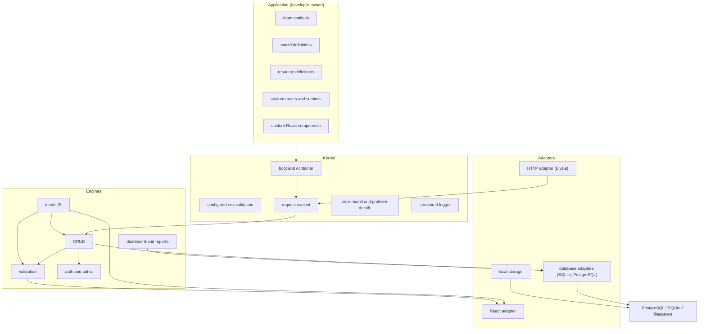

# Loom Architecture

Status: Stage 0 blueprint. It describes what the implementation must become, not what exists today. The repository contains no framework source code yet.

Source of truth: `PRD.md`. Where this document narrows a PRD proposal, the change is recorded in `docs/DECISION_LOG.md` with an ID. Requirement IDs (`R-*`), decisions (`D-*`), open questions (`Q-*`), and acceptance criteria (`AC-*`) come from the PRD and keep their meaning here.

---

## 1. What is constrained

These decisions are confirmed in PRD section 46 and are not open for redesign during Stages 1 to 8.

| Decision | Consequence for the code |
| --- | --- |
| D-01 Fullstack framework | One repository ships server, data layer, admin UI, and CLI |
| D-02 Hybrid simple and advanced modes | Generated defaults everywhere, with an override seam at each layer |
| D-03 Modular batteries included | Modules register explicitly; nothing initializes that the app did not enable |
| D-04 Hybrid core | Own contracts, engines, and DX; do not own HTTP servers, databases, or browsers |
| D-05 Bun primary, Node secondary | Bun is the supported MVP runtime; Node code paths exist and are marked unverified until tested |
| D-06 React first | Only a React adapter ships in the MVP |
| D-08 Hybrid UI | Components are replaceable; descriptors and tokens are the contract |
| D-09 SQL over PostgreSQL, MySQL, SQLite | A dialect-aware gateway, not a new ORM; raw SQL stays available |
| D-10 Framework-owned backend core | Business logic depends on `Request`/`Response` and Loom types, never on Elysia types |
| D-11 to D-15 Engines | CRUD, forms, tables, dashboard, reporting are first-class, not plugins |

Two PRD items stay open and shape the build order:

- **Q-02 / D-16, security engine.** The PRD recommends session-first opaque cookies with deny-by-default authorization. Until the owner confirms, the code must keep authentication mechanics behind an interface so a different mechanism can replace them.
- **Q-01, product name.** Packages use the `@loom/` scope. Renaming later touches manifests and imports, nothing architectural.

---

## 2. System shape



Read the arrows as compile-time and runtime dependencies. The application imports the kernel and public engine APIs. The kernel never imports an adapter. Adapters never import application code.

---

## 3. Package boundaries

The PRD lists about thirty packages for the full 1.0 and 2.0 surface. Stages 1 to 8 need a smaller set. Each package below is created in the stage that first needs it, with real code and at least one test. No package is created as an empty shell.

Tier rules from PRD 12.2 apply unchanged: tier 0 imports nothing, tier 1 imports tier 0 and platform built-ins, tier 2 imports tiers 0 and 1, tier 3 imports tiers 0 to 2, tier 4 imports public APIs only.

| Package | Tier | Responsibility | Introduced |
| --- | --- | --- | --- |
| `@loom/contracts` | 0 | Shared types: branded IDs, problem-details shape, model IR types, descriptor types, HTTP handler contract. No runtime dependencies. | Stage 1 |
| `@loom/core` | 1 | Boot, container, module registry, config and env loading, error classes, logger, request context, runtime detection | Stage 2 |
| `@loom/model` | 2 | Field and relation builders, IR normalization, naming rules, metadata merging | Stage 3 |
| `@loom/validation` | 2 | IR to Standard Schema projection, coercion, field error mapping | Stage 3 |
| `@loom/db` | 2 | Gateway interface, dialect capability flags, identifier allowlists, migration runner and schema diff | Stage 3 |
| `@loom/db-sqlite` | 3 | SQLite dialect adapter on `bun:sqlite`, Drizzle wiring, introspection | Stage 3 |
| `@loom/db-postgres` | 3 | PostgreSQL dialect adapter on `pg` and Drizzle | Stage 3 |
| `@loom/http` | 2 | Route manifest, handler contract, middleware chain, body parsing, error mapping | Stage 4 |
| `@loom/http-elysia` | 3 | Elysia wiring; the only package that imports Elysia | Stage 4 |
| `@loom/authz` | 2 | Permission grammar, policy evaluation, field masks, row-scope predicates | Stage 5 |
| `@loom/auth` | 2 | Principal and identity interfaces, session store, password hashing, login and logout handlers | Stage 5 |
| `@loom/audit` | 2 | Audit event contract and writer; persistence through the DB gateway | Stage 5 |
| `@loom/crud` | 2 | Resource registry, list query parser, CRUD handlers, hooks, transactions | Stage 5 |
| `@loom/storage` | 2 | Storage interface plus a local filesystem adapter | Stage 6 |
| `@loom/ui` | 2 | Form, table, and dashboard descriptor types; design tokens; no React | Stage 6 |
| `@loom/react` | 3 | React components and client hooks that render descriptors | Stage 6 |
| `@loom/dashboard` | 2 | Widget registry, metric and chart queries, role filtering | Stage 8 |
| `@loom/report` | 2 | Report definitions, grouped queries, CSV export | Stage 8 |
| `@loom/testing` | 3 | `createTestApp`, factories, database isolation, HTTP test client | Stage 2 |
| `@loom/cli` | 4 | `loom` binary and commands | Stage 2 |
| `apps/stockroom` | app | Reference inventory application | Stage 8 |
| `apps/playground` | app | Manual verification app used from Stage 2 | Stage 2 |

Packages the PRD lists but the MVP does not include: `db-mysql`, `http-hono`, `preact`, `vue`, `svelte`, `jobs`, `cache`, `email`, `i18n`, `openapi`, `charts`, `runtime-bun`, `runtime-node`. They arrive with the phases that justify them, or never.

### 3.1 Why runtime is not a package

The PRD proposes `runtime-bun` and `runtime-node`. In the MVP, "runtime abstraction" means one small interface: capability detection, env access, filesystem flags, and shutdown signals. That is a module inside `@loom/core` (`core/runtime`), not a package with two implementations nobody can test yet. A separate package becomes worthwhile when Node support is promised rather than tracked. Recorded as ADR-0003.

### 3.2 Why charts are not a package

`@loom/react` renders a chart descriptor with Apache ECharts. A `@loom/charts` package only earns its place when a second frontend adapter has to share chart logic. Until then it adds a build boundary with one consumer. Recorded as ADR-0010.

---

## 4. The five contracts

Everything else is replaceable. These five seams decide whether the framework can grow without breaking applications.

### 4.1 Model IR

One normalized object per model, produced by schema-first builders or by database introspection. It carries six metadata groups, kept separate so each consumer reads only what it needs:

| Group | Examples | Consumed by |
| --- | --- | --- |
| Database | table, columns, types, indexes, foreign keys | DB adapter, migrations |
| Domain | fields, logical types, relations, primary key | Model API, types |
| Validation | required, min/max, pattern, enum values | Validation, forms |
| UI | widget, label, order, help text, groups | Form and table descriptors |
| Authorization | resource name, field sensitivity, default policy | Authz, field masks |
| Resource | route base, allowed operations, hooks | CRUD registry |

Rules: the IR is serializable JSON with no functions; relations are named and directional; logical types map to dialect types through a table, never through `any`; an IR version number travels with the payload; unknown fields survive a round trip so newer metadata does not break older readers.

### 4.2 Database gateway

```ts
// PROPOSED API — not implemented
interface Db {
  readonly dialect: Dialect;
  readonly capabilities: DialectCapabilities;
  select<T>(query: SelectQuery): Promise<T[]>;
  selectOne<T>(query: SelectQuery): Promise<T | null>;
  insert<T>(table: string, values: Record<string, unknown>, opts?: WriteOptions): Promise<T>;
  update<T>(table: string, patch: Record<string, unknown>, where: Where, opts?: WriteOptions): Promise<T[]>;
  delete(table: string, where: Where, opts?: WriteOptions): Promise<number>;
  transaction<T>(fn: (tx: Db) => Promise<T>): Promise<T>;
  raw<T>(sql: string, params?: unknown[]): Promise<T[]>;
}
```

Drizzle stays inside dialect adapters. Applications may use it directly through an escape hatch, and the gateway must not hide what the driver can do. Table and column names are resolved through the IR registry and quoted by the adapter; user input never reaches an identifier position.

### 4.3 HTTP seam

Handlers receive the platform `Request`, a Loom `RequestContext`, and validated input. They return a `Response`. This is the contract every adapter implements.

```ts
// PROPOSED API — not implemented
type Handler<Input, Output> = (args: {
  request: Request;
  ctx: RequestContext;
  input: Input;
}) => Promise<Output | Response>;
```

Elysia mounts these handlers. A direct invocation helper calls the same function without a socket, so integration tests do not depend on the server library. Streaming and file responses use standard `Response` bodies.

### 4.4 Descriptors

The server produces serializable descriptors: forms, tables, dashboards, and filter definitions, each already filtered by the current principal. The React adapter renders them and reports user intent back as query state or mutation payloads. Descriptors never carry data the user may not see, and never carry secrets.

### 4.5 Standard Schema

All validation surfaces accept a Standard Schema v1 validator. Zod is the first implementation, chosen for ecosystem familiarity, and is isolated behind the validation package so a different validator can replace it without changing resource definitions.

---

## 5. Request lifecycle

Order matters for security, not only for tidiness.

1. Transport adapter receives the request and creates a request ID.
2. Middleware runs in fixed order: request ID and logger, rate limit, body parse with size limit, session resolve, CSRF check for unsafe methods, authorization context.
3. Route lookup. Unknown routes return 404 before any policy work.
4. Input validation. Failure returns 422 and never reaches the database.
5. Policy evaluation. Failure returns 403 and never reaches the database.
6. Handler runs inside a transaction when it writes.
7. Serialization applies field masks, then the response leaves through the adapter.
8. Audit and metrics record outcome, latency, and principal ID, never payload contents.

A 403 must not reveal whether a record exists. A validation error must not disclose field values the caller cannot read.

---

## 6. Boot sequence

1. Locate `loom.config.ts` and import it. A missing or malformed config is a startup error with a file and line reference.
2. Validate environment variables declared by config. Report every problem at once.
3. Detect runtime and capabilities (`bun` or `node`, SQLite driver, filesystem, signals).
4. Build the service container from enabled modules in topological order.
5. Validate module dependencies before any I/O. A cycle or missing dependency fails with the full chain.
6. Open database connections lazily, then verify with a cheap query when the app declares a database.
7. Build the model registry, then the resource registry, then the route manifest.
8. Initialize the authz registry. A resource without an access rule is a startup error, not a runtime surprise.
9. Start the HTTP server or return the app object for tests.
10. Register shutdown handlers for SIGINT and SIGTERM: stop accepting, drain, close the database, flush logs.

Config layering follows PRD 12.6: framework defaults, module defaults, `loom.config.ts`, environment values, test overrides. Secrets only enter through environment references.

---

## 7. Error model

One base class, narrow subclasses, and a single serializer at the HTTP boundary.

| Class | Code prefix | Status | Use |
| --- | --- | --- | --- |
| `ConfigError` | `LOOM_CONFIG_` | 500 at boot | Missing or invalid configuration |
| `ValidationError` | `LOOM_VALIDATION_` | 422 | Input shape or field failure |
| `AuthError` | `LOOM_AUTH_` | 401 | Missing or invalid session |
| `ForbiddenError` | `LOOM_FORBIDDEN` | 403 | Policy denial, including row scope |
| `NotFoundError` | `LOOM_NOT_FOUND` | 404 | Missing record after authorization |
| `ConflictError` | `LOOM_CONFLICT` | 409 | Unique constraint, version mismatch |
| `RateLimitError` | `LOOM_RATE_LIMIT` | 429 | Rate limit exceeded |
| `InternalError` | `LOOM_INTERNAL` | 500 | Unexpected failure; cause logged, never returned |

The wire shape is RFC 9457 problem details plus `code`, `requestId`, `errors[]`, and safe `meta`. Stack traces, SQL text, file paths, and driver messages stay in logs. Client code branches on `code`.

Database driver errors are translated by the dialect adapter into `ConflictError`, `NotFoundError`, or `InternalError`. Untranslated driver text never reaches a response.

---

## 8. Security architecture skeleton

The full design lives in PRD sections 23 and 24. The code must enforce these properties from the first CRUD endpoint.

- **Deny by default.** A resource registers with zero access. Rules are added explicitly. An empty policy set denies.
- **Principal required.** Generated routes reject anonymous callers unless a rule names `public`.
- **Authorization before data.** Policy produces a decision plus a row predicate. The predicate is compiled into the SQL `WHERE` clause, not filtered after fetch.
- **Field masks at serialization.** Read masks remove fields before the response is built. Write masks reject fields the principal may not set, which is the mass-assignment defense.
- **Writable field allowlist.** Only IR fields marked writable in the resource definition are accepted from input, regardless of request body size.
- **Transactions on writes.** Multi-step writes and audit records commit together or not at all.
- **Audit.** Authentication events and CRUD writes produce an audit record with actor, action, resource, record ID, and timestamp. Payload values are excluded by default.

Authentication mechanics stay behind `IdentityProvider`, `SessionStore`, and `PasswordHasher` interfaces. Stage 5 implements the session-first recommendation. If Q-02 resolves differently, the interfaces remain and the implementations change.

---

## 9. Frontend architecture

The server owns truth. The browser owns interaction.

1. The server generates a descriptor from IR plus the current principal's masks.
2. The React adapter maps descriptor field types to registered widgets.
3. Client validation reuses the same schema where practical, and is treated as a convenience only.
4. Mutations call the generated endpoints. The server revalidates and reauthorizes every write.
5. Query state for tables lives in the URL so refresh, back, and sharing behave.

Design tokens are CSS custom properties under a `loom-` prefix. Components consume tokens, not hard-coded colors, so theming does not fork the component code. The default stylesheet is one import; the unstyled entry point is available for teams that bring their own components.

The default route shape is client-side rendering with a server-rendered HTML shell. This is PRD Q-05's recommended default and stays changeable until the owner decides.

---

## 10. Runtime strategy

| Capability | Bun 1.4 | Node 24 | MVP stance |
| --- | --- | --- | --- |
| HTTP server | `Bun.serve`, Elysia native | Elysia Node adapter | Bun supported, Node untested |
| SQLite | `bun:sqlite` | `node:sqlite` or `better-sqlite3` | Bun driver tested; Node driver behind a capability check |
| Password hashing | `Bun.password` Argon2id | `@node-rs/argon2` | Chosen at boot through `PasswordHasher` |
| Test runner | `bun test` | not used | Bun only in CI for MVP |
| Build | `bun build` | ESM output consumed by Node | Bun output verified; Node output documented |
| Signals and shutdown | supported | supported | Same shutdown path, tested on Bun |

Node support is not claimed until Stage 8 runs the compatibility suite on Node and records results. Q-08 (Node floor) and Q-09 (SQLite driver) stay open.

---

## 11. Test architecture

| Layer | Tool | Scope | Runs |
| --- | --- | --- | --- |
| Unit | `bun test` | Pure functions, IR normalization, config merge, policy evaluation | Every change |
| Contract | `bun test` | Same adapter suite executed per dialect | Stage 3 onward |
| Integration | `bun test` | HTTP handler to SQLite, migrations, CRUD | Stage 4 onward |
| Security matrix | `bun test` | Route × role × field × row scope | Stage 5 onward |
| Component | `bun test` + happy-dom | React form and table behavior | Stage 6 onward |
| End-to-end | Playwright, optional | Stockroom critical paths | Stage 8, if browsers install |
| Performance | Script under `benchmarks/` | 100k-row table, query counts | Stage 7 onward |

Test names include the acceptance criterion they verify, for example `it('AC-CRUD-04 denies list without a rule')`. A test without an AC ID is allowed for internal behavior and must say what it protects.

Databases in tests are created per file in a temporary directory and deleted on exit. No test touches a shared database or the network. External services are replaced by in-memory fakes that implement the same interface.

---

## 12. What is deliberately absent

Absent means "not built in Stages 1 to 8", not "forgotten".

| Area | Reason | Returns when |
| --- | --- | --- |
| MySQL adapter | No server available to test; PRD gates it on Q-04 | Stage 3 only if a server exists, otherwise 1.0 |
| Hono adapter | One working adapter first; the seam exists | Post-MVP |
| Preact, Vue, Svelte | React conformance first | 1.x to 2.0 |
| Plugin system and marketplace | Trust model unresolved (Q-06) | 2.0 |
| Multi-tenancy | Needs tenant scoping in schema and cache (Q-15) | 1.x |
| Background jobs and scheduled reports | No queue in MVP | 1.x |
| Redis, S3, SMTP | Local adapters first | 1.x |
| OAuth, OIDC, MFA, SSO | Session-first only in MVP | 1.x to 2.0 |
| i18n catalogs | English first (Q-14) | 1.0 |
| OpenAPI generation and API reports | Useful, not on the critical path | Post-MVP |
| Docs site | Markdown in `docs/` is enough until the API stabilizes | 1.0 |

---

## 13. Risks the architecture must absorb

| Risk | Architectural response |
| --- | --- |
| Drizzle limits appear mid-build | Gateway interface keeps Drizzle inside dialect adapters; raw SQL escape hatch |
| Elysia ties business logic to Bun | Handlers use `Request`/`Response`; direct invocation tests run without Elysia |
| Descriptor contract cannot express a real form | Widget registry and escape hatches at field level; override ladder from PRD 19.4 |
| SQLite and PostgreSQL drift | One contract suite, per-dialect skips recorded with reasons |
| Scope pressure from nine compressed stages | Stage boundaries are enforced; deferred features are listed, not half-built |
| Single maintainer and 2-core machine | CI fast lane under three minutes; no benchmark claims without runs |

---

## 14. Open questions that change this document

| ID | Question | Affects | Stage |
| --- | --- | --- | --- |
| Q-02 | Is session-first auth confirmed? | `auth` package, login flow, principal interface | 5 |
| Q-04 | MySQL at 1.0? | Adapter contract suite, migration engine | 3 |
| Q-08 | Node floor | Runtime detection, build target | 2, 8 |
| Q-09 | SQLite driver per runtime | SQLite adapter | 3 |
| Q-10 | Ark UI or own primitives | React widget layer | 6 |
| Q-15 | Multi-tenancy in 1.0? | Row scope interface, cache keys | 5 |
| Q-20 | Generated files or runtime descriptors | CLI, model loading | 3 |

A stage that depends on an unanswered question uses the PRD's recommended default, states the assumption in its completion report, and keeps the decision reversible.
